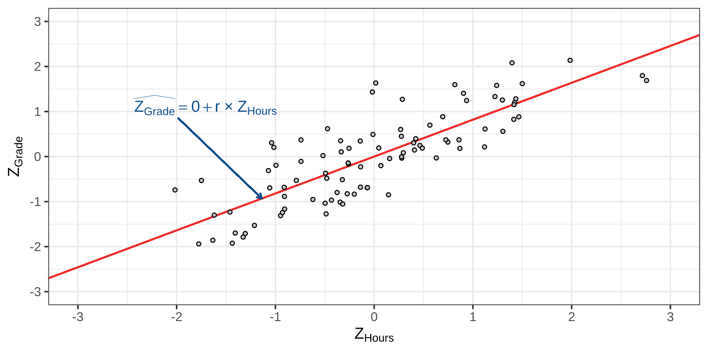
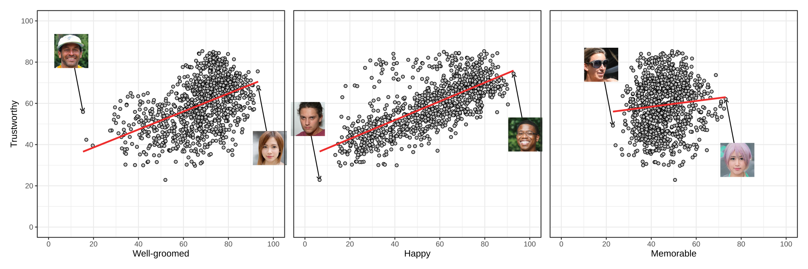

# Assignment 2

## Assignment 2

- Deadline moved to December 18th (23:59)
  * further from the exam
- Instructions slightly adjusted:
  * See the pdf on canvas.
  * Ignore the gitbook (it's mostly the same though).

# Recap Linear Regression


## Grades vs. Hours Studied

::: {.hidden}
$$
\newcommand{\hypo}{\mathcal{H}}
\newcommand{\SE}{\mathrm{SE}}
\newcommand{\dnorm}[2]{\mathcal{N}\left(#1, #2\right)}
\newcommand{\res}{e}
\newcommand{\rep}{\epsilon}
\newcommand{\TSS}{\mathrm{TSS}}
\newcommand{\SSE}{\mathrm{SSE}}
\newcommand{\RSS}{\mathrm{RSS}}

\newcommand{\MSE}{\mathrm{MSE}}
\newcommand{\MSR}{\mathrm{MSR}}
$$
:::


{fig-align="center"}

## Unstandardized Regression

{fig-align="center"}

## Standardized Regression

{fig-align="center"}


## Three sums of squares

- **TSS:** How much variation was there to begin with?
- **SSE:** How much remains unexplained?
- **RSS:** How much has the regression explained?

{fig-align="center"}

## Explained Variance

The proportion explained is:

$$
R^2 = \frac{\text{explained variation}}{\text{total variation}}
= \frac{\RSS}{\TSS}
$$

## Explained Variance: Demo



## Recap

1. The Ordinary Least Squares finds $a$ and $b$ that minimize the SSE.
2. But SSE on it's own doesn't tell us how good the predictions are.
3. Explained variance tells us how much of the variance is explained by the regression line.

. . .

Goals for today:

- How do we test $a$ and $b$?
- How do we test if $R^2 > 0$?
<!-- something else? -->


# Data Example I: Trustworthy Faces

## How Trustworthy is this face?

{fig-align="center"}


## How Trustworthy is this face?

<!-- https://github.com/jcpeterson/omi/blob/main/images/638.jpg
 -->
<!-- {fig-align="center"} -->
{fig-align="center"}


## Trustworthy Faces

These faces are part of The One Million Impressions (OMI) dataset, which contains over a million human judgments of over 1,000 synthetic face images along 34 attributes.

. . .

Participants judged faces on a scale from 0 to 100 on attributes such as

::: {.columns}

::: {.column}

- trustworthy
- attractive
- dominant


:::

::: {.column}

- smart
- memorable
- well-groomed


:::

:::

We use the mean ratings for each of the 1,004 faces: one observation is one face.


::: footer

Peterson, J. C., Uddenberg, S., Griffiths, T. L., Todorov, A., & Suchow, J. W. (2022). Deep models of superficial face judgments. Proceedings of the National Academy of Sciences (PNAS), 119(17), e2115228119. doi:10.1073/pnas.2115228119

source: <https://github.com/jcpeterson/omi/>

:::

## Can you guess the scale?


::: {.columns}

::: {.column}

{fig-align="center" width="90%"}


:::

::: {.column}

{fig-align="center" width="90%"}


:::

:::

```{=html}
<div style="display: grid; grid-template-columns: repeat(3, 1fr); width: 100%; text-align: center;">
  <div>(A) happy</div>
  <div>(B) well-groomed</div>
  <div>(C) age</div>
</div>
```

## Can you guess the scale?


::: {.columns}

::: {.column}

{fig-align="center" width="90%"}


:::

::: {.column}

{fig-align="center" width="90%"}


:::

:::


```{=html}
<div style="display: grid; grid-template-columns: repeat(3, 1fr); width: 100%; text-align: center;">
  <div>(A) happy</div>
  <div>(B) smart</div>
  <div>(C) dominant</div>
</div>
```

## Can you guess the scale?


::: {.columns}

::: {.column}

{fig-align="center" width="90%"}


:::

::: {.column}

{fig-align="center" width="90%"}


:::

:::

```{=html}
<div style="display: grid; grid-template-columns: repeat(3, 1fr); width: 100%; text-align: center;">
  <div>(A) happy</div>
  <div>(B) smart</div>
  <div>(C) memorable</div>
</div>
```

## Can we predict trustworthiness?



## One relationship, several questions

Let's use _well-groomed_ to predict _trustworthy_.

$$
\widehat{\text{Trustworthy}} = a + b \times \text{Well-groomed}
$$

. . .

- What does the line predict at a particular grooming score?
- Is there an association in the population?
- Is the association large enough to meet a particular benchmark?

::: {.notes}

Ask students to describe the intercept and slope in words before showing the estimates. We will return to this same relationship after explaining sampling variability. All regressions here have just one predictor.

:::

## Our sample gives one line

For these 1,004 faces:

$$
\widehat{\text{Trustworthy}} = 29.88 + 0.44 \times \text{Well-groomed}
$$

. . .

A 10-point increase in grooming corresponds to a 4.40-point increase in _predicted_ trustworthiness.

. . .

Would another sample of faces give us exactly the same line?

::: {.notes}

Statistics are calculated before rounding and displayed to two decimals. Symbolic formulas avoid substituting rounded coefficients and standard errors. The ten-point interpretation uses 10 times the displayed slope of 0.44.

:::

# $t$-test: Testing coefficients

## Hypothesis testing

Recall the general procedure:

1. What are $\hypo_0$ and $\hypo_1$?
2. What would we expect because of _sampling variability_ if $\hypo_0$ were true?
3. How far is our estimate from $\hypo_0$ in _standard errors_?
4. What is the _$p$-value_?

Let's do this for the intercept $a$, and then the slope $b$.

## Hypothesis testing

Let $\alpha$ be the population parameter for $a$.

To test the intercept we state: $\hypo_0 : \alpha = \alpha_{\hypo_0}$

For now, let's assume $\hypo_0 : \alpha = 0$

This says: the population line predicts $y = 0$ when $x = 0$.

. . .

What is the sampling distribution for $a$, given that $\hypo_0$ is true?

::: {.notes}

Pause for the interpretation before moving to the repeated samples. The following figures use a simplified population with intercept zero; they are not repeated samples from the faces data.

:::


## Sampling distribution: intercept.

{fig-align="center"}

::: {.notes}

Same population relationship, eight samples. Ask: would you draw exactly the same regression line in every panel? Keep the predictor values fixed and imagine observing new outcomes with new errors.

:::

## Sampling distribution: intercept.

{fig-align="center"}

::: {.notes}

Reveal the fitted lines. Ask students to identify what changes across samples. Both intercepts and slopes vary, even though the population line stays the same.

:::

## Sampling distribution: intercept.

{fig-align="center"}

::: {.notes}

The yellow triangles mark the estimated intercepts at x = 0. Ask: does a nonzero sample intercept automatically contradict a zero population intercept? Let students explain why not.

:::

## From many estimates to a sampling distribution

Imagine repeating this thousands of times and collecting every estimated intercept $a$.

. . .

- The estimates vary around the population intercept $\alpha$.
- Their spread tells us how much estimates vary across samples.
- We estimate that spread with the standard error, $\SE_a$.

. . .

- Any sample intercept is likely nonzero.
  * How far from zero would be surprising?


## What impacts the sampling distribution?

The population regression model is:

$$
Y_i = \alpha + \beta x_i + \epsilon_i,
\qquad \epsilon_i \overset{\mathrm{iid}}{\sim} \mathcal{N}(0, \sigma_\epsilon^2)
$$

- $\alpha$ and $\beta$ are population intercept and slope
- At each $x$, outcomes vary around the population line.
- Errors are independent, normally distributed, and have constant variance.

. . .

More data (larger $N$) and less error (smaller $\sigma_{\res_p}$) generally give more precise estimates.


## Sampling distribution: intercept.

<!-- Teaching suggestion: if time is tight, move this formula slide to an appendix. Keep all three repeated-sample slides and the explanation of the standard error. -->

$$
a\mid \hypo_0 \sim \dnorm{\alpha_{\hypo_0}}{\sigma_\epsilon^2\times c_\alpha}\quad
$$

- $\alpha_{\hypo_0}$ is the value we test against
- $\sigma_\epsilon^2$ is the population error variance
- $c_\alpha$ depends on the predictor values

## How far from the null value?

We estimate the unknown error variance from the residuals.

$$
t = \frac{a - \alpha_{\hypo_0}}{\SE_a}
\qquad\text{with } df = N - 2
$$

. . .

Under $\hypo_0$, this statistic follows a $t$-distribution.

- The numerator is the distance from the null value.
- The denominator expresses that distance in standard errors.
- The alternative hypothesis determines which tail(s) give the $p$-value.


## Back to faces: test the intercept against zero

$$
\widehat{\text{Trustworthy}} = 29.88 + 0.44 \times \text{Well-groomed}
$$

$\hypo_0: \alpha = 0$ versus $\hypo_1: \alpha \neq 0$.

. . .

::: {style="font-size:95%"}
Does the population line predict $\widehat{\text{Trustworthy}}=0$ at $\text{Well-groomed}=0$?
:::

. . .

$$
t = \frac{a - 0}{\SE_a} = 16.81,
\qquad df = 1004 - 2 = 1002
$$

Is this significant?

. . .

Yes, $p < .001$, reject $\hypo_0$.

. . .

Was this a meaningful test?

. . .

No! All scores were given on a 0 - 100 scale!

::: {.notes}

Ask for the meaning of the test before revealing the calculation. Rejecting alpha = 0 does not establish an association: a horizontal line can also have a nonzero intercept. The prediction at x = 0 extrapolates beyond the observed data.

:::

## A more meaningful test for the intercept

$$
\widehat{\text{Trustworthy}} = 29.88 + 0.44 \times \text{Well-groomed}
$$

. . .

The intercept predicts trustworthiness of about 30 at a grooming score of zero.

. . .

Assume the population slope is positive.

What does it mean if the population intercept was above 50?

## A more meaningful test for the intercept




## A more meaningful test for the intercept

Is population predicted trustworthiness above 50 even at the lowest possible grooming score?

$$
\hypo_0: \alpha \leq 50,
\qquad \hypo_1: \alpha > 50
$$

. . .

$$
t = \frac{a - 50}{\SE_a} = -11.32,
\qquad df = 1002
$$

Is this significant?

. . .

No. The upper-tail $p$-value rounds to $1.00$. We do not reject $\hypo_0$.

We do not have evidence that the population line stays above 50 throughout the grooming scale.


## Testing the slope: is there an association?

Let $\beta$ be the population slope.

$$
\hypo_0: \beta = 0,
\qquad \hypo_1: \beta \neq 0
$$

. . .

Under $\hypo_0$, the population line is horizontal: predicted trustworthiness does not vary with grooming.

$$
t = \frac{b - \beta_{\hypo_0}}{\SE_b}
= 16.80
$$

With $df = 1002$, the two-sided $p$-value is $< .001$.

::: {.notes}

Repeat the sampling-distribution reasoning verbally for b: repeated samples produce different slopes around beta. This test concerns a linear association, not a causal effect of changing grooming.

:::

## A more informed comparison

For happy and memorable we find the following results.

$$
\begin{aligned}
\widehat{\text{Trustworthy}} &= 33.67 + 0.45 \times \text{Happy}\\
\widehat{\text{Trustworthy}} &= 52.80 + 0.14 \times \text{Memorable}
\end{aligned}
$$


Is the slope for the relation with groomedness larger than that of happiness?

What about memorableness?

. . .

We use their sample slopes as benchmarks for the population grooming slope $\beta$.

::: footer

There are better ways to test this but those are not part of this course.

:::

## A more informed comparison


## Is the association of well-groomed > happy?

First, compare the grooming slope with the happiness benchmark:

$$
\hypo_0: \beta \leq 0.45,
\qquad \hypo_1: \beta > 0.45
$$

. . .

$$
t = \frac{b - \beta_{\hypo_0}}{\SE_b} = -0.73,
\qquad df = 1002
$$

Our alternative is $\beta > 0.45$, so we use the upper tail.

. . .

The $p$-value is $0.77$. We do not reject $\hypo_0$.

The sample grooming slope is slightly smaller. We do not have evidence that the population grooming slope exceeds the happiness benchmark.


## Is the association of well-groomed > memorable?

Keep the grooming slope and its standard error. Change the comparison:

$$
\hypo_0: \beta \leq 0.14,
\qquad \hypo_1: \beta > 0.14
$$

. . .

$$
t = \frac{b - \beta_{\hypo_0}}{\SE_b} = 11.42,
\qquad df = 1002
$$

The upper-tail $p$-value is $< .001$. We reject $\hypo_0$.

. . .

We have evidence that the population grooming slope exceeds the memorability benchmark.

::: {.notes}

Before revealing the calculation, ask students which estimate and SE to use: both still come from trustworthy predicted by well-groomed. Only the null value changes. Calculate statistics before rounding, including the reference sample slope; display results to two decimals. We again treat the reference slope as fixed. Contrast the two results: a sample estimate can exceed a benchmark without sufficient evidence to reject, while a larger distance in standard errors gives a smaller p-value. Slope comparisons concern rating points per predictor point, not explained variance.

:::

## Your turn: what are we testing?

For each question, name the parameter and write $\hypo_0$ and $\hypo_1$.

1. At grooming zero, does the population line predict trustworthiness different from 50?
2. Does predicted trustworthiness decrease as grooming increases?
3. Does a 10-point grooming difference correspond to more than 3 trustworthiness points?

::: {.notes}

Allow a minute of discussion before showing answers verbally: (1) alpha = 50 versus not equal; (2) beta >= 0 versus beta < 0; (3) beta <= 0.3 versus beta > 0.3. Ask which SE is needed for each. This checks interpretation before moving to the F-test.

:::


# $F$-test: Testing models

## The same faces, a model question

Compare two ways to predict trustworthiness:

- Use the same prediction for every face: the sample mean.
- Use the face's grooming score to make a prediction.

. . .

Does adding grooming explain more variation than we would expect from sampling variability alone?

::: {.notes}

Connect back to the two-sided beta = 0 test. For this simple regression the F-test will give the same p-value. It does not test whether beta exceeds either reference slope.

:::

## Comparing two models

Before we compared individually $a$ and $b$ against 0 or specific values.

Now we'll examine a test to compare two models:

$$
\begin{align}
\hypo_0:& \text{ the null model},       &&y_i = a \phantom{+ b\times x_i }\;\,+\res_i\\
\hypo_1:& \text{ the regression model}, &&y_i = a + b\times x_i +\res_i
\end{align}
$$

. . .

Let's take 5 minutes to brainstorm about this comparison.

- What does it mean when we reject H0?
- What are equivalent statistical questions?

## Equivalent meanings of this comparison

Comparing the models is identical to comparing...

1. $\hypo_0: \beta = 0$ vs $\hypo_1: \beta \neq 0$.
2. $\hypo_0: \rho^2 = 0$ vs $\hypo_1: \rho^2 > 0$.

. . .

We develop this theory for the second question.

. . .

Later on, during ANOVA, a model comparison can test more than one coefficient at once.

## Testing Explained Variance

- $\hypo_0: \rho^2 = 0$
- $\hypo_1: \rho^2 > 0$

. . .

Here, $\rho^2$ is the _population_ value for $R^2$

. . .

What is the sampling distribution?

## Testing Explained Variance

$$
R^2 = \frac{\RSS}{\TSS} = \text{Explained variance}
$$

. . .

$$
1 - R^2 = \frac{\SSE}{\TSS} = \text{Unexplained variance}
$$

. . .

Therefore:
$$
\frac{R^2}{1 - R^2} = \frac{\RSS/\cancel{\TSS}}{\SSE/\cancel{\TSS}}= \frac{\RSS}{\SSE} = \frac{\text{Explained variance}}{\text{Unexplained variance}}
$$

::: {.notes}

The TSS cancels because both fractions describe the same outcome and observations. RSS means explained sum of squares throughout these slides; some software uses SSR for that quantity.

:::

## Testing Explained Variance

<!-- $\frac{R^2}{1 - R^2}$ is convenient, but: -->
$R^2/(1 - R^2)$ is convenient, but:

- even "random" predictors explain _some_ variation.
- we need to account for the number of parameters being estimated.

. . .

$$
F =
(N - 2)\times\frac{R^2}{1 - R^2}
$$

. . .

Under the $\hypo_0$ the sampling distribution is:

$$
F =
(N - 2)\times\frac{R^2}{1 - R^2} \sim F(1, N - 2)
$$

::: {style="font-size: 50%;"}

Yes, the $F$-statistic and $F$-distribution are both abbreviated with $F$.

:::


::: {.notes}

Indicate that "random" means without meaningful association

the no. parameters corresponds to the degrees of freedom

:::

## F distribution

The $F(df_1, df_2)$ distribution:

{fig-align="center"}

## F distribution

The $F(df_1, df_2)$ distribution:

{fig-align="center"}

## F distribution

The $F(df_1, df_2)$ distribution:

{fig-align="center"}


## F distribution: Example

For well-groomed predicting trustworthy, $N = 1004$ and $R^2 = 0.22$.

$$
\hypo_0: \rho^2 = 0,
\qquad \hypo_1: \rho^2 > 0
$$

. . .

$$
F = (N - 2)\times\frac{R^2}{1 - R^2}
= 282.21
$$

Compare with $F(1,1002)$: the upper-tail $p$-value is $< .001$.

. . .

We reject $\hypo_0$. Grooming explains about **22%** of the sample variation in perceived trustworthiness.

::: {.notes}

Work through this example together. The numerator degrees of freedom are one because the regression adds one slope to the intercept-only model. The denominator degrees of freedom are N - 2 because we estimate an intercept and a slope. All numerical F examples use the actual software statistics, calculated before rounding and displayed to two decimals. A significant F-test does not tell us whether the slope is positive or negative; inspect b for the direction.

:::

## F-test: happy predicting trustworthy

For the same 1,004 faces, $R^2 = 0.49$.

$$
\hypo_0: \rho^2 = 0,
\qquad \hypo_1: \rho^2 > 0
$$

. . .

$$
F = (N - 2)\times\frac{R^2}{1 - R^2}
= 955.86
$$

With $df_1 = 1$ and $df_2 = 1002$, $p < .001$.

. . .

We reject $\hypo_0$. Happy ratings explain about **49%** of the sample variation in perceived trustworthiness.

## F-test: memorable predicting trustworthy

For the same 1,004 faces, $R^2 = 0.01$.

$$
\hypo_0: \rho^2 = 0,
\qquad \hypo_1: \rho^2 > 0
$$

. . .

$$
F = (N - 2)\times\frac{R^2}{1 - R^2}
= 9.50
$$

With $df_1 = 1$ and $df_2 = 1002$, $p < .01$. We reject $\hypo_0$.

. . .

But only about **1%** of the sample variation is explained. How useful is that for prediction?

::: {.notes}

Ask students to predict whether such a small R-squared can be statistically significant before revealing the calculation. With 1,004 observations, even a small association can be detected. The upper-tail p-value exceeds .001, so report p < .01 here. Statistical significance does not imply accurate predictions or substantive importance.

:::

## Three regressions, three F-tests

Each regression predicts trustworthy ratings using **one predictor**.

Predictor | $R^2$ | $F(1,1002)$ | $p$
--- | ---: | ---: | ---:
Well-groomed | 0.22 | 282.21 | $< .001$
Happy | 0.49 | 955.86 | $< .001$
Memorable | 0.01 | 9.50 | $< .01$

. . .

- All three model tests are significant.
- Explained variation differs substantially across the three models.
- Each test compares one regression with the intercept-only model.

::: {.notes}

Keep the statistical and descriptive conclusions separate: each F-test compares one regression with the intercept-only model. Ranking these sample R-squared values is descriptive, not a formal test of differences between population relationships. These are three separate regressions, not a model containing three predictors.

:::

## The same regressions, two tests

The $t$-test and $F$-test results side by side are:

Predictor | Slope $t$-statistic | Model $F$-statistic
--- | ---: | ---:
Well-groomed | 16.80 | 282.21
Happy | 30.92 | 955.86
Memorable | 3.08 | 9.50

What relationship do you notice between the two statistics?

. . .

$$
F = t^2
$$

::: footer

Statistics are calculated before rounding and displayed to two decimals.

:::

## Why do we have both a t-test and an F-test?

In simple regression with an intercept, these ask the same question:

- Does the population slope differ from zero?
- Does the regression improve on the intercept-only model?

. . .

The model $F$-test and the **two-sided** $t$-test of $\beta = 0$ give the same $p$-value.

- Squaring $t$ removes the direction of the slope.
- A one-sided $t$-test asks a directional question.
- If we test $\beta$ against some value other than 0 this does not hold.

::: {.notes}

The identity uses the same unrounded estimates in both statistics, with F degrees of freedom (1, N - 2) and t degrees of freedom N - 2. Small differences when squaring the displayed t-values come from rounding. The equivalence does not apply to the intercept test or to the tests against the happy and memorable benchmarks.

:::

## F-test: alternative explanation

Recall: the null model predicts the mean for everyone; the regression model also estimates a slope.

If $\hypo_0$ is true, then we know that:

- $\TSS$ estimates $(N - 1)\times \sigma_y^2$
- $\SSE$ estimates $(N - 2)\times\sigma_\res^2 \underbrace{= (N - 2) \times \sigma_y^2}_{\substack{\text{Under $\hypo_0$}}}$

. . .

We've already seen this!

## Explained Variance: Demo




::: {.notes}

show that as R^2 goes to zero that RSS = 0, and that TSS and SSE become the same thing.

:::

## F-test: alternative explanation

If $\hypo_0$ is true, then we know that the expectations are:

- $\TSS$ estimates $(N - 1)\times \sigma_y^2$
- $\SSE$ estimates $(N - 2)\times\sigma_\res^2 \underbrace{= (N - 2) \times \sigma_y^2}_{\substack{\text{Under $\hypo_0$}}}$

. . .

If we do this for $\RSS = \TSS - \SSE$ we get

$$
\begin{align}
\RSS &\text{ estimates } (N - 1)\times \sigma_y^2 - (N - 2) \times \sigma_y^2\\
\RSS &\text{ estimates } \sigma_y^2
\end{align}
$$

## F-test: alternative explanation

Divide each sum of squares by its degrees of freedom to obtain the _mean squares_:

- $\mathrm{MSR} = \RSS / (p - 1)$
- $\mathrm{MSE} = \SSE / (N - p)$

- $N$ = the sample size
- $p$ = the number of parameters in the model
  * for bivariate regression we only have $a$ and $b$ so $p = 2$.

## From mean squares to F

Their ratio is:

$$
F=\frac{\MSR}{\MSE} = \frac{(N - p)}{p - 1} \frac{R^2}{1 - R^2}
$$

* $df_1$: p-1
* $df_2$: n-p


## F-test: summary

- Under $\hypo_0$, MSR and MSE estimate the same error variance.
- A large ratio $F = \MSR / \MSE$ is evidence against $\hypo_0$.
- The $p$-value is the area to the **right** of the observed $F$.

. . .

A significant test says there is a linear association. $R^2$ tells us how much sample variation the line explains.


## F-test: alternative explanation

<!-- Teaching suggestion: this repeats the mean-squares ratio above. I would combine those explanations or move this slide to an appendix to leave more time for interpreting the faces tests. Retained here as requested. -->

The F-test is a ratio of two sources of variance:

$$
F = \frac{\MSR}{\MSE} = \frac{\RSS/(p-1)}{\SSE/(N-p)}
$$

$p$: number of parameters ($a$ and $b$); $N$: number of observations (here, faces).

* $df_1 = p - 1 = 1$
* $df_2 = N - p = 1002$

::: {.notes}

These mean squares are estimates formed from sums of squares, not two known population variances. Under the null they estimate the same error variance; their ratio fluctuates across samples rather than being exactly one.

:::

# Conclusions

## What did we learn from the faces?

- Grooming and happy ratings both show positive associations with perceived trustworthiness.
- Happy ratings explain about **49%** of its sample variation; grooming explains about **22%**.
- Memorability explains about **1%**, despite a significant model test.

. . .

These describe how faces are **perceived**. They do not establish actual trustworthiness or causal effects.

## Different questions need different tests

Question | What do we use?
--- | ---
What is predicted when $x=0$? | The intercept $a$
Does that prediction exceed 50? | A one-sided intercept $t$-test against 50
Is there a linear association? | A slope $t$-test against zero or the model $F$-test
Does the slope exceed a benchmark? | A one-sided slope $t$-test against that value
How much sample variation is explained? | $R^2$

::: {.notes}

For equivalence with the F-test, the slope t-test against zero must be two-sided. Recall that our slope benchmark exercises treated sample slopes from the other regressions as fixed. A formal comparison of population slopes also needs their uncertainty. For the intercept interpretation, recall the observed predictor range and the assumption of a positive population slope when interpreting the entire line as above 50.

:::

## Before interpreting a p-value

1. Say what the parameter means in this example.
2. State the null value and the alternative direction.
3. Express the estimate's distance from the null in standard errors, or form the model $F$-ratio.
4. Use the appropriate tail(s) and degrees of freedom.
5. Interpret the estimated size and $R^2$ alongside statistical significance.

. . .

Just because a predictor is significant doesn't mean it's predictions are useful!

## Next weeks

- Assumption tests (next week)
- Independent samples t-test (week after that)
- ANOVA (both weeks after that)
