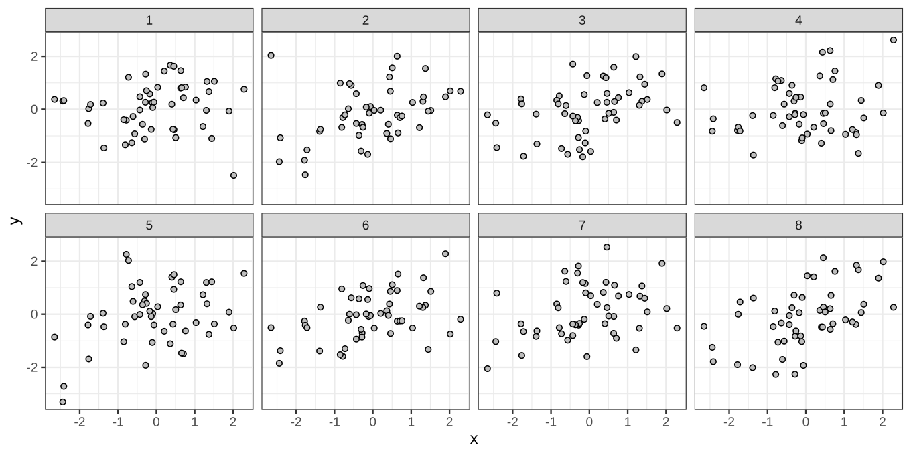
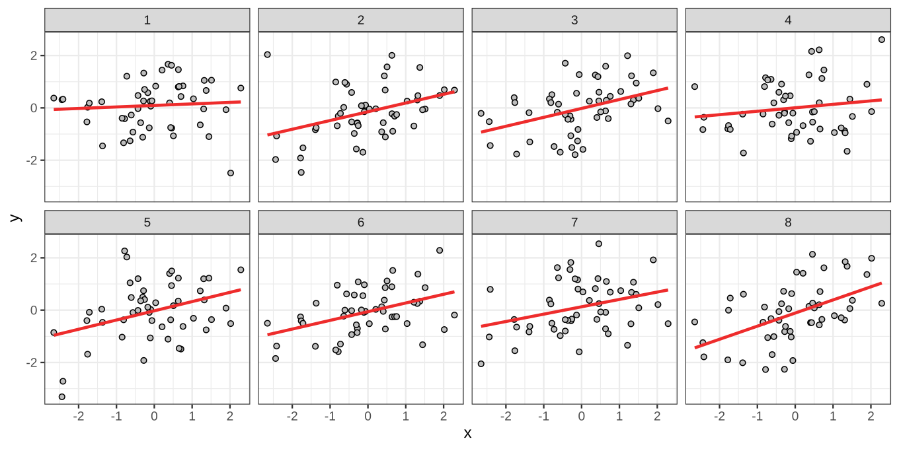
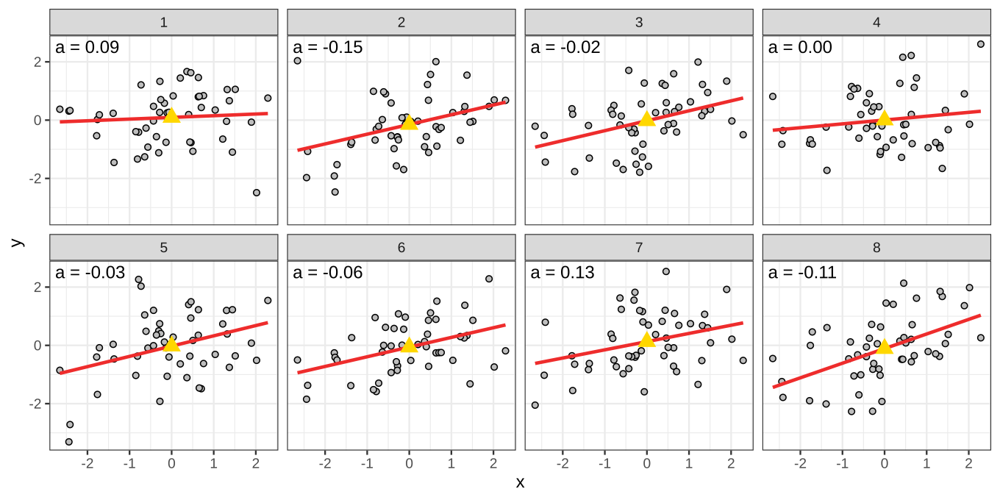
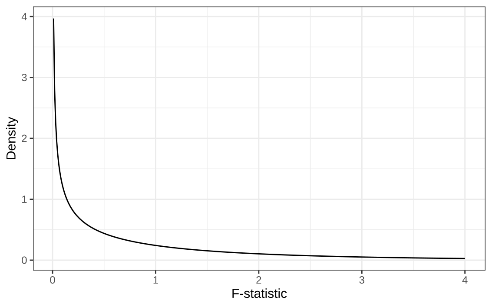
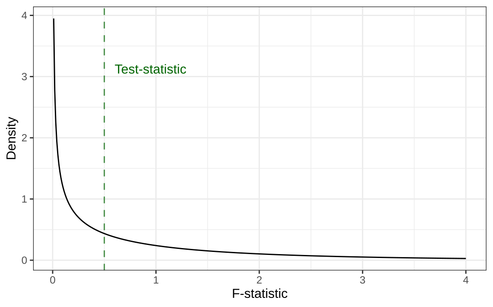
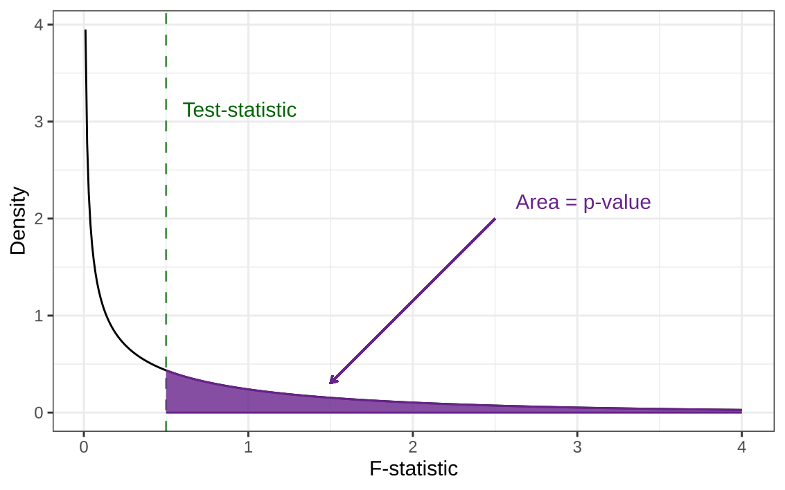

# Assignment 2

## Assignment 2

- Deadline moved to December 18th (23:59)
  * further from the exam
- Instructions slightly adjusted:
  * See the pdf on canvas.
  * Ignore the gitbook (it's mostly the same though).

# Recap Linear Regression


## Grades vs. Hours Studied

::: {.hidden}
$$
\newcommand{\hypo}{\mathcal{H}}
\newcommand{\SE}{\mathrm{SE}}
\newcommand{\dnorm}[2]{\mathcal{N}\left(#1, #2\right)}
\newcommand{\res}{e}
\newcommand{\rep}{\epsilon}
\newcommand{\TSS}{\mathrm{TSS}}
\newcommand{\SSE}{\mathrm{SSE}}
\newcommand{\RSS}{\mathrm{RSS}}

\newcommand{\MSE}{\mathrm{MSE}}
\newcommand{\MSR}{\mathrm{MSR}}
$$
:::


{fig-align="center"}

## Grades vs. Hours Studied

{fig-align="center"}

## Three sums of squares

- **TSS:** How much variation was there to begin with?
- **SSE:** How much remains unexplained?
- **RSS:** How much has the regression explained?

{fig-align="center"}

## Explained Variance

The proportion explained is:

$$
R^2 = \frac{\text{explained variation}}{\text{total variation}}
= \frac{\RSS}{\TSS}
$$

## Explained Variance: Demo



## Recap

1. The Ordinary Least Squares finds $a$ and $b$ that minimize the SSE.
2. But SSE on it's own doesn't tell us how good the predictions are.
3. Explained variance tells us how much of the variance is explained by the regression line.

. . .

Goals for today:

- How do we test $a$ and $b$?
- How do we test if $R^2 > 0$?
<!-- something else? -->


# Data Example I: Trustworthy Faces

## How Trustworthy is this face?

{fig-align="center"}


## How Trustworthy is this face?

<!-- https://github.com/jcpeterson/omi/blob/main/images/638.jpg
 -->
<!-- {fig-align="center"} -->
{fig-align="center"}


## Trustworthy Faces

These faces are part of The One Million Impressions (OMI) dataset, which contains over a million human judgments of over 1,000 synthetic face images along 34 attributes.

. . .

Participants judged faces on a scale from 0 to 100 on attributes such as

::: {.columns}

::: {.column}

- trustworthy
- attractive
- dominant


:::

::: {.column}

- smart
- memorable
- well-groomed


:::

:::

The dataset contains mean judgements averaged across the 1,000,000 people.


::: footer

Peterson, J. C., Uddenberg, S., Griffiths, T. L., Todorov, A., & Suchow, J. W. (2022). Deep models of superficial face judgments. Proceedings of the National Academy of Sciences (PNAS), 119(17), e2115228119. doi:10.1073/pnas.2115228119

source: <https://github.com/jcpeterson/omi/>

:::

## Can you guess the scale?


::: {.columns}

::: {.column}

{fig-align="center" width="90%"}


:::

::: {.column}

{fig-align="center" width="90%"}


:::

:::

```{=html}
<div style="display: grid; grid-template-columns: repeat(3, 1fr); width: 100%; text-align: center;">
  <div>(A) happy</div>
  <div>(B) well-groomed</div>
  <div>(C) age</div>
</div>
```

## Can you guess the scale?


::: {.columns}

::: {.column}

{fig-align="center" width="90%"}


:::

::: {.column}

{fig-align="center" width="90%"}


:::

:::


```{=html}
<div style="display: grid; grid-template-columns: repeat(3, 1fr); width: 100%; text-align: center;">
  <div>(A) happy</div>
  <div>(B) smart</div>
  <div>(C) dominant</div>
</div>
```

## Can you guess the scale?


::: {.columns}

::: {.column}

{fig-align="center" width="90%"}


:::

::: {.column}

{fig-align="center" width="90%"}


:::

:::

```{=html}
<div style="display: grid; grid-template-columns: repeat(3, 1fr); width: 100%; text-align: center;">
  <div>(A) happy</div>
  <div>(B) smart</div>
  <div>(C) memorable</div>
</div>
```

## Can we predict trustworthiness?

<iframe
  src="figures/faces_linked.svg"
  data-external="1"
  style="width: 80%; height: 450px; border: none;">
</iframe>

<!--

Let's do the following thing!

First we have a test for one example

then we ask, "is the slope of this variable higher or lower than the slope of that variable?"

then we can do the informed test for a slope <= whatever we found for the other variable

 -->

# $t$-test: Testing coefficients

## Hypothesis testing

Recall the general procedure:

1. What are $\hypo_0$ and $\hypo_1$?
2. What would we expect because of _sampling variability_ if $\hypo_0$ were true?
3. How far is our estimate from $\hypo_0$ in _standard errors_?
4. What is the _$p$-value_?

Let's do this for the intercept $a$, and then the slope $b$.

## Hypothesis testing

Let $\alpha$ be the population parameter for $a$.

To test the intercept we state: $\hypo_0 : \alpha = \alpha_{\hypo_0}$

For now, let's assume $\hypo_0 : \alpha = 0$

. . .

What is the sampling distribution for $a$, given that $\hypo_0$ is true?


## Sampling distribution: intercept.

{fig-align="center"}

## Sampling distribution: intercept.

{fig-align="center"}

## Sampling distribution: intercept.

{fig-align="center"}


## What impacts the sampling distribution?

There is only one distributional assumption to linear regression:

$$
\res_p \sim \mathcal{N}(0, \sigma_{\res_p})
$$

## Sampling distribution: intercept.

$$
a\mid \hypo_0 \sim \dnorm{\alpha_{\hypo_0}}{\sigma_\epsilon^2\times c_\alpha}\quad
$$

- $\alpha_{\hypo_0}$ is the value we test against
- $\sigma_\epsilon^2$ is the variance of the residuals
- $c$ we left unknown last time

<!-- TODO can we relate c to TSS and SSE? -->

## Demo: Sampling distribution Intercept.

knobs:

- sample size
- variance x
- variance y
- mean x
- mean y
- slope
- intercept
- H0 value for intercept

output:

normal distribution


# $F$-test: Testing models

## Comparing two models

Before we compared individually $a$ and $b$ against 0 or specific values.

Now we'll examine a test two compare two models:

$$
\begin{align}
\hypo_0:& \text{ the null model},       &&y_i = a \phantom{+ b\times x_i }\;\,+\res_i\\
\hypo_1:& \text{ the regression model}, &&y_i = a + b\times x_i +\res_i
\end{align}
$$

. . .

Let's take 5 minutes to brainstorm about this comparison.

- What does it mean when we reject H0?
- What are equivalent statistical questions?

## Equivalent meanings of this comparison

Comparing the models is identical to comparing...

1. $\hypo_0: b = 0$ vs $\hypo_1: b \neq 0$.
2. $\hypo_0: R^2 = 0$ vs $\hypo_1: R^2 > 0$.

. . .

We develop this theory for the second question.

. . .

Later on, (during ANOVA), the model comparison is no longer equal to testing $b = 0$.

## Testing Explained Variance

- $\hypo_0: \rho^2 = 0$
- $\hypo_1: \rho^2 > 0$

. . .

Here, $\rho^2$ is the _population_ value for $R^2$

. . .

What is the sampling distribution?

## Testing Explained Variance

$$
R^2 = \frac{\RSS}{\TSS} = \text{Explained variance}
$$

. . .

$$
1 - R^2 = \frac{\SSE}{\TSS} = \text{Unexplained variance}
$$

. . .

Therefore:
$$
\frac{R^2}{1 - R^2} = \frac{\RSS/\cancel{\TSS}}{\SSE/\cancel{\TSS}}= \frac{\RSS}{\SSE} = \frac{\text{Explained variance}}{\text{Unexplained variance}}
$$

<!-- TODO: make the above step by step with fragments -->

## Testing Explained Variance

<!-- $\frac{R^2}{1 - R^2}$ is convenient, but: -->
$R^2/(1 - R^2)$ is convenient, but:

- even "random" predictors explain _some_ variation.
- we need to account for the number of parameters being estimated.

. . .

$$
F =
(N - 2)\times\frac{R^2}{1 - R^2}
$$

. . .

Under the $\hypo_0$ the sampling distribution is:

$$
F =
(N - 2)\times\frac{R^2}{1 - R^2} \sim F(1, N - 2)
$$

::: {style="font-size: 50%;"}

Yes, the $F$-statistic and $F$-distribution are both abbreviated with $F$.

:::


::: {.notes}

Indicate that "random" means without meaningful association

the no. parameters corresponds to the degrees of freedom

:::

## F distribution

The $F(df_1, df_2)$ distribution:

{fig-align="center"}

## F distribution

The $F(df_1, df_2)$ distribution:

{fig-align="center"}

## F distribution

The $F(df_1, df_2)$ distribution:

{fig-align="center"}


## F distribution: Example


<!--

Here come slides with the actual distribution and the testing, etc.

-->

## F-test: alternative explanation

<!-- TODO: maybe one more slide with the recall stuff because maybe they forgot... -->

If $\hypo_0$ is true, then we know that:

- $\TSS$ estimates $(N - 1)\times \sigma_y^2$
- $\SSE$ estimates $(N - 2)\times\sigma_\res^2 \underbrace{= (N - 2) \times \sigma_y^2}_{\substack{\text{Under $\hypo_0$}}}$

. . .

We've already seen this!

## Explained Variance: Demo




::: {.notes}

show that as R^2 goes to zero that RSS = 0, and that TSS and SSE become the same thing.

:::

## F-test: alternative explanation

If $\hypo_0$ is true, then we know that the expectations are:

- $\TSS$ estimates $(N - 1)\times \sigma_y^2$
- $\SSE$ estimates $(N - 2)\times\sigma_\res^2 \underbrace{= (N - 2) \times \sigma_y^2}_{\substack{\text{Under $\hypo_0$}}}$

. . .

If we do this for $\RSS = \TSS - \SSE$ we get

$$
\begin{align}
\RSS &\text{ estimates } (N - 1)\times \sigma_y^2 - (N - 2) \times \sigma_y^2\\
\RSS &\text{ estimates } \sigma_y^2
\end{align}
$$

## F-test: alternative explanation

We don't know $\sigma_y^2$, so we divide out the sample size and obtain the _mean squares_:

- $\mathrm{MSR} = \RSS / (p - 1)$
- $\mathrm{MSE} = \SSE / (N - p)$

- $N$ = the sample size
- $p$ = the number of parameters in the model
  * for bivariate regression we only have $a$ and $b$ so $p = 2$.

Their ratio is:

$$
F=\frac{\MSR}{\MSE} = \frac{(N - p)}{p - 1} \frac{R^2}{1 - R^2}
$$

* $df_1$: p-1
* $df_2$: n-p


## F-test: summary

- The F-test is a ratio of explained variance over unexplained variance
- The F-test is a ratio of explained variance over unexplained variance
- other things from the example


## F-test: alternative explanation

<!-- this will be the final slide about the  -->

The F-test is a ratio of two sources of variance:

$$
F = \frac{\sigma^2_{\text{regression}}}{\sigma^2_{\text{Error}}} =  \frac{MS_{\text{regression}}}{MS_{\text{Error}}} = \frac{SSR/(p-1)}{SSE/(n-p)}
$$

p: parameters ($a$ and $b$), n: number of participants

* $df_1$: p-1
* $df_2$: n-p


# Data Example II: Sesame street and childrens


::: footer

Data from "Regression and Other Stories", by by Andrew Gelman, Jennifer Hill, and Aki Vehtari (2020).

:::

# Testing coefficients


# Testing models

