# Assignment 2

## Assignment 2

- Deadline moved to December 18th (23:59)
  * further from the exam
- Instructions slightly adjusted:
  * See the pdf on canvas.
  * Ignore the gitbook (it's mostly the same though).

# Recap Linear Regression


## Grades vs. Hours Studied

::: {.hidden}
$$
\newcommand{\hypo}{\mathcal{H}}
\newcommand{\SE}{\mathrm{SE}}
\newcommand{\dnorm}[2]{\mathcal{N}\left(#1, #2\right)}
\newcommand{\res}{e}
\newcommand{\rep}{\epsilon}
\newcommand{\TSS}{\mathrm{TSS}}
\newcommand{\SSE}{\mathrm{SSE}}
\newcommand{\RSS}{\mathrm{RSS}}

\newcommand{\MSE}{\mathrm{MSE}}
\newcommand{\MSR}{\mathrm{MSR}}
$$
:::


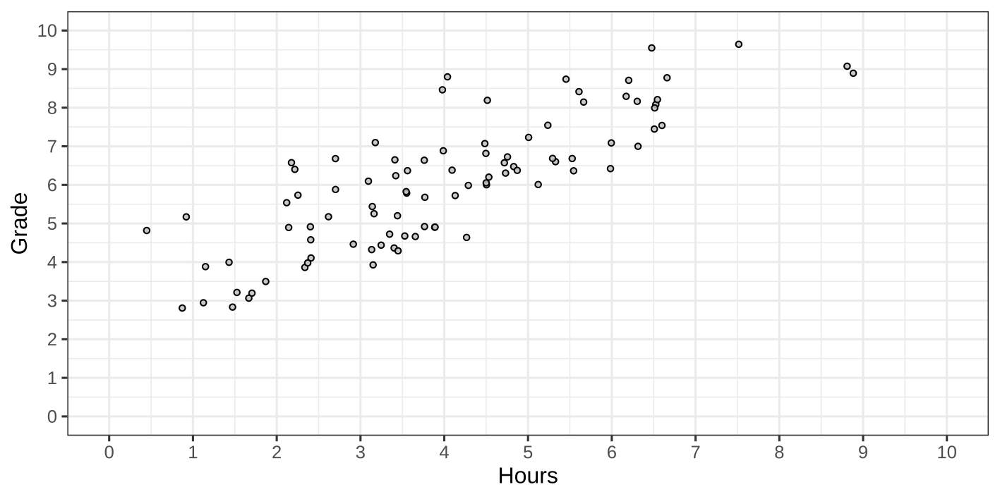{fig-align="center"}

## Unstandardized Regression

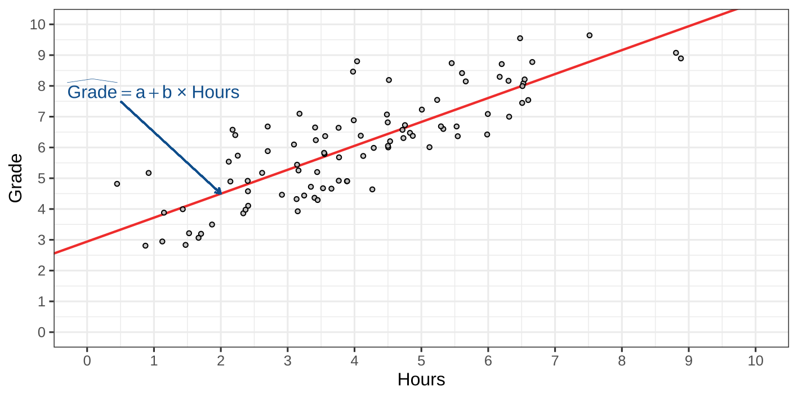{fig-align="center"}

## Standardized Regression

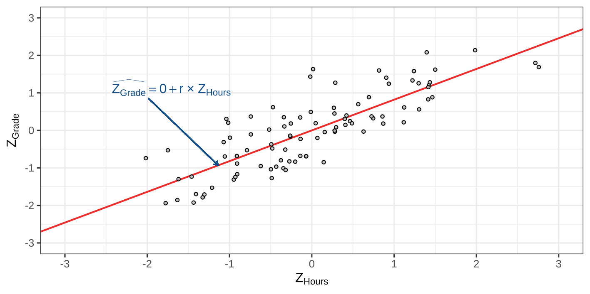{fig-align="center"}


## Three sums of squares

- **TSS:** How much variation was there to begin with?
- **SSE:** How much remains unexplained?
- **RSS:** How much has the regression explained?

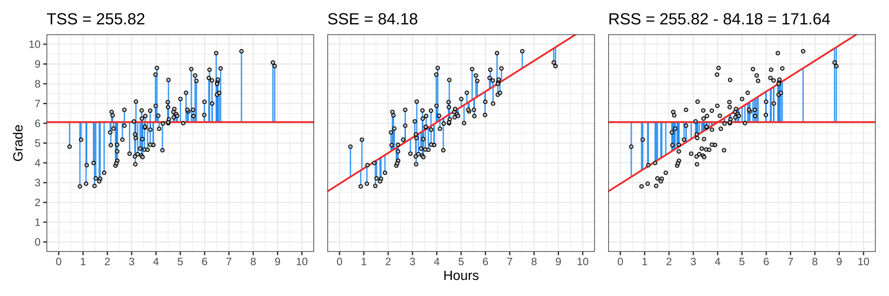{fig-align="center"}

## Explained Variance

The proportion explained is:

$$
R^2 = \frac{\text{explained variation}}{\text{total variation}}
= \frac{\RSS}{\TSS}
$$

## Explained Variance: Demo



## Recap

1. The Ordinary Least Squares finds $a$ and $b$ that minimize the SSE.
2. But SSE on it's own doesn't tell us how good the predictions are.
3. Explained variance tells us how much of the variance is explained by the regression line.

. . .

Goals for today:

- How do we test $a$ and $b$?
- How do we test if $R^2 > 0$?


# Data Example I: Trustworthy Faces

## How Trustworthy is this face?

{fig-align="center"}


## How Trustworthy is this face?

<!-- https://github.com/jcpeterson/omi/blob/main/images/638.jpg
 -->
<!-- {fig-align="center"} -->
{fig-align="center"}


## Trustworthy Faces

These faces are part of The One Million Impressions (OMI) dataset, which contains over a million human judgments of over 1,000 synthetic face images along 34 attributes.

. . .

Participants judged faces on a scale from 0 to 100 on attributes such as

::: {.columns}

::: {.column}

- trustworthy
- attractive
- dominant


:::

::: {.column}

- smart
- memorable
- well-groomed


:::

:::

We use the mean ratings for each of the 1,004 faces: one observation is one face.


::: footer

Peterson, J. C., Uddenberg, S., Griffiths, T. L., Todorov, A., & Suchow, J. W. (2022). Deep models of superficial face judgments. Proceedings of the National Academy of Sciences (PNAS), 119(17), e2115228119. doi:10.1073/pnas.2115228119

source: <https://github.com/jcpeterson/omi/>

:::

## Can you guess the scale?


::: {.columns}

::: {.column}

{fig-align="center" width="90%"}


:::

::: {.column}

{fig-align="center" width="90%"}


:::

:::

```{=html}
<div style="display: grid; grid-template-columns: repeat(3, 1fr); width: 100%; text-align: center;">
  <div>(A) happy</div>
  <div>(B) well-groomed</div>
  <div>(C) age</div>
</div>
```

## Can you guess the scale?


::: {.columns}

::: {.column}

{fig-align="center" width="90%"}


:::

::: {.column}

{fig-align="center" width="90%"}


:::

:::


```{=html}
<div style="display: grid; grid-template-columns: repeat(3, 1fr); width: 100%; text-align: center;">
  <div>(A) happy</div>
  <div>(B) smart</div>
  <div>(C) dominant</div>
</div>
```

## Can you guess the scale?


::: {.columns}

::: {.column}

{fig-align="center" width="90%"}


:::

::: {.column}

{fig-align="center" width="90%"}


:::

:::

```{=html}
<div style="display: grid; grid-template-columns: repeat(3, 1fr); width: 100%; text-align: center;">
  <div>(A) happy</div>
  <div>(B) smart</div>
  <div>(C) memorable</div>
</div>
```

## Can we predict trustworthiness?

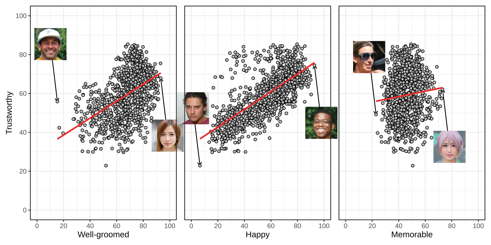

## Does well-groomed predict trustworthy?

Let's use _well-groomed_ to predict _trustworthy_.

$$
\widehat{\text{Trustworthy}} = a + b \times \text{Well-groomed}
$$

. . .

- What does the line predict at a particular grooming score?
- Is there an association in the population?
- Is the association large enough to meet a particular benchmark?

## Our sample gives one line

For these 1,004 faces:

$$
\widehat{\text{Trustworthy}} = 29.88 + 0.44 \times \text{Well-groomed}
$$

. . .

A 10-point increase in grooming corresponds to a 4.4-point increase in _predicted_ trustworthiness.

. . .

Is 0.44 significantly different from 0?

. . .

Would another sample of faces give us exactly the same line?

# $t$-test: Testing coefficients

## Hypothesis testing

The general procedure:

1. What are $\hypo_0$ and $\hypo_1$?
2. If $\hypo_0$ were true, what do we expect due to _sampling variability_?
3. How far is our estimate from $\hypo_0$ in _standard errors_?
4. What is the _$p$-value_?

. . .

We'll do this for the intercept $a$, and then the slope $b$.

## Hypothesis testing

Let $\alpha$ be the population parameter for $a$.

To test the intercept we state: $\hypo_0 : \alpha = \alpha_{\hypo_0}$

For now, let's assume $\hypo_0 : \alpha = 0$

This says: the population line predicts $y = 0$ when $x = 0$.

. . .

What is the sampling distribution for $a$, given that $\hypo_0$ is true?


## Sampling distribution: intercept

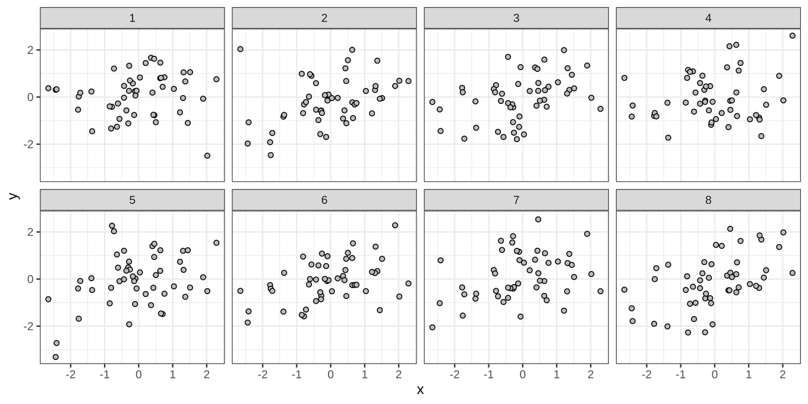{fig-align="center"}

## Sampling distribution: intercept

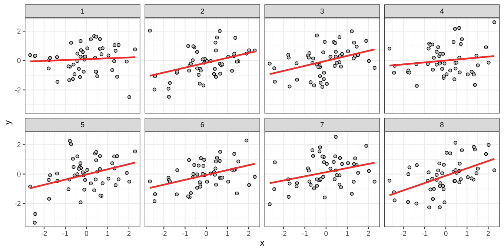{fig-align="center"}

## Sampling distribution: intercept

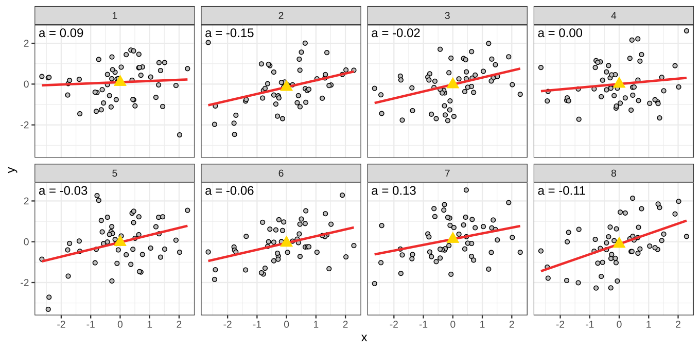{fig-align="center"}


## From many estimates to a sampling distribution

Imagine repeating this thousands of times and collecting every estimated intercept $a$.

. . .

- The estimates vary around the population intercept $\alpha$.
- Their spread tells us how much estimates vary across samples.
- We estimate that spread with the standard error, $\SE_a$.

. . .

- Any sample intercept is likely nonzero.
  * How far from zero would be surprising?


## What impacts the sampling distribution?

The population regression model is:

$$
Y_i = \alpha + \beta x_i + \epsilon_i,
\qquad \epsilon_i \overset{\mathrm{iid}}{\sim} \mathcal{N}(0, \sigma_\epsilon^2)
$$

- $\alpha$ and $\beta$ are population intercept and slope
- At each $x$, outcomes vary around the population line.
- Errors are independent, normally distributed, and have constant variance.

. . .

More data (larger $N$) and less error (smaller $\sigma_{\res_p}$) generally give more precise estimates.


## Sampling distribution: intercept.


$$
a\mid \hypo_0 \sim \dnorm{\alpha_{\hypo_0}}{\sigma_\epsilon^2\times c_\alpha}\quad
$$

- $\alpha_{\hypo_0}$ is the value we test against
- $\sigma_\epsilon^2$ is the population error variance
- $c_\alpha$ depends on the predictor values
- $\SE_a = \sigma_\epsilon^2\times c_\alpha$, the standard error

## Sampling distribution: intercept.

$$
\hat{a} = \bar{y} - \hat{b}\times \bar{x}
$$

. . .

$$
\SE_a^2 =
%\underbrace{\text{Uncertainty in mean outcome}}_{\small{\frac{SSE}{n\times(n - 2)}}}
\underbrace{\text{Uncertainty in mean}}_{\small{\hat{\sigma}_\epsilon^2 / n}}
+
\underbrace{\text{Uncertainty in slope}}_{\small{\bar x^2 SE(\hat b)^2}}
$$

. . .

- Uncertainty about the slope impacts the uncertainty about the intercept
- Even if we knew the slope, random errors would make the intercept vary

## How far from the null value?

We estimate the unknown error variance from the residuals.

$$
t = \frac{a - \alpha_{\hypo_0}}{\SE_a}
\qquad\text{with } df = N - 2
$$

. . .

Under $\hypo_0$, this statistic follows a $t$-distribution.

- The numerator is the distance from the null value.
- The denominator expresses that distance in standard errors.
- The alternative hypothesis determines which tail(s) give the $p$-value.

## Back to faces: test if the intercept is zero

$$
\widehat{\text{Trustworthy}} = 29.88 + 0.44 \times \text{Well-groomed}
$$

$\hypo_0: \alpha = 0$ versus $\hypo_1: \alpha \neq 0$.

. . .

::: {style="font-size:95%"}
Does the population line predict $\widehat{\text{Trustworthy}}=0$ at $\text{Well-groomed}=0$?
:::

## Back to faces: test if the intercept is zero {.small-slide}


<style>

.spss-coef thead th {
  border-bottom: none !important;
}

.spss-coef .group-title {
  display: block;
  text-align: center;
  border-bottom: 1px solid currentColor;
  padding-bottom: 6px;
  margin: 0 12px;
}

.spss-coef .beta {
  text-align: center;
}
</style>

<table class="spss-coef" style="width: 100%; text-align: right;">
  <thead>
    <tr>
      <th rowspan="2" style="text-align: left;">Model</th>
      <th rowspan="2"></th>
      <th colspan="2">
        <span class="group-title">Unstandardized Coefficients</span>
      </th>
      <th>
        <span class="group-title">Standardized Coefficients</span>
      </th>
      <th rowspan="2">t</th>
      <th rowspan="2">Sig.</th>
    </tr>
    <tr>
      <th>B</th>
      <th>Std. Error</th>
      <th class="beta">Beta</th>
    </tr>
  </thead>
  <tbody>
    <tr>
      <td>1</td>
      <td style="text-align: left;">(Constant)</td>
      <td>29.880</td>
      <td>1.777</td>
      <td class="beta"></td>
      <td>16.813</td>
      <td>???</td>
    </tr>
    <tr>
      <td></td>
      <td style="text-align: left;">well-groomed</td>
      <td>0.436</td>
      <td>0.026</td>
      <td class="beta">0.469</td>
      <td>16.799</td>
      <td>???</td>
    </tr>
  </tbody>
</table>

## Back to faces: test if the intercept is zero

$$
\widehat{\text{Trustworthy}} = 29.88 + 0.44 \times \text{Well-groomed}
$$

$\hypo_0: \alpha = 0$ versus $\hypo_1: \alpha \neq 0$.

::: {style="font-size:95%"}
Does the population line predict $\widehat{\text{Trustworthy}}=0$ at $\text{Well-groomed}=0$?
:::

. . .

$$
t = \frac{a - \alpha_{\hypo_0}}{\SE_a}
= \frac{29.88 - 0}{1.77}
= 16.81,
\qquad df = 1004 - 2 = 1002
$$


Is this significant?

. . .

Yes, $p < .001$, reject $\hypo_0$.

. . .

Was this a meaningful test?

. . .

No! All scores were given on a 0 - 100 scale!

## A more meaningful test for the intercept

$$
\widehat{\text{Trustworthy}} = 29.88 + 0.44 \times \text{Well-groomed}
$$

. . .

The intercept predicts trustworthiness of about 30 at a grooming score of zero.

. . .

Assume the population slope is positive.

What does it mean if the population intercept was above 50?

## A more meaningful test for the intercept




## A more meaningful test for the intercept

Is population predicted trustworthiness above 50 even at the lowest possible grooming score?

$$
\hypo_0: \alpha \leq 50,
\qquad \hypo_1: \alpha > 50
$$

. . .

$$
t = \frac{a - \alpha_{\hypo_0}}{\SE_a}
= \frac{29.88 - 50}{1.77} = -11.32,
\qquad df = 1002
$$

Is this significant?

. . .

No! It's far into the tail, but this is a _one sided_ test and it's the wrong tail. We do not reject $\hypo_0$.

## A more meaningful test for the intercept

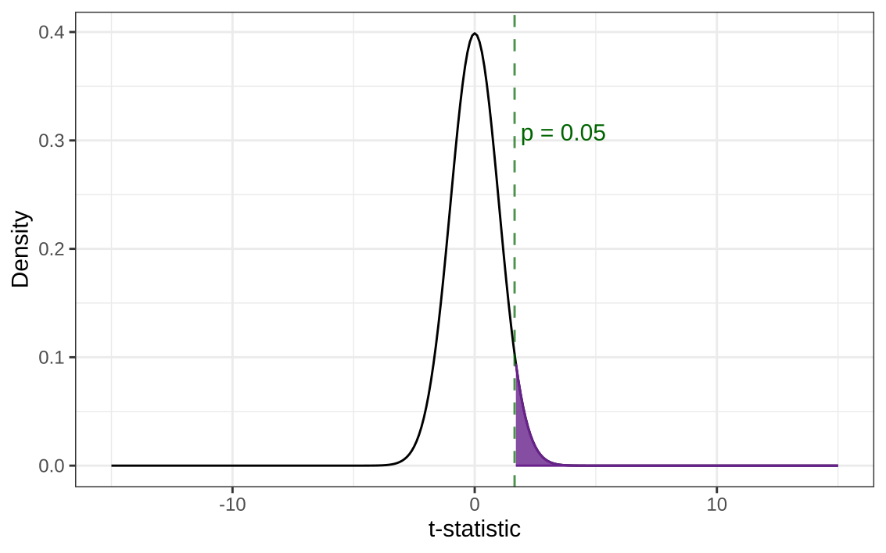{fig-align="center"}

## A more meaningful test for the intercept

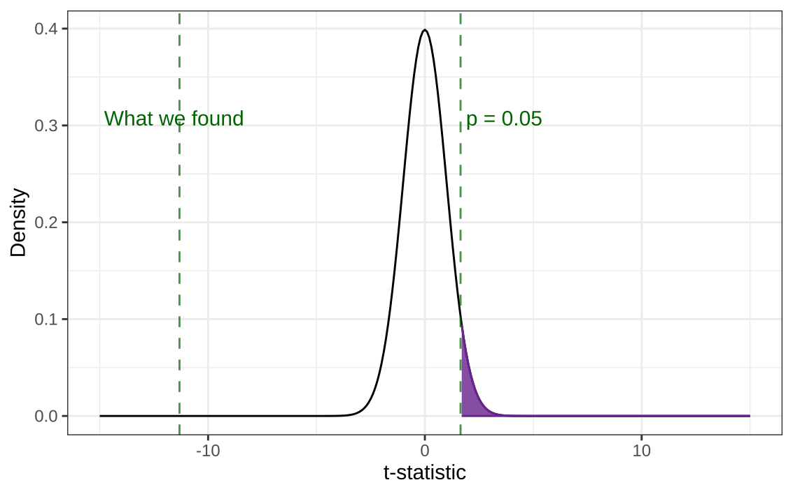{fig-align="center"}

## Sampling distribution: slope

{fig-align="center"}

## Sampling distribution: slope

{fig-align="center"}

## Sampling distribution: slope

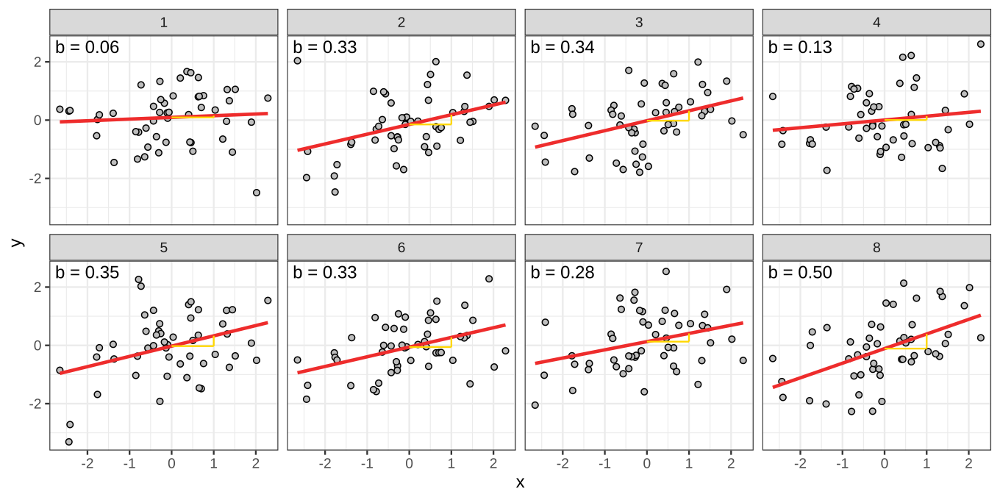{fig-align="center"}

## Sampling distribution: slope

Different random samples produce different estimates of the slope $b$.

$$
b \mid \hypo_0 \sim \dnorm{\beta_{\hypo_0}}{
\sigma_\epsilon^2 \times c_\beta
}
$$

- $\beta_{\hypo_0}$ is the value we test against
- $\sigma_\epsilon^2$ is the population error variance
- $c_\beta$ depends on the predictor values
- $\SE_b = \sigma_\epsilon^2 \times c_\beta$, the standard error


## What determines the uncertainty of the slope?

We estimate the error variance using the residuals:

$$
\SE_b^2 =
%\underbrace{\text{Unexplained variation}}_{\small{\frac{SSE}{(n-1)\times(n - 2)}}}
\underbrace{\text{Unexplained variation}}_{\small{\hat{\sigma}_\epsilon^2 / (n - 1)}}
/
\underbrace{\text{Variation in }X}_{\small{s_x^2}}
$$

. . .

If unexplained variation increases, uncertainty about the slope goes up.

If variation in $x$ increases, uncertainty about the slope goes down.


## Testing the slope: is there an association?

The population slope was called $\beta$. The hypotheses are:

$$
\hypo_0: \beta = 0,
\qquad \hypo_1: \beta \neq 0
$$


. . .

## Testing the slope: is there an association?


<style>

.spss-coef thead th {
  border-bottom: none !important;
}

.spss-coef .group-title {
  display: block;
  text-align: center;
  border-bottom: 1px solid currentColor;
  padding-bottom: 6px;
  margin: 0 12px;
}

.spss-coef .beta {
  text-align: center;
}
</style>

<table class="spss-coef" style="width: 100%; text-align: right;">
  <thead>
    <tr>
      <th rowspan="2" style="text-align: left;">Model</th>
      <th rowspan="2"></th>
      <th colspan="2">
        <span class="group-title">Unstandardized Coefficients</span>
      </th>
      <th>
        <span class="group-title">Standardized Coefficients</span>
      </th>
      <th rowspan="2">t</th>
      <th rowspan="2">Sig.</th>
    </tr>
    <tr>
      <th>B</th>
      <th>Std. Error</th>
      <th class="beta">Beta</th>
    </tr>
  </thead>
  <tbody>
    <tr>
      <td>1</td>
      <td style="text-align: left;">(Constant)</td>
      <td>29.880</td>
      <td>1.777</td>
      <td class="beta"></td>
      <td>16.813</td>
      <td>.000</td>
    </tr>
    <tr>
      <td></td>
      <td style="text-align: left;">well-groomed</td>
      <td>0.436</td>
      <td>0.026</td>
      <td class="beta">0.469</td>
      <td>16.799</td>
      <td>???</td>
    </tr>
  </tbody>
</table>

## Testing the slope: is there an association?

The population slope was called $\beta$. The hypotheses are:

$$
\hypo_0: \beta = 0,
\qquad \hypo_1: \beta \neq 0
$$

<!-- TODO: could here show the figure for the sampling distribution of the slope -->


$$
t = \frac{b - \beta_{\hypo_0}}{\SE_b}
= \frac{0.44 - 0}{0.03}
= 16.80
$$

With $df = 1002$, the two-sided $p$-value is $< .001$.


## A more informed comparison

For happy and memorable we find the following results.

$$
\begin{aligned}
\widehat{\text{Trustworthy}} &= 33.67 + 0.45 \times \text{Happy}\\
\widehat{\text{Trustworthy}} &= 52.80 + 0.14 \times \text{Memorable}
\end{aligned}
$$


. . .

Is the slope for the relation with groomedness larger than that of happiness?

What about memorableness?

. . .

We use their sample slopes as comparison for the population slope of well-groomed.

::: footer

There are better ways to test this but those are not part of this course.

:::

## A more informed comparison


## Is the association of well-groomed > happy?

$$
\hypo_0: \beta \leq 0.45,
\qquad \hypo_1: \beta > 0.45
$$

. . .

$$
t = \frac{b - \beta_{\hypo_0}}{\SE_b}
= \frac{0.44 - 0.45}{0.03} = -0.73,
\qquad df = 1002
$$

Which tail of the $t$ distribution do we use?

. . .

Our alternative is $\beta > 0.45$, so we use the upper tail.

. . .

The $p$-value is $0.77$. We do not reject $\hypo_0$.


::: footer

The numbers shown are rounded, but actual computation of the $t$-value was done without without rounding.

:::

## Is the association of well-groomed > memorable?

Again, the main change is in the hypotheses:

$$
\hypo_0: \beta \leq 0.14,
\qquad \hypo_1: \beta > 0.14
$$

. . .

$$
t = \frac{b - \beta_{\hypo_0}}{\SE_b}
= \frac{0.44 - 0.14}{0.03}
= 11.42,
\qquad df = 1002
$$

. . .

The one-sided $p$-value is $< .001$. We reject $\hypo_0$.

<!--

TODO:
possible question would be:

A first hypothesis tests \beta = 0 vs. \beta not 0.
A second hypothesis tests \beta <= .5 vs. \beta > .5
What changes in the second second hypothesis test relative to the first?

A. The comparison value implied by H0.
B. The comparison value implied by H0, and the standard error
C. The standard error and the degrees of freedom
C. The comparison value implied by H0 and the degrees of freedom

-->

# $F$-test: Testing models

## Two sides of the same faces

Compare two ways to predict trustworthiness:

- Use the same prediction for every face: the sample mean.
- Use the face's grooming score to make a prediction.

. . .

Does adding grooming explain more variation than we would expect from sampling variability alone?

## Comparing two models

Before we compared individually $a$ and $b$ against 0 or specific values.

Now we'll examine a test to compare two models:

$$
\begin{align}
\hypo_0:& \text{ the null model},       &&y_i = a \phantom{+ b\times x_i }\;\,+\res_i\\
\hypo_1:& \text{ the regression model}, &&y_i = a + b\times x_i +\res_i
\end{align}
$$

. . .

Let's take 5 minutes to brainstorm about this comparison.

- What does it mean when we reject H0?
- What are equivalent statistical questions?

## Equivalent meanings of this comparison

Comparing the models is identical to comparing...

1. $\hypo_0: \beta = 0$ vs $\hypo_1: \beta \neq 0$.
2. $\hypo_0: \rho^2 = 0$ vs $\hypo_1: \rho^2 > 0$.

Here, $\rho^2$ is the _population_ value for $R^2$

. . .

We develop this theory for the second question.

. . .

Later on, during ANOVA, a model comparison can test more than one coefficient at once.


## Testing Explained Variance

$$
R^2 = \frac{\RSS}{\TSS} = \text{Explained variance}
$$

. . .

$$
1 - R^2 = \frac{\SSE}{\TSS} = \text{Unexplained variance}
$$

. . .

Therefore:
$$
\frac{R^2}{1 - R^2} = \frac{\RSS/\cancel{\TSS}}{\SSE/\cancel{\TSS}}= \frac{\RSS}{\SSE} = \frac{\text{Explained variance}}{\text{Unexplained variance}}
$$


## From sums of squares to mean squares

Even unrelated predictors explain some variation in a sample.

To account for this, we divide each sum of squares by its degrees of freedom:

$$
\begin{aligned}
\MSR &= \frac{\RSS}{1}
&&\text{(explained variation)}\\[8pt]
\MSE &= \frac{\SSE}{N-2}
&&\text{(unexplained variation)}
\end{aligned}
$$

. . .

If $\hypo_0$ is true, both mean squares estimate the same population error variance.

## Testing Explained Variance

We compare the two mean squares:

$$
F = \frac{\MSR}{\MSE}
= \frac{\RSS}{\SSE / (N-2)}
$$

. . .

Using what we know about $R^2$: $F = (N-2)\frac{R^2}{1-R^2}$

. . .

Under $\hypo_0$, the sampling distribution is:

$$
F \sim F(1,N-2)
$$

. . .

- A large $F$ is evidence against $\hypo_0$.
- The $p$-value is the area to the right of the observed $F$.

## F distribution

The $F(df_1, df_2)$ distribution:

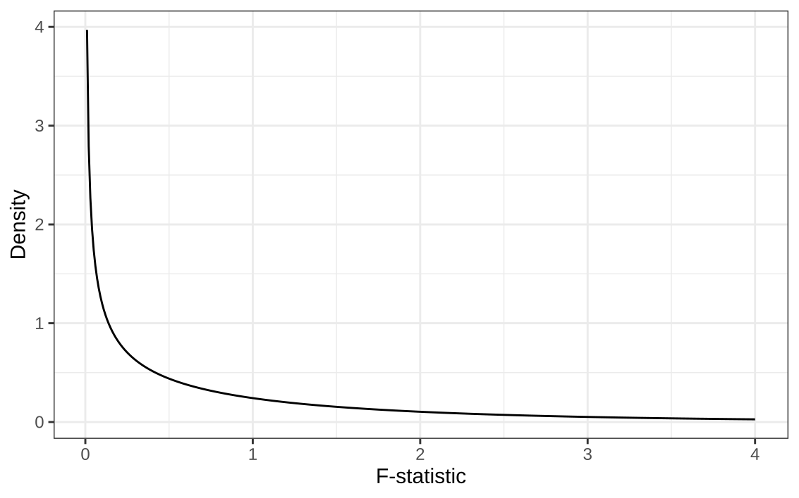{fig-align="center"}

## F distribution

The $F(df_1, df_2)$ distribution:

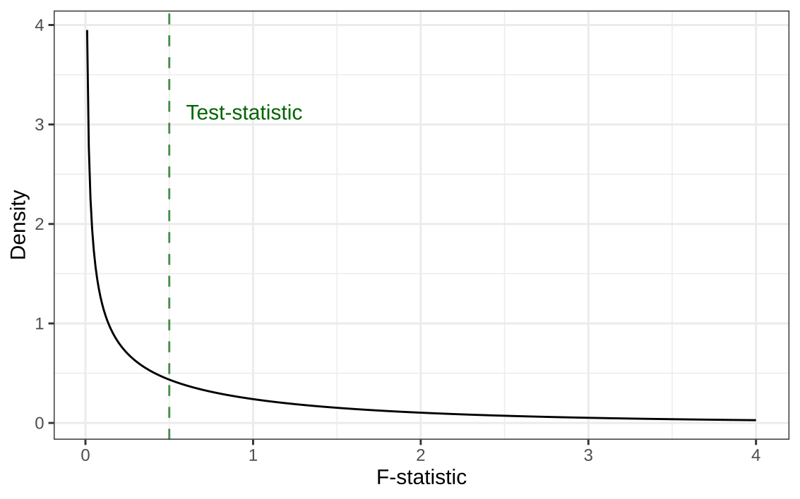{fig-align="center"}

## F distribution

The $F(df_1, df_2)$ distribution:

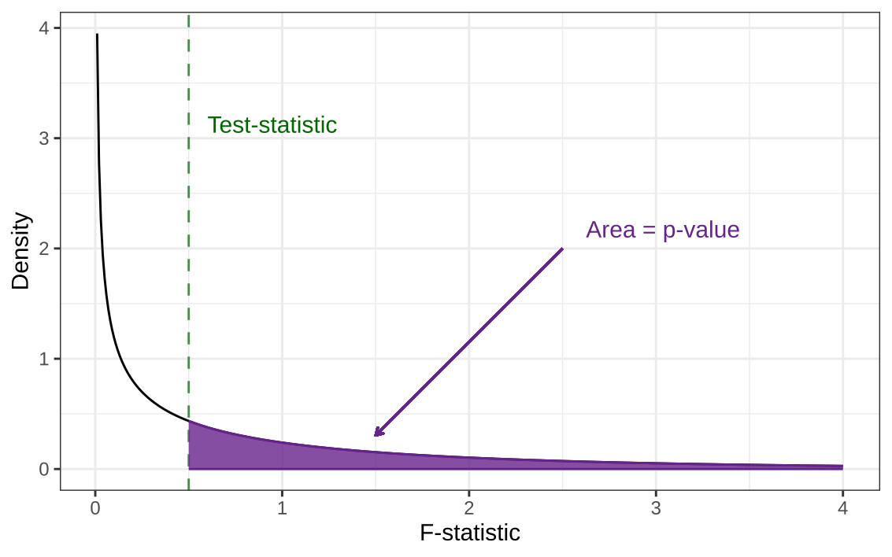{fig-align="center"}


## F test: well-groomed predicting trustworthy

::: {.columns}

::: {.column width = "70%"}

For the same 1,004 faces, $R^2 = 0.22$.

$$
\hypo_0: \rho^2 = 0,
\qquad \hypo_1: \rho^2 > 0
$$

. . .

$$
F = (N - 2)\times\frac{R^2}{1 - R^2}
= 282.21
$$


:::

::: {.column width = "30%"}

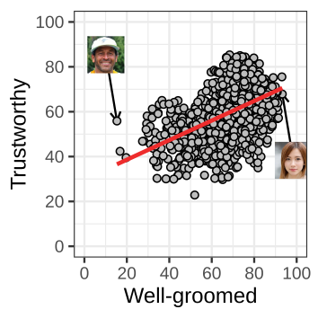{ fig-align="right"}

:::

:::

. . .

Compare with $F(1,1002)$: the upper-tail $p$-value is $< .001$.

. . .

We reject $\hypo_0$. Grooming explains about 22% of the sample variation in perceived trustworthiness.

## F-test: happy predicting trustworthy


::: {.columns}

::: {.column width = "70%"}

For the same 1,004 faces, $R^2 = 0.49$.


$$
\hypo_0: \rho^2 = 0,
\qquad \hypo_1: \rho^2 > 0
$$

. . .

$$
F = (N - 2)\times\frac{R^2}{1 - R^2}
= 955.86
$$


:::

::: {.column width = "30%"}

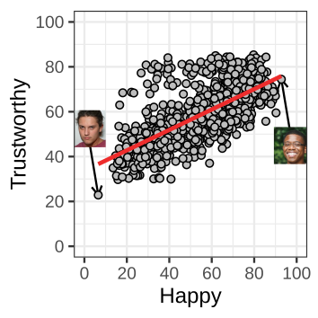{ fig-align="right"}

:::

:::


. . .

With $df_1 = 1$ and $df_2 = 1002$, $p < .001$.

. . .

We reject $\hypo_0$. Happy ratings explain about 49% of the sample variation in perceived trustworthiness.

## F-test: memorable predicting trustworthy

::: {.columns}

::: {.column width = "70%"}

For the same 1,004 faces, $R^2 = 0.01$.

$$
\hypo_0: \rho^2 = 0,
\qquad \hypo_1: \rho^2 > 0
$$

. . .

$$
F = (N - 2)\times\frac{R^2}{1 - R^2}
= 9.50
$$


:::

::: {.column width = "30%"}

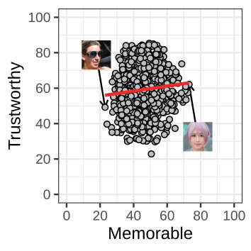{ fig-align="right"}

:::

:::

. . .

With $df_1 = 1$ and $df_2 = 1002$, $p < .01$. We reject $\hypo_0$.

. . .

But only about 1% of the sample variation is explained. How useful is that for prediction?

## Three regressions, three F-tests

Each regression predicts trustworthy ratings using one predictor.

Predictor | $R^2$ | $F(1,1002)$ | $p$
--- | ---: | ---: | ---:
Well-groomed | 0.22 | 282.21 | $< .001$
Happy | 0.49 | 955.86 | $< .001$
Memorable | 0.01 | 9.50 | $< .01$

. . .

- All three model tests are significant.
- Explained variation differs substantially across the three models.
- Each test compares one regression with the intercept-only model.


## The same regressions, two tests

The $t$-test and $F$-test results side by side are:

Predictor | Slope $t$-statistic | Model $F$-statistic
--- | ---: | ---:
Well-groomed | 16.80 | 282.21
Happy | 30.92 | 955.86
Memorable | 3.08 | 9.50

What relationship do you notice between the two statistics?

. . .

$$
F = t^2
$$


## Why do we have both a t-test and an F-test?

In simple regression with an intercept, these ask the same question:

- Does the population slope differ from zero?
- Does the regression improve on the intercept-only model?

. . .

The model $F$-test and the _two-sided_ $t$-test of $\beta = 0$ give the same $p$-value.

- Squaring $t$ removes the direction of the slope.
- A one-sided $t$-test asks a directional question.
- If we test $\beta$ against some value other than 0 this does not hold.


# Conclusions

## What did we learn from the faces?

- Grooming and happy ratings both show positive associations with perceived trustworthiness.
- Happy ratings explain about 49% of its sample variation; grooming explains about 22%.
- Memorability explains about 1%, despite a significant model test.

. . .

Just because a predictor is statistically significant doesn't mean it's predictions are useful!

## Different questions need different tests

We've answered multiple questions with different tests:

Question | What do we use?
--- | ---
What is predicted when $x=0$? | The intercept $a$
Does that prediction exceed 50? | A one-sided intercept $t$-test against 50
Is there a linear association? | A slope $t$-test against zero or the model $F$-test
Does the slope exceed a benchmark? | A one-sided slope $t$-test against that value
How much sample variation is explained? | $R^2$

## Next weeks

- Assumption tests (next week)
- Independent samples t-test (week after that)
- ANOVA (both weeks after that)
