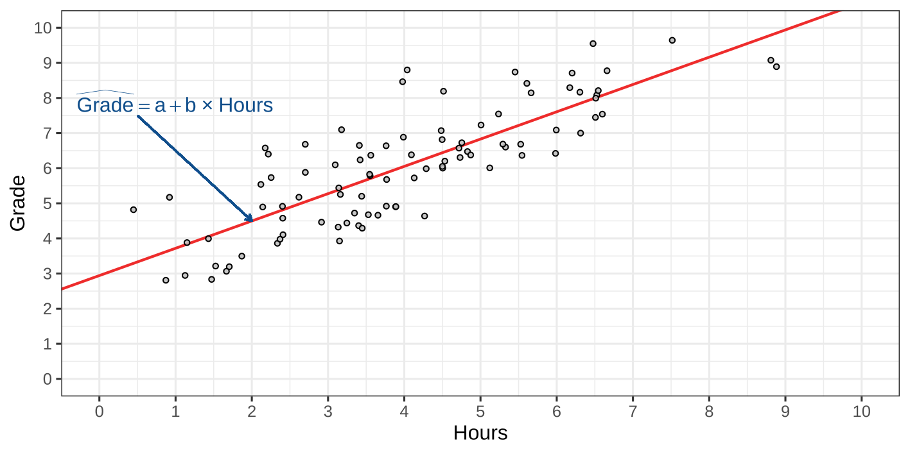
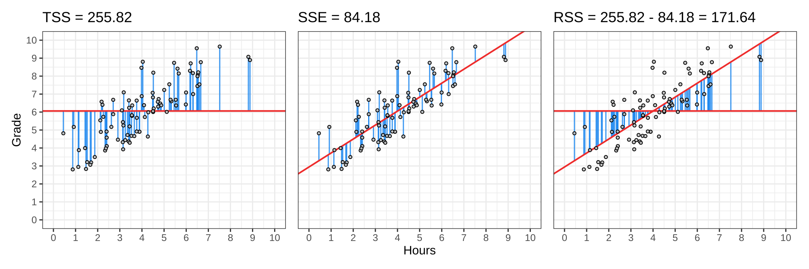

# Recap Linear Regression

## Grades vs. Hours Studied

::: {.hidden}
$$
\newcommand{\hypo}{\mathcal{H}}
\newcommand{\SE}{\mathrm{SE}}
\newcommand{\dnorm}[2]{\mathcal{N}\left(#1, #2\right)}
\newcommand{\res}{e}
\newcommand{\rep}{\epsilon}
\newcommand{\TSS}{\mathrm{TSS}}
\newcommand{\SSE}{\mathrm{SSE}}
\newcommand{\RSS}{\mathrm{RSS}}
$$
:::

{fig-align="center"}

## Grades vs. Hours Studied

{fig-align="center"}

## Three sums of squares

- **TSS:** How much variation was there to begin with?
- **SSE:** How much remains unexplained?
- **RSS:** How much has the regression explained?

{fig-align="center"}

## Explained Variance

The proportion explained is:

$$
R^2 = \frac{\text{explained variation}}{\text{total variation}}
= \frac{\RSS}{\TSS}
$$

## Explained Variance: Demo



## Recap

1. The Ordinary Least Squares finds $a$ and $b$ that minimize the SSE.
2. But SSE on it's own doesn't tell us how good the predictions are.
3. Explained variance tells us how much of the variance is explained by the regression line.

. . .

Goals for today:

- How do we test $a$ and $b$?
- How do we test if $R^2 > 0$?
<!-- something else? -->

# Data Example I: Freshness and box office

## Who is this?

<!-- TODO: picture by Adam Sandler -->

## Freshness and box office

in 2015, someone collected data on 31 movies by Adam Sandler.

They recorded:

- Year: The year the movie played
- Title: The Movie title
- Freshness: Freshness ratings on [Rotten Tomatoes](https://www.rottentomatoes.com)
  * ranges from 0 (rotten) to 1 (fresh).
- Box Office ($M): Box office succes of the movies
  * in millions of US dollars.

What should we predict?

::: footer

TODO: url to data source

:::

# $t$-test: Testing coefficients

## Hypothesis testing

Recall the general procedure:

1. What are $\hypo_0$ and $\hypo_1$?
2. What would we expect because of _sampling variability_ if $\hypo_0$ were true?
3. How far is our estimate from $\hypo_0$ in _standard errors_?
4. What is the _$p$-value_?

Let's do this for the intercept $a$, and then the slope $b$.

## Hypothesis testing

# $F$-test: Testing models

## Comparing two models

Before we compared individually $a$ and $b$ against 0 or specific values.

Now we'll examine a test two compare two models:

$$
\begin{align}
\hypo_0:& \text{ the null model},       &&y_i = a \phantom{+ b\times x_i }\;\,+\res_i\\
\hypo_1:& \text{ the regression model}, &&y_i = a + b\times x_i +\res_i
\end{align}
$$

. . .

Let's take 5 minutes to brainstorm about this comparison.

- What does it mean when we reject H0?
- What are equivalent statistical questions?

## Equivalent meanings of this comparison

Comparing the models is identical to comparing...

1. $\hypo_0: b = 0$ vs $\hypo_1: b \neq 0$.
2. $\hypo_0: R^2 = 0$ vs $\hypo_1: R^2 > 0$.

. . .

We develop this theory for the second question.

. . .

Later on, (during ANOVA), the model comparison is no longer equal to testing $b = 0$.

## Testing Explained Variance

- $\hypo_0: \rho^2 = 0$
- $\hypo_1: \rho^2 > 0$

. . .

Here, $\rho^2$ is the _population_ value for $R^2$

. . .

What is the sampling distribution?

## Testing Explained Variance

$$
R^2 = \frac{\RSS}{\TSS} = \text{Explained variance}
$$

. . .

$$
1 - R^2 = \frac{\SSE}{\TSS} = \text{Unexplained variance}
$$

. . .

Therefore:
$$
\frac{R^2}{1 - R^2} = \frac{\RSS}{\SSE} = \frac{\text{Explained variance}}{\text{Unexplained variance}}
$$

## Testing Explained Variance

$\frac{R^2}{1 - R^2}$ is convenient, but:

- even "random" predictors explain _some_ variation.
- we need to account for the number of parameters being estimated.

. . .

$$
F =
\frac{\RSS}{\SSE / (N - 2)}
=
(N - 2)\times\frac{R^2}{1 - R^2}
$$

. . .

<!--

TODO: figure out if this comes back during ANOVA
in Caspar's slides. If it does, only introduce it there!

 -->

<!--

::: {style="font-size: 90%;"}

In general:
$$
F =
\frac{\RSS / (p - 1)}{\SSE / (N - p)}
=
\frac{N - p}{p - 1}\times\frac{R^2}{1 - R^2}
$$
:::

-->

::: {.notes}

Indicate that "random" means without meaningful association

the no. parameters corresponds to the degrees of freedom

:::

## $F$-distribution

Let's see why this makes sense. Suppose $\hypo_0$ is true.

Then what is the sampling distribution of

- $\RSS / (p - 1)$,
- $\SSE / (N - p)$?

. . .

Suppose that $\rho^2 = 0$.

Then in the population $\RSS = 0$, and $\SSE = \TSS$.

<!-- Do not forget that F = t_b^2 -->

## $F$-distribution

Recall that $R^2 = \frac{\RSS}{\TSS}$.

We use a very similar quantity:

- $\mathrm{MSR} = \RSS / (p - 1)$
- $\mathrm{MSE} = \SSE / (N - p)$

<!--
TODO: can we do the same but use TSS
for symmetry with the R^2 computation?
 -->

- $N$ = the sample size
- $p$ = the number of parameters in the model
  * for bivariate regression we only have $a$ and $b$ so $p = 2$.

## F-test

The F-test is a ratio of two sources of variance:

$$
F = \frac{\sigma^2_{\text{regression}}}{\sigma^2_{\text{Error}}} =  \frac{MS_{\text{regression}}}{MS_{\text{Error}}} = \frac{SSR/(p-1)}{SSE/(n-p)}
$$

p: parameters ($a$ and $b$), n: number of participants

* $df_1$: p-1
* $df_2$: n-p

Both SS can only be positive, so the F-statistic is always positive, so we use a probability distribution with only positive values.

# Data Example II: Sesame street and childrens

::: footer

Data from "Regression and Other Stories", by by Andrew Gelman, Jennifer Hill, and Aki Vehtari (2020).

:::

# Testing coefficients

# Testing models

