# Recap

<!--

TODO:

- derivation of a and b for OLS
- recap should now contain t-test and F-test
  - probably skip standardized regressions

- recap should probably use the same data example as last time

TODO:

- move shapiro-wilk to normality?
- homoscedastic situation should go slower
- Wooclap! some questions are already there in the slide/ R code

-->

::: {.hidden}
$$
\newcommand{\hypo}{\mathcal{H}}
\newcommand{\SE}{\mathrm{SE}}
\newcommand{\dnorm}[2]{\mathcal{N}\left(#1, #2\right)}
\newcommand{\res}{e}
\newcommand{\rep}{\epsilon}
\newcommand{\TSS}{\mathrm{TSS}}
\newcommand{\SSE}{\mathrm{SSE}}
\newcommand{\RSS}{\mathrm{RSS}}

\newcommand{\MSE}{\mathrm{MSE}}
\newcommand{\MSR}{\mathrm{MSR}}
$$
:::

## Trustworthy Faces

Recall The One Million Impressions (OMI) dataset, which contains over a million human judgments of over 1,000 synthetic face images along 34 attributes.

. . .

Participants judged faces on a scale from 0 to 100 on attributes such as

::: {.columns}

::: {.column width = "33%"}

- trustworthy
- attractive

:::

::: {.column width = "33%"}

- smart
- memorable

:::

::: {.column width = "33%"}

- dominant
- well-groomed

:::

:::

. . .

Each observation is the average rating across many participants.

. . .

- We can do 33 regressions
- Each may or may not violate the assumptions.

::: footer

Peterson, J. C., Uddenberg, S., Griffiths, T. L., Todorov, A., & Suchow, J. W. (2022). Deep models of superficial face judgments. Proceedings of the National Academy of Sciences (PNAS), 119(17), e2115228119. doi:10.1073/pnas.2115228119

source: <https://github.com/jcpeterson/omi/>

:::

## Trustworthiness vs. Happiness

{fig-align="center"}

## Trustworthiness vs. Happiness

{fig-align="center"}

## Trustworthiness vs. Happiness

{fig-align="center"}

## Trustworthiness vs. Happiness

{fig-align="center"}

## Testing Coefficients

<!-- SUGGESTION: If revising this recap later, distinguish the population
sampling SD from its sample estimate SE_a, and use a consistent variance or
SD convention in the normal-distribution notation. The t statistic below
uses an estimated SE. Original slide retained. -->

$$
a\mid \hypo_0 \sim \dnorm{\alpha_{\hypo_0}}{\SE_a}\quad
$$

- Compute
$$
t = \frac{a - \alpha_{\hypo_0}}{\SE_a} \qquad \text{with}\;df = N - 2
$$

- Examine the $t$-table
  * use the appropriate tail of the distribution depending on the hypothesis test conducted.

. . .

For the slope everything worked out the same, but with $b$ instead of $a$.

## Comparing two models

Rather than individually comparing $a$ and $b$ against 0 or specific values,

we can also compare two models:

:::: {.r-stack}

::: {.fragment .fade-out fragment-index="2"}
$$
\begin{align}
\hypo_0:& \text{ the null model},       &&y_i = a \phantom{+ b\times x_i }\;\,+\res_i\\
\hypo_1:& \text{ the regression model}, &&y_i = a + b\times x_i +\res_i
\end{align}
$$
:::

::: {.fragment .fade-in fragment-index="2"}
$$
\begin{align}
\hypo_0:& \text{ the null model},       &&y_i = a + 0\times x_i +\res_i\\
\hypo_1:& \text{ the regression model}, &&y_i = a + b\times x_i +\res_i
\end{align}
$$
:::

::::

::: {.fragment fragment-index="1"}
1. $\hypo_0: \beta = 0$ vs $\hypo_1: \beta \neq 0$.
:::

::: {.fragment fragment-index="3"}
2. $\hypo_0: \rho^2 = 0$ vs $\hypo_1: \rho^2 > 0$.

Here, $\rho^2$ is the _population_ value for $R^2$
:::

## Comparing two models



## F-test

:::: {.r-stack}

::: {.fragment .fade-out fragment-index="1"}
$$
F = (N-2)\times\frac{R^2}{1-R^2}
\phantom{
  = (N-2)\times
  \frac{\text{Explained variance}}{\text{Unexplained variance}}
}
$$
:::

::: {.fragment .fade-in fragment-index="1"}
$$
F = (N-2)\times\frac{R^2}{1-R^2}
  = (N-2)\times
  \frac{\text{Explained variance}}{\text{Unexplained variance}}
$$
:::

::::

::: {.fragment fragment-index="2"}

If $\hypo_0$ is true, the $F$-value is $F$-distributed:

$$
F \sim F(1, N - 2)
$$

:::

## F-distribution

{fig-align="center"}

## F-distribution

{fig-align="center"}

## F-distribution

{fig-align="center"}

## F-test: happy predicting trustworthy

::: {.columns}

::: {.column width = "55%"}

$N= 1,004$, $R^2 = 0.49$.

. . .

$$
\hypo_0: \rho^2 = 0,
\qquad \hypo_1: \rho^2 > 0
$$

. . .

$$
F = (N - 2)\times\frac{R^2}{1 - R^2}
= 955.86
$$

. . .

$F(1, 1002) = 955.86$, $p < .001$.

. . .

We reject $\hypo_0$. Happy ratings explain about 49% of the sample variation in trustworthiness.

:::

::: {.column width = "45%"}

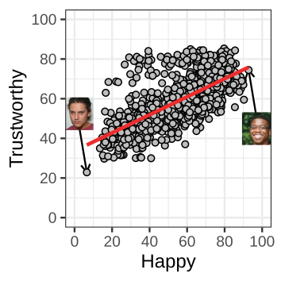{ fig-align="right"}

:::

:::

## F-test: memorable predicting trustworthy

::: {.columns}

::: {.column width = "55%"}

$N= 1,004$, $R^2 = 0.01$.

. . .

$$
\hypo_0: \rho^2 = 0,
\qquad \hypo_1: \rho^2 > 0
$$

. . .

$$
F = (N - 2)\times\frac{R^2}{1 - R^2}
= 9.50
$$

. . .

$F(1, 1002) = 9.50$, $p < .01$.

. . .

Statistically significant, but practically of limited value: Memorableness ratings explain only 1% of the sample variation in trustworthiness.

:::

::: {.column width = "45%"}

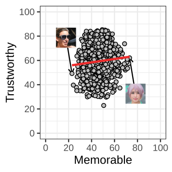{ fig-align="right"}

:::

:::

## Recap

<!-- SUGGESTION: Point 4 could distinguish coefficient hypotheses from the
overall model hypothesis. Neither test alone establishes useful prediction.
The existing recap is retained in full. -->

1. The Ordinary Least Squares finds $a$ and $b$ that minimize the SSE.
2. But SSE on it's own doesn't tell us how good the predictions are.
3. Explained variance tells us how much of the variance is explained by the regression line.
4. The tests for $a$, $b$, and the $F$-test provide statistical tests for this.

<!-- TODO: rewrite point 4 above -->

. . .

Today:

- Linear regression, and these significance tests make assumptions.
- What are these assumptions?
- How do check if they are violated?

# Assumptions

## Assumptions

- Almost all models make assumptions. Assume that...
  * the data are normally distributed
  * the sample is representative for the population
  * observations are independent of each other

. . .

- If assumptions are violated things can go wrong:
  * The model could misrepresents the data
  * Tests are misleading
    + The type-I error is inflated
  * Inferences may not be justified

. . .

- To complicate things, sometimes assumptions are violated, but the consequences are minor.
  * Example: Z vs. $t$-test when the sample size is larger

## Linear Regression Assumptions

:::: {.r-stack}

::: {.fragment .fade-out fragment-index="1"}
$$
Y_i = \alpha + \beta x_i + \epsilon_i,
\qquad \epsilon_i \overset{\mathrm{iid}}{\sim} \mathcal{N}(0, \sigma_\epsilon^2)
$$
:::

::: {.fragment .fade-in-then-out fragment-index="1"}
$$
Y_i = \textcolor{blue}{\alpha + \beta x_i} + \epsilon_i,
\qquad \epsilon_i \overset{\mathrm{iid}}{\sim} \mathcal{N}(0, \sigma_\epsilon^2)
$$
:::

::: {.fragment .fade-in fragment-index="2"}
$$
Y_i = \alpha + \beta x_i + \textcolor{blue}{\epsilon_i},
\qquad \textcolor{blue}{\epsilon_i \overset{\mathrm{iid}}{\sim} \mathcal{N}(0, \sigma_\epsilon^2)}
$$
:::

::::

::: {.fragment fragment-index="1"}

1. Linearity
   - The association between $x$ and $y$ is a straight line.

:::

::: {.fragment fragment-index="2"}

2. Assumptions about the errors
   - Normality: Errors follow a normal distribution.
   - Homoscedasticity: Errors have the same variance for all $x$.
   - Independence: Errors are independent of each other.

:::

## Linearity

{fig-align="center"}

## Linearity

but what causes deviations from normality?

<!-- SUGGESTION: "normality" here should read "linearity". Existing text
retained as requested. -->

. . .

- Too much of a good thing/ U-shaped
  * Dopamine vs working memory performance
- Diminishing returns/ plateau
  * Study time vs. exam performance
- Threshold effect
  * Swimming lessons vs. distance swum
- Heterogeneous sample
  * XXX

## Linearity

{fig-align="center"}

## U-shaped

{fig-align="center"}

## Diminishing returns/ plateau

{fig-align="center"}

## Threshold effect

{fig-align="center"}

## Faces: Cute vs. Trustworthy

{fig-align="center"}

<!-- TODO: with faces? -->

## Faces: Electable vs. Trustworthy

{fig-align="center"}

<!-- TODO: with faces? but only this one-->

## Faces: Electable vs. Trustworthy
{fig-align="center"}

## Faces: Electable vs. Trustworthy

{fig-align="center"}

## Faces: Electable vs. Trustworthy

{fig-align="center"}

# Residuals

## Errors and residuals

:::: {.r-stack}

::: {.fragment .fade-out fragment-index="1"}
$$
Y_i = \alpha + \beta x_i + \epsilon_i,
\qquad \epsilon_i \overset{\mathrm{iid}}{\sim} \mathcal{N}(0, \sigma_\epsilon^2)
$$
:::

::: {.fragment .fade-in-then-out fragment-index="1"}
$$
Y_i = \textcolor{blue}{\alpha + \beta x_i} + \epsilon_i,
\qquad \epsilon_i \overset{\mathrm{iid}}{\sim} \mathcal{N}(0, \sigma_\epsilon^2)
$$
:::

::: {.fragment .fade-in fragment-index="2"}
$$
Y_i = \alpha + \beta x_i + \textcolor{blue}{\epsilon_i},
\qquad \textcolor{blue}{\epsilon_i \overset{\mathrm{iid}}{\sim} \mathcal{N}(0, \sigma_\epsilon^2)}
$$
:::

::::

## Errors and residuals

In the population:

$$
Y_i = \alpha + \beta\times x_i + \epsilon_i
\qquad
\text{so,}\qquad
\epsilon_i = Y_i - (\alpha + \beta x_i)
$$

- The error is the distance from the _population line_.
- We do not know that line, so we cannot observe its errors.

## From errors to residuals

In our sample:

$$
\hat{y}_i = a + b\times x_i
\qquad
\text{so,}\qquad
e_i = y_i - \hat y_i = y_i - (a + b x_i)
$$

- The residual is the distance from the _fitted line_.
- Residuals help us assess the assumptions about errors.

## From the regression line to residuals

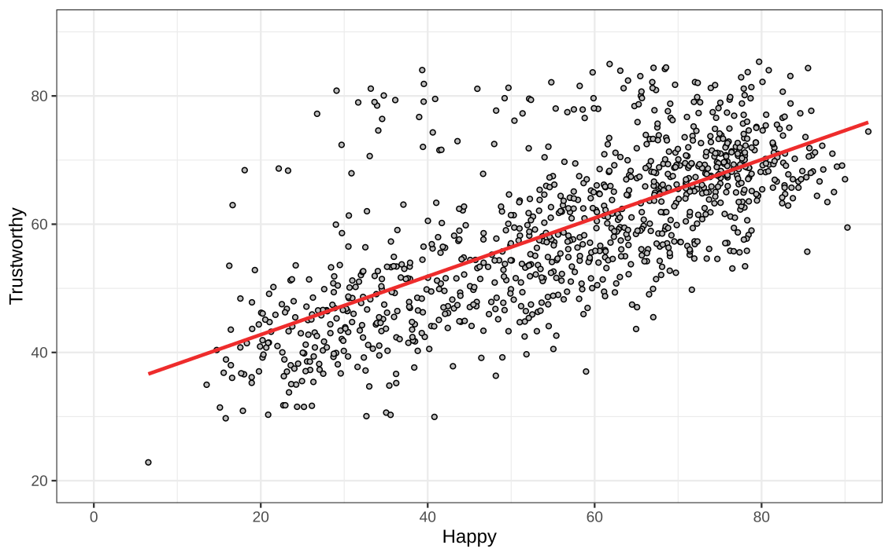{fig-align="center"}

## From the regression line to residuals

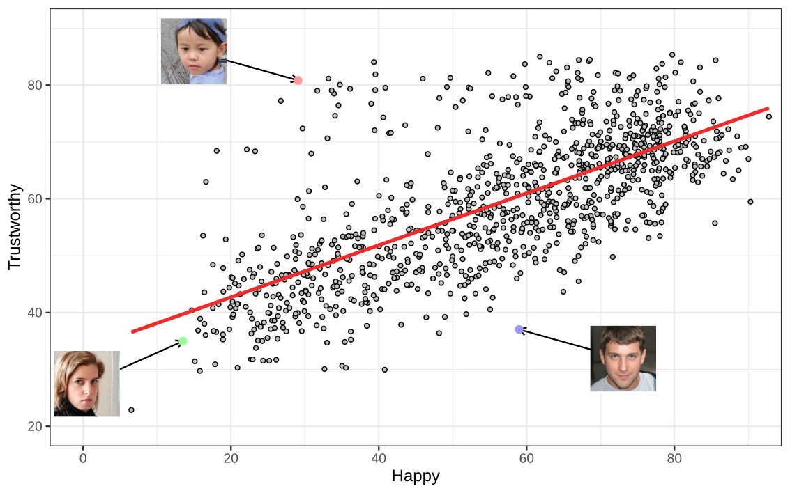{fig-align="center"}

## From the regression line to residuals

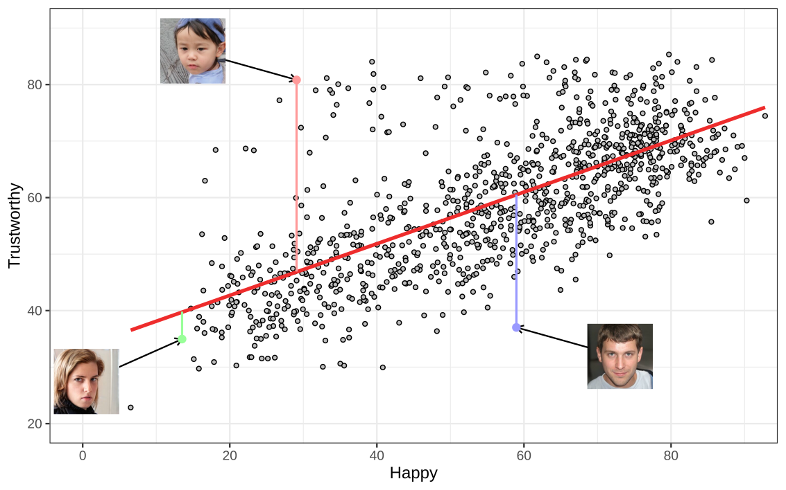{fig-align="center"}

## From the regression line to residuals

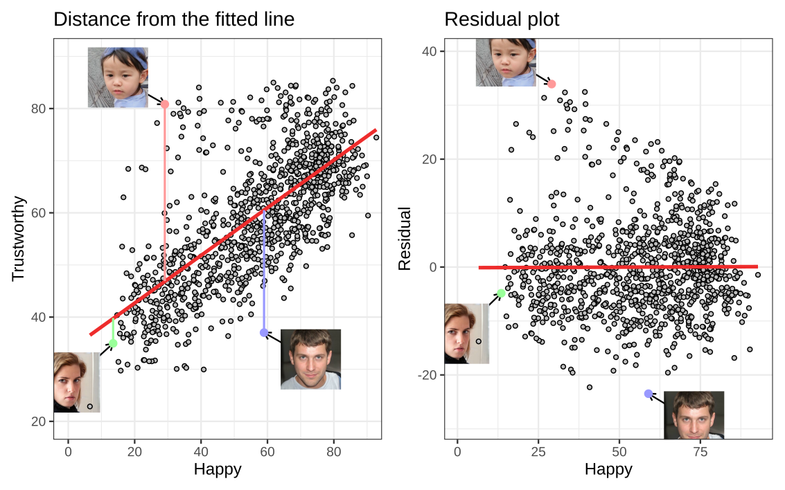{fig-align="center"}

## From the regression line to residuals

- Keep each face's happy rating on the horizontal axis.
- Replace its trustworthy rating with its residual.
- The colored points were the same observation in each panels.

## What are we looking for?

We can do (almost) all assumption checks using the residuals

- If there is a systematic pattern, this suggests that the regression line misses part of the relationship.

. . .

- That is a check for linearity!

## Checking linearity from the residuals

{fig-align="center"}

The dino is the nonlinear signal.

## Checking linearity from the residuals

{fig-align="center"}

## Checking linearity from the residuals

{fig-align="center"}

## Checking linearity from the residuals

{fig-align="center"}

## Faces: Cute vs. Trustworthy

{fig-align="center"}

## Faces: Electable vs. Trustworthy

{fig-align="center"}

<!-- TODO:

continue below
 -->

## Residuals and Linearity

- We can examine the residuals for any systematic pattern.
  + If we find one, this can suggests that the regression line misses part of the relationship.
    * the part that is nonlinear.

. . .

What about the other assumptions?

. . .

- Normality: Errors follow a normal distribution.
- Homoscedasticity: Errors have the same variance for all $x$.
- Independence: Errors are independent of each other.

. . .

We again examine the residuals!

# Normality

## Normality

$$
Y_i = \alpha + \beta x_i + \textcolor{blue}{\epsilon_i},
\qquad \textcolor{blue}{\epsilon_i \overset{\mathrm{iid}}{\sim} \mathcal{N}(0, \sigma_\epsilon^2)}
$$

Normality: Errors follow a normal distribution.

. . .

- The assumption concerns **errors around the population line**.
- The outcome variable $y$ does not need to be normally distributed.
- Only the prediction error is!

. . .

We'll look at some examples and develop a new tool to examine deviations from normality: QQ-plots

## Normality

{fig-align="center"}

At each value of the predictor $x_i$, mistakes are normally distributed.

## Normality

{fig-align="center"}

By examining the residuals, the trend disappears.

## Normality

{fig-align="center"}

Now we can look at the residuals as a whole.

## Normality

{fig-align="center"}

## Normality

{fig-align="center"}

<!--

W question:

The assumption of normality means:

A) y must be normally distributed
B) x must be normally distributed
C) the prediction error must be normally distributed
D) all of the above

 -->

## Residual histograms

The histogram of (the residuals of) Godly looks "more normal" than that of Happy.

- Godly: fairly symmetric and bell-shaped.
- Happy: a longer right tail.

. . .

While histograms are useful, but their appearance depends on the bins.

## Histograms depend on the bins

{fig-align="center"}

## From histograms to QQ plots

{fig-align="center"}

## From histograms to QQ plots

{fig-align="center"}

## From histograms to QQ plots

{fig-align="center"}

## From histograms to QQ plots

{fig-align="center"}

## From histograms to QQ plots

{fig-align="center"}

## How to read a normal Q-Q plot

<!-- A Q-Q plot compares _ordered residuals_ against a normal distribution. -->

<!-- For example: -->

- The sample residuals had mean 0 and standard deviation 8.86
- A normal distribution would expect 97.5% of observations to fall below a value $1.96 \times 8.86=17.37$
- In our sample, the top 97.5% of the residuals for happy fell were actually at 22.2
  * we look at equally spaced percentages that we vary from almost 0% to almost 100%

<!-- TODO: write the correct definition above -->

. . .

- Approximately normal: points lie on a straight line.
- Skewness or unusual tails: systematic departures from that line.
- Some deviation is expected in a sample.

## QQ-plots for the Faces

{fig-align="center"}

## Histograms and QQ-plots

{fig-align="center"}

## Faces: the predictor need not be normal

::: {.columns}

::: {.column}

Let's consider a the regression

$$
\widehat{\mathrm{trustworthy}} = a + b \times \mathrm{gender}
$$

- gender was scored on a scale from 0 to 100.
  + Like all other variables.

Gender clearly has two peaks and is absolutely not normal.

:::

::: {.column}

{fig-align="right"}

:::

:::

<!--
TODO: fragments
first shows plot
second shows conclusion
 -->

## Faces: the predictor need not be normal

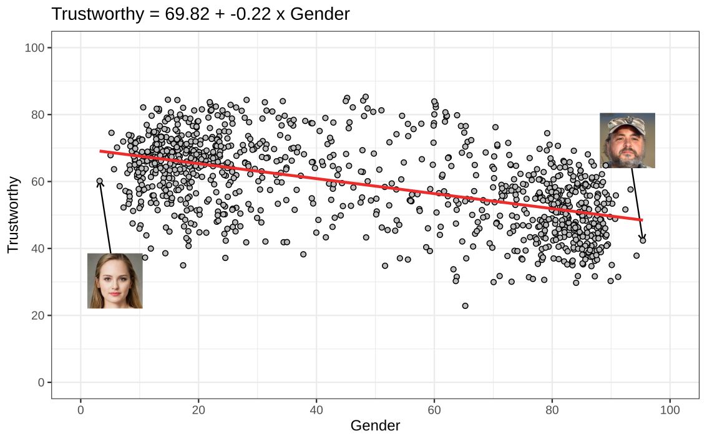{fig-align="center"}

## Faces: the predictor need not be normal

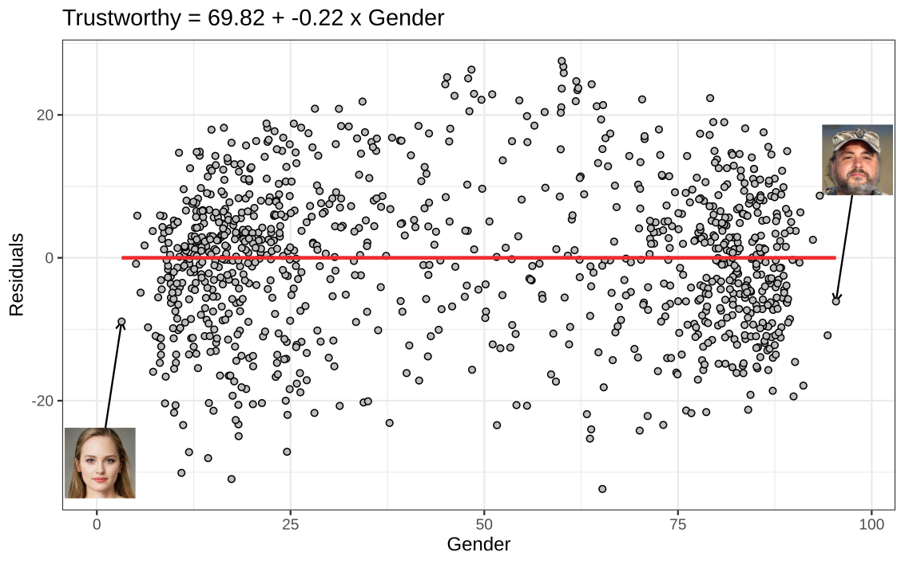{fig-align="center"}

## Faces: the predictor need not be normal

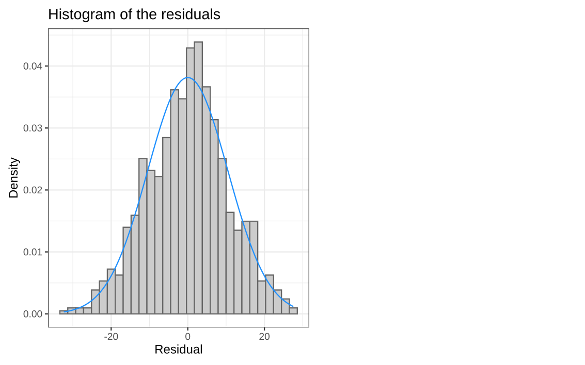{fig-align="center"}

## Faces: the predictor need not be normal

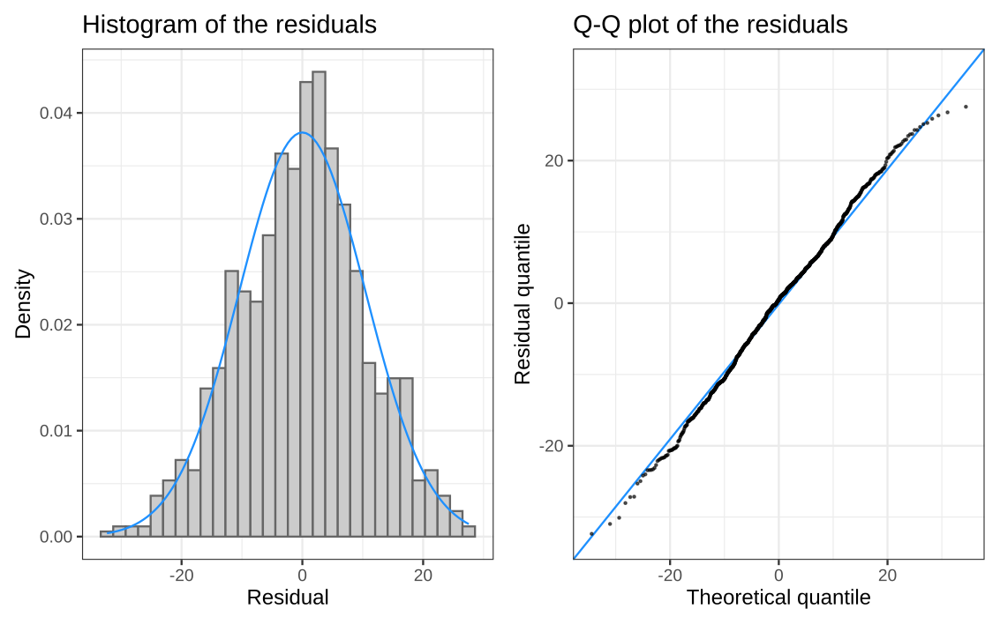{fig-align="center"}

# Constant Error Variance

## Homoscedasticity

The model uses **one error variance** for all predictor values.

At every $x_i$, we expect a similar spread of the residuals.

- Homoscedasticity: the same error variance across $x$.
- Heteroscedasticity: error variance changes across $x$.

The residuals can look normal overall, but still heteroscedastic.

## Typical and Smart - Regression

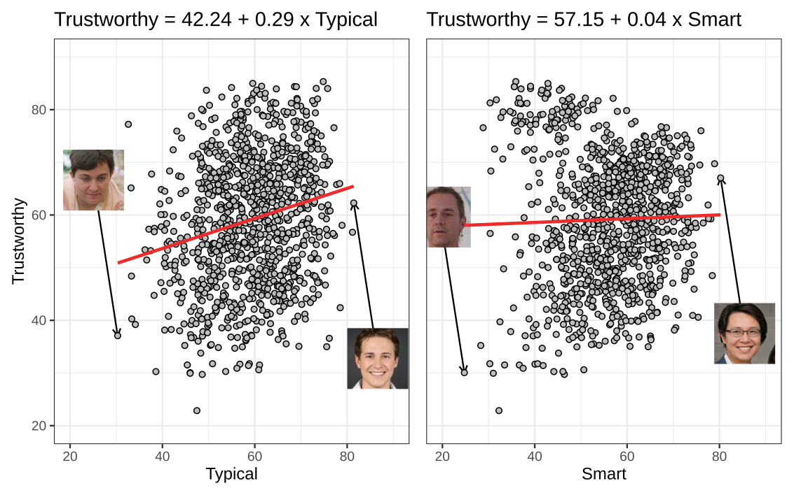{fig-align="center"}

## Typical and Smart - Residuals

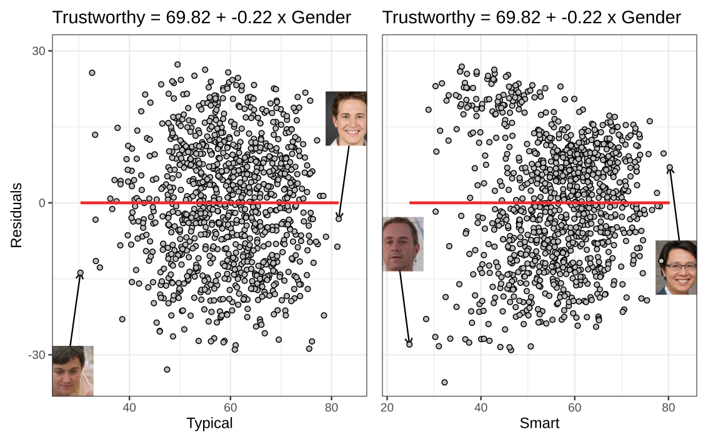{fig-align="center"}

## Typical and Smart - Normality

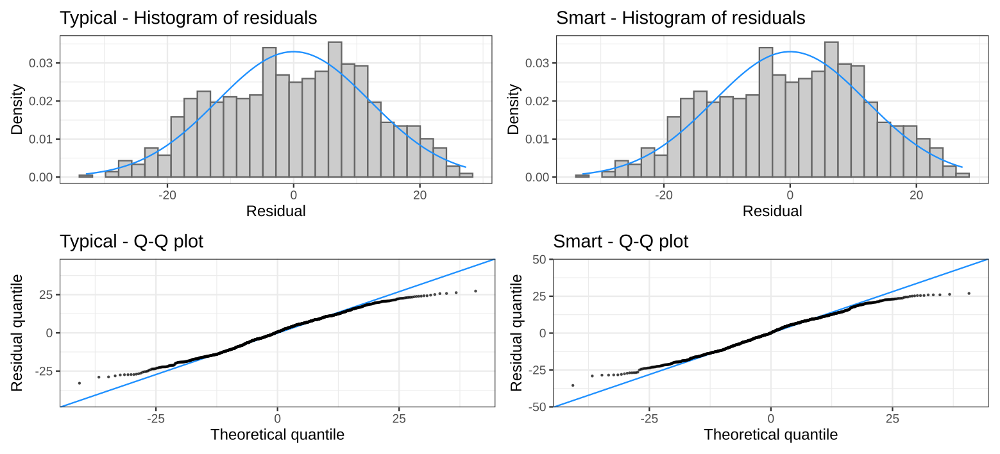{fig-align="center"}

<!-- TODO: first the regressions! -->
<!-- Then residuals -->
<!-- Then qq plots -->
<!-- Then residuals + variances -->

## Examine the residuals' spread

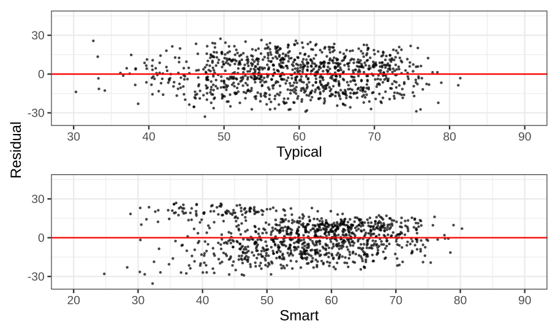{fig-align="center"}

## Examine the residuals' spread

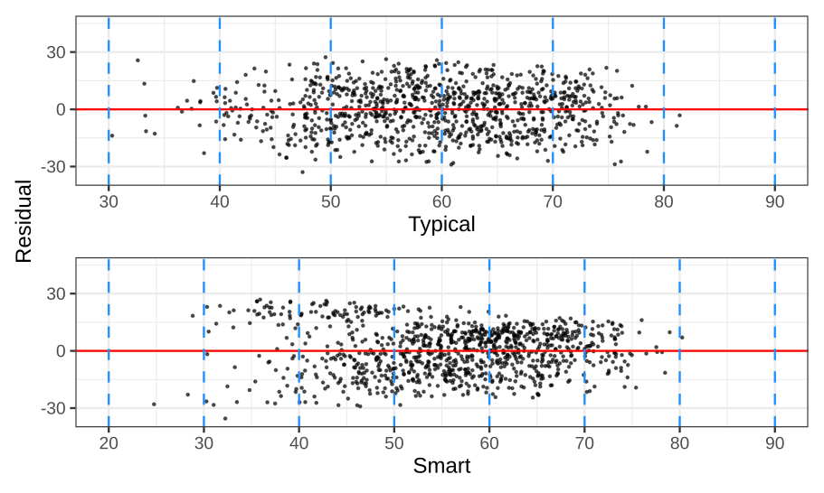{fig-align="center"}

## Examine the residuals' spread

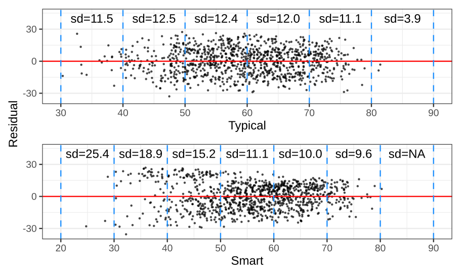{fig-align="center"}

## Examine the residuals' spread

- Typical: spread is relatively similar across much of the predictor range.
- Smart: residuals tend to be more spread out at lower ratings.

In general, the residuals can widen or narrow. Both suggest unequal error variance.

# Independence

## What does one row represent?

Independent observations contribute independent information.

Study | Potential dependence
--- | ---
One measurement from each independently sampled person | No dependence built into the design
Two measurements from each person | Measurements share a person
Students from the same classroom | Students share a classroom

. . .

- This is all about how the data were collected.
- We usually cannot assess this using statistics, but have to reason about the design

## Independence in the faces data

Each regression has one row per face, not one row per individual rating.

. . .

Questions to ask:

- Are the same or closely related face stimuli included more than once?
- Did participants rate multiple faces, potentially introducing shared rating tendencies?
- How were ratings combined into the face averages?

. . .

Averaging many ratings does not by itself establish independence between faces.

# Interpreting Assumption Checks

## Can we prove an assumption?

No.

Assumptions concern the population. We examine sample diagnostics.

. . .

- A plot can reveal important departures.
- A formal test can provide evidence against an assumption.
- Neither can prove that an assumption holds exactly.

## Shapiro-Wilk: testing normality

<!--
TODO: should we move this to normality?
 -->
$$
\begin{aligned}
\hypo_0 &: \text{the distribution is normal},\\
\hypo_1 &: \text{the distribution is not normal}.
\end{aligned}
$$

SPSS gives you a test-statistic $W$ and a $p$-value.

. . .

- Small $p$: evidence against normality.
- Large $p$: insufficient evidence against normality.
  * This does **not** establish that the distribution is normal.

. . .

::: {style="font-size: 80%;"}
You know by know:

- what a test statistic is
- what a p-value is
- and therefore how to interpret the Shapiro Wilk test.
:::

## Faces: Shapiro-Wilk results



Each row describes residuals from a separate regression predicting trustworthy ratings.

. . .

Compare these results with the histograms and Q-Q plots.

::: {.notes}
Values are generated from the local OMI data by diagnostic_figures.R.
Godly is the roughly normal comparison, not a model endorsed by all
diagnostics. The earlier residual plot shows why passing a normality
diagnostic alone is insufficient. The spread comparisons are also not
certified by their normality-test results.
:::

## Sample size changes what a test detects

- Small sample: an important departure can go undetected.
- Large sample: a minor departure can be statistically significant.

. . .

Often, the Q-Q plots can be more informative than the statistical tests.

In the faces data, with $N=1,004$, many shapiro wilk tests were significant.

But the Q-Q plots look fine.

## When Assumptions Are Doubtful

Ideal world: fit a different model that doesn't make the assumption

This course: report it properly.

## Next weeks

- Independent samples t-test (next week)
  * Here we do have a solution when homoscedasticity is violated
- ANOVA (both weeks after that)

