# Recap

<!--

TODO:

- derivation of a and b for OLS
- recap should now contain t-test and F-test
  - probably skip standardized regressions

- recap should probably use the same data example as last time

- show the happy and memorableness F-test results.
  - reiterate that statistically significant doesn't imply pratical relevance.

- gender: looks weird but actually no issues?
- age: nonnormal AND heteroscedastic?

 -->

::: {.hidden}
$$
\newcommand{\hypo}{\mathcal{H}}
\newcommand{\SE}{\mathrm{SE}}
\newcommand{\dnorm}[2]{\mathcal{N}\left(#1, #2\right)}
\newcommand{\res}{e}
\newcommand{\rep}{\epsilon}
\newcommand{\TSS}{\mathrm{TSS}}
\newcommand{\SSE}{\mathrm{SSE}}
\newcommand{\RSS}{\mathrm{RSS}}

\newcommand{\MSE}{\mathrm{MSE}}
\newcommand{\MSR}{\mathrm{MSR}}
$$
:::

## Trustworthiness vs. Happiness

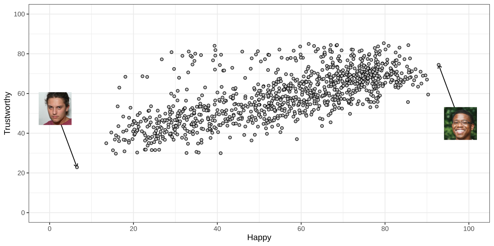{fig-align="center"}

## Trustworthiness vs. Happiness

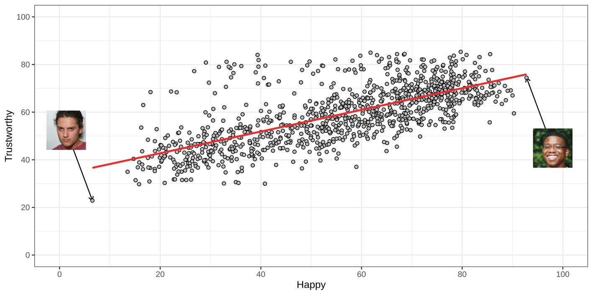{fig-align="center"}

## Trustworthiness vs. Happiness

{fig-align="center"}

## Trustworthiness vs. Happiness

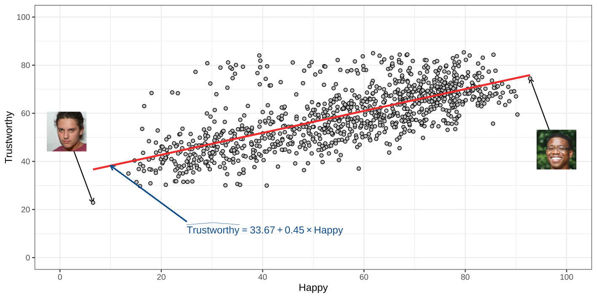{fig-align="center"}

## Testing Coefficients

$$
a\mid \hypo_0 \sim \dnorm{\alpha_{\hypo_0}}{\SE_a}\quad
$$

- Compute $t = \frac{a - \alpha_{\hypo_0}}{\SE_a}$ with $df = N - 2$
- Examine the $t$-table
  * use the appropriate tail of the distribution depending on the hypothesis test conducted.

. . .

For the slope everything worked out the same, but with $b$ instead of $a$.

## Testing Models

## Comparing two models

Before we compared individually $a$ and $b$ against 0 or specific values.

Now we'll examine a test to compare two models:

:::: {.r-stack}

::: {.fragment .fade-out fragment-index="2"}
$$
\begin{align}
\hypo_0:& \text{ the null model},       &&y_i = a \phantom{+ b\times x_i }\;\,+\res_i\\
\hypo_1:& \text{ the regression model}, &&y_i = a + b\times x_i +\res_i
\end{align}
$$
:::

::: {.fragment .fade-in fragment-index="2"}
$$
\begin{align}
\hypo_0:& \text{ the null model},       &&y_i = a + 0\times x_i +\res_i\\
\hypo_1:& \text{ the regression model}, &&y_i = a + b\times x_i +\res_i
\end{align}
$$
:::

::::

::: {.fragment fragment-index="1"}
1. $\hypo_0: \beta = 0$ vs $\hypo_1: \beta \neq 0$.
:::

::: {.fragment fragment-index="3"}
2. $\hypo_0: \rho^2 = 0$ vs $\hypo_1: \rho^2 > 0$.

Here, $\rho^2$ is the _population_ value for $R^2$
:::

## Comparing two models



## F-test

:::: {.r-stack}

::: {.fragment .fade-out fragment-index="1"}
$$
F = (N-2)\times\frac{R^2}{1-R^2}
\phantom{
  = (N-2)\times
  \frac{\text{Explained variance}}{\text{Unexplained variance}}
}
$$
:::

::: {.fragment .fade-in fragment-index="1"}
$$
F = (N-2)\times\frac{R^2}{1-R^2}
  = (N-2)\times
  \frac{\text{Explained variance}}{\text{Unexplained variance}}
$$
:::

::::

::: {.fragment fragment-index="2"}

If $\hypo_0$ is true, the $F$-value is $F$-distributed:

$$
F \sim F(1, N - 2)
$$

:::

## F-distribution

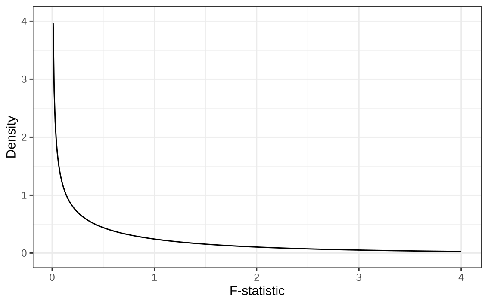{fig-align="center"}

## F-distribution

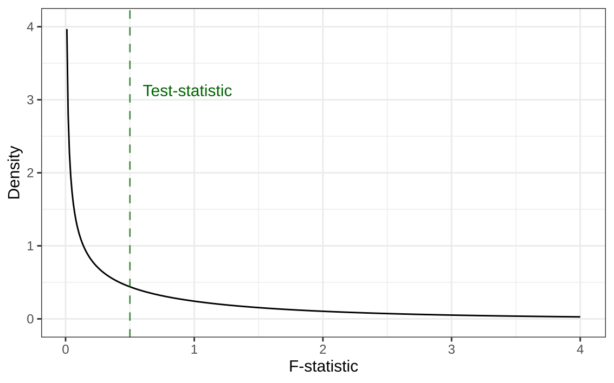{fig-align="center"}

## F-distribution

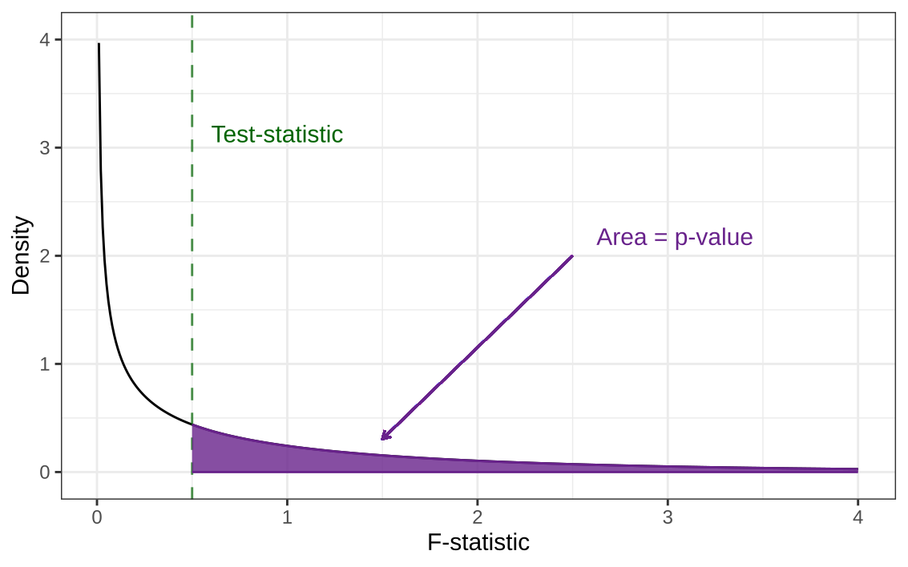{fig-align="center"}

## F-test: happy predicting trustworthy

::: {.columns}

::: {.column width = "55%"}

$N= 1,004$, $R^2 = 0.49$.

. . .

$$
\hypo_0: \rho^2 = 0,
\qquad \hypo_1: \rho^2 > 0
$$

. . .

$$
F = (N - 2)\times\frac{R^2}{1 - R^2}
= 955.86
$$

. . .

$F(1, 1002) = 955.86$, $p < .001$.

. . .

We reject $\hypo_0$. Happy ratings explain about 49% of the sample variation in trustworthiness.

:::

::: {.column width = "45%"}

{ fig-align="right"}

:::

:::

## F-test: memorable predicting trustworthy

::: {.columns}

::: {.column width = "55%"}

$N= 1,004$, $R^2 = 0.01$.

. . .

$$
\hypo_0: \rho^2 = 0,
\qquad \hypo_1: \rho^2 > 0
$$

. . .

$$
F = (N - 2)\times\frac{R^2}{1 - R^2}
= 9.50
$$

. . .

$F(1, 1002) = 9.50$, $p < .01$.

. . .

Statistically significant, but practically of limited value: Memorableness ratings explain only 1% of the sample variation in trustworthiness.

:::

::: {.column width = "45%"}

{ fig-align="right"}

:::

:::

## Recap

1. The Ordinary Least Squares finds $a$ and $b$ that minimize the SSE.
2. But SSE on it's own doesn't tell us how good the predictions are.
3. Explained variance tells us how much of the variance is explained by the regression line.
4. The tests for $a$, $b$, and the $F$-test provide statistical tests for this.

<!-- TODO: rewrite point 4 above -->

. . .

Today:

- Linear regression, and these significance tests make assumptions.
- What are these assumptions?
- How do check if they are violated?

# Assumptions

## Assumptions

- Almost all models make assumptions. Assume that...
  * the data are normally distributed
  * the central limit theorem applies
  * XXX

- If assumptions are violated things can go wrong:
  * The model could misrepresents the data
  * Tests are misleading
    + The type-I error is inflated
  * Inferences may not be justified

. . .

- To complicate things, sometimes assumptions are violated, but the consequences are minor.

## Assumptions

- Strictly speaking, the model misrepresents the data

. . .

- Practically, it doesn't matter:
  * Violations can be too minor to impact conclusions

. . .

- We will see:
  * Which assumptions does linear regression make?
  * How do we test these?

## Trustworthy Faces (continued)

Recall The One Million Impressions (OMI) dataset, which contains over a million human judgments of over 1,000 synthetic face images along 34 attributes.

. . .

Participants judged faces on a scale from 0 to 100 on attributes such as

::: {.columns}

::: {.column width = "33%"}

- trustworthy
- attractive

:::

::: {.column width = "33%"}

- smart
- memorable

:::

::: {.column width = "33%"}

- dominant
- well-groomed

:::

:::

. . .

Each observation is the average rating across many participants.

. . .

- We can do 33 regressions
- Each may or may not violate the assumptions.

::: footer

Peterson, J. C., Uddenberg, S., Griffiths, T. L., Todorov, A., & Suchow, J. W. (2022). Deep models of superficial face judgments. Proceedings of the National Academy of Sciences (PNAS), 119(17), e2115228119. doi:10.1073/pnas.2115228119

source: <https://github.com/jcpeterson/omi/>

:::

## Linear Regression Assumptions

::: {.fragment .fade-in fragment-index="1"}

- The relation between $x$ and $y$ is linear
  * a straight line

:::

:::: {.r-stack}

::: {.fragment .fade-in-then-out fragment-index="2"}
$$
Y_i = \alpha + \beta x_i + \epsilon_i,
\qquad \epsilon_i \overset{\mathrm{iid}}{\sim} \mathcal{N}(0, \sigma_\epsilon^2)
$$
:::

::: {.fragment .fade-in fragment-index="3"}
$$
Y_i = \alpha + \beta x_i + \epsilon_i,
\qquad \textcolor{blue}{\epsilon_i \overset{\mathrm{iid}}{\sim} \mathcal{N}(0, \sigma_\epsilon^2)}
$$
:::

::::

. . .

- Normally distributed errors
- Homescedastic errors
- Independent errors

## Linear Regression Assumptions

:::: {.r-stack}

::: {.fragment .fade-out fragment-index="1"}
$$
Y_i = \alpha + \beta x_i + \epsilon_i,
\qquad \epsilon_i \overset{\mathrm{iid}}{\sim} \mathcal{N}(0, \sigma_\epsilon^2)
$$
:::

::: {.fragment .fade-in-then-out fragment-index="1"}
$$
Y_i = \textcolor{blue}{\alpha + \beta x_i} + \epsilon_i,
\qquad \epsilon_i \overset{\mathrm{iid}}{\sim} \mathcal{N}(0, \sigma_\epsilon^2)
$$
:::

::: {.fragment .fade-in fragment-index="2"}
$$
Y_i = \alpha + \beta x_i + \epsilon_i,
\qquad \textcolor{blue}{\epsilon_i \overset{\mathrm{iid}}{\sim} \mathcal{N}(0, \sigma_\epsilon^2)}
$$
:::

::::

::: {.fragment fragment-index="1"}

1. Linearity

- The association between $x$ and $y$ is a straight line.

:::

::: {.fragment fragment-index="2"}

2. Assumptions about the errors

- Normality: Errors follow a normal distribution.
- Homoscedasticity: Errors have the same variance for all $x$.
- Independence: Errors are independent of each other.

:::

## Linearity

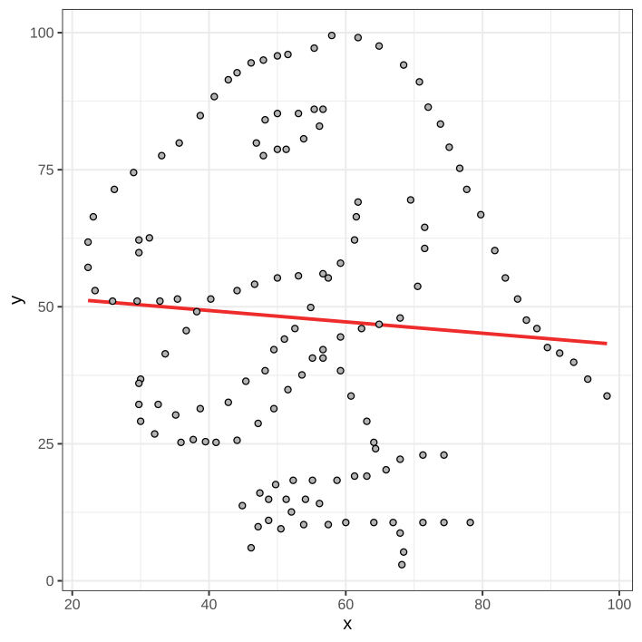{fig-align="center"}

## Linearity

but what causes deviations from normality?

. . .

- Too much of a good thing/ U-shaped
  * Dopamine vs working memory performance
- Diminishing returns/ plateau
  * Study time vs. exam performance
- Threshold effect
  * Swimming lessons vs. distance swum

## Linearity

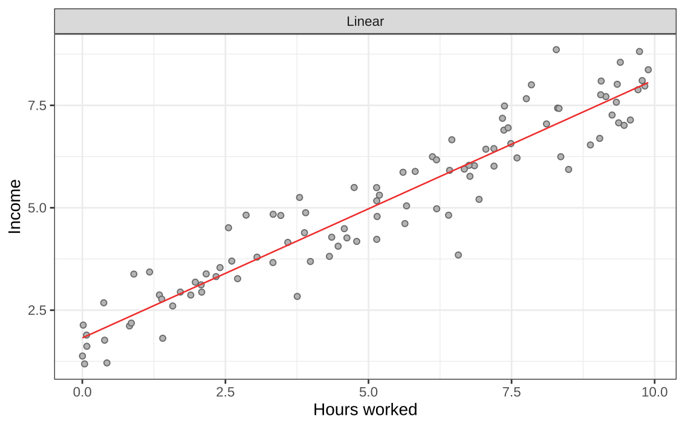{fig-align="center"}

## U-shaped

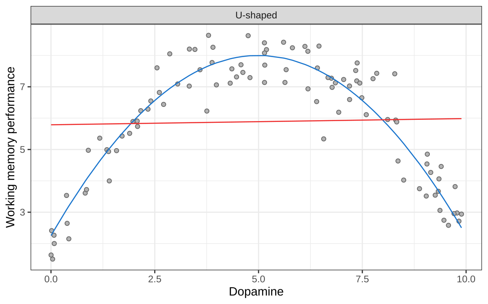{fig-align="center"}

## Diminishing returns/ plateau

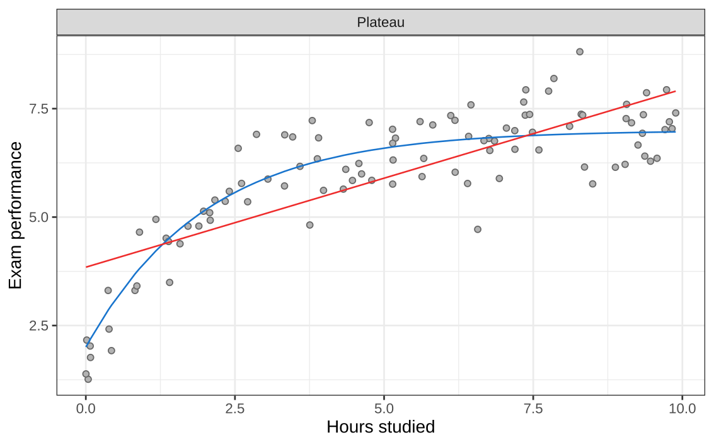{fig-align="center"}

## Threshold effect

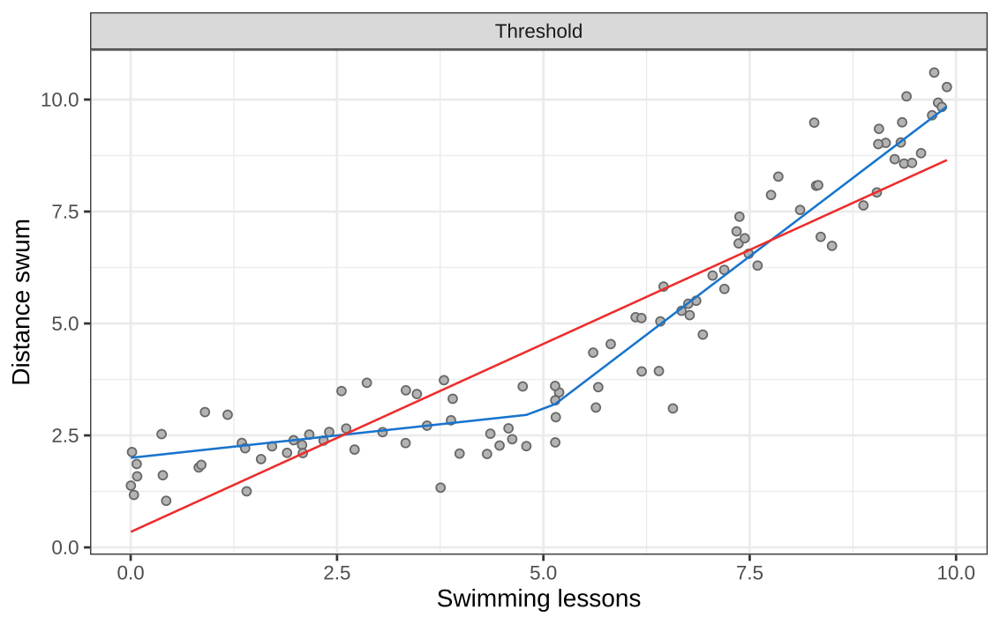{fig-align="center"}

## Faces

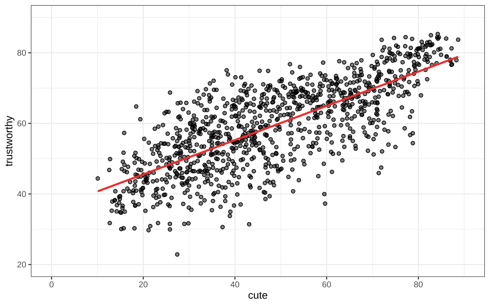{fig-align="center"}

## Faces

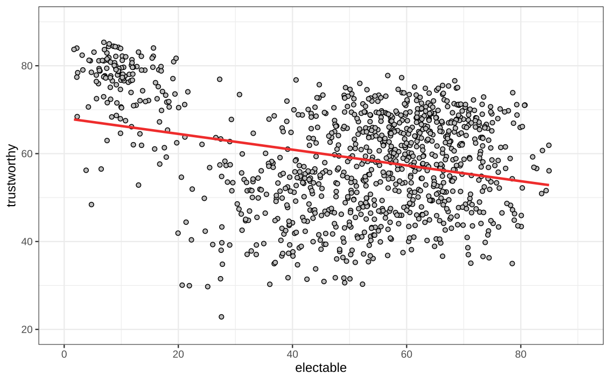{fig-align="center"}

## Faces

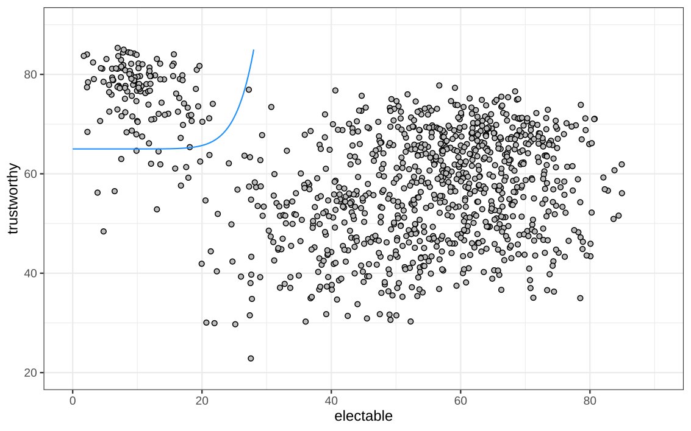{fig-align="center"}

## Faces

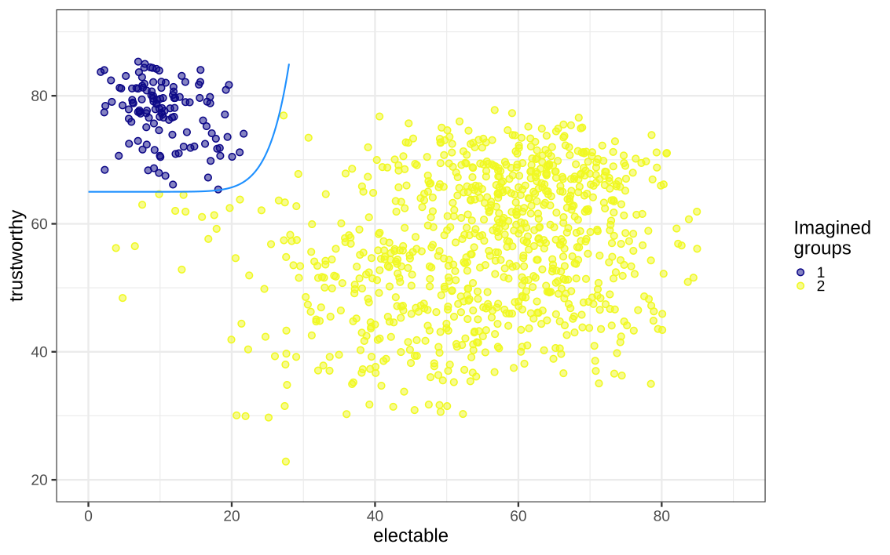{fig-align="center"}

## Faces

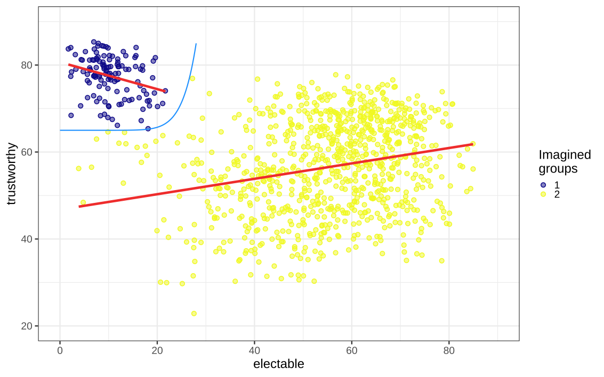{fig-align="center"}

# Testing Assumptions

