# Recap

<!--

Recap:

let's do the recap with the gender example, which wasn't binary before.

then we can wonder, what if the predictor was binary?

what happens?

can we still test these slope and intercept?
what do these even mean?
do the assumptions change?

When do we have binary predictors?

- treatment and control (use both disease and teaching method as examples)
- A/ B testing in websites
- ???

- Measurement level is nominal or ordinal
  - at most two observed categories
  - say (but not write), when we have three categories, we examine ANOVA

- here introduce the anorexia data

How do we do regression with binary predictors?
- Dummy coding:
- can't multiply treatment by 3

- (near end of the lecture, or the motivation for the week after?)
- actually, there are three treatment groups
- individual comparisons leads to a multiple testing problems
- so we need another approach (ANOVA)

 -->

::: {.hidden}
$$
\newcommand{\hypo}{\mathcal{H}}
\newcommand{\SE}{\mathrm{SE}}
\newcommand{\dnorm}[2]{\mathcal{N}\left(#1, #2\right)}
\newcommand{\res}{e}
\newcommand{\rep}{\epsilon}
\newcommand{\TSS}{\mathrm{TSS}}
\newcommand{\SSE}{\mathrm{SSE}}
\newcommand{\RSS}{\mathrm{RSS}}

\newcommand{\MSE}{\mathrm{MSE}}
\newcommand{\MSR}{\mathrm{MSR}}
$$
:::

## Trustworthy Faces

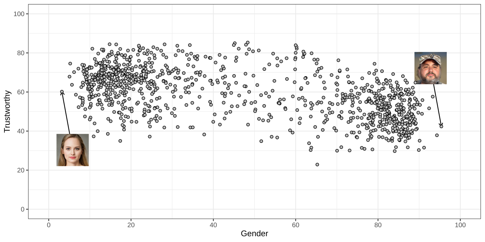{fig-align="center"}

## Trustworthy Faces

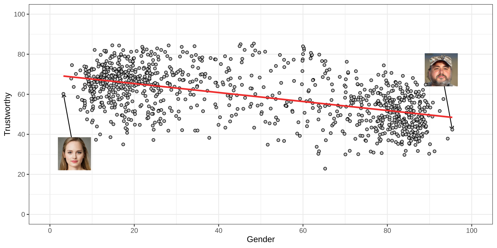{fig-align="center"}

## Trustworthy Faces

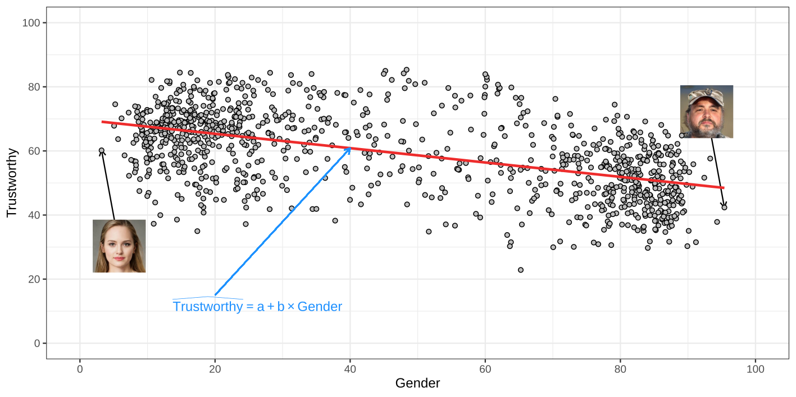{fig-align="center"}

## Trustworthy Faces

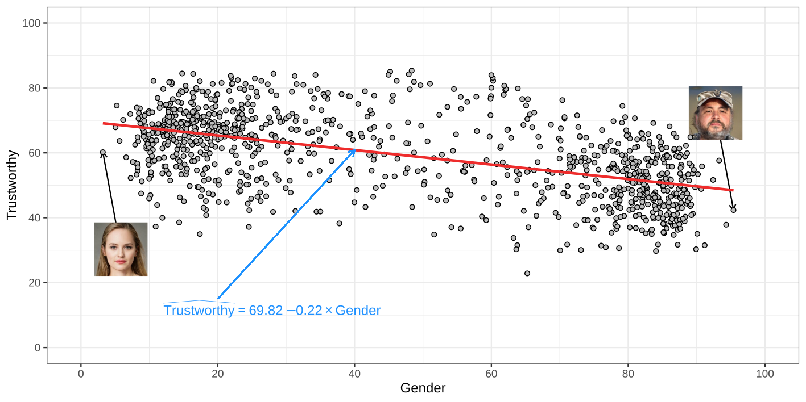{fig-align="center"}

## Residual plot

{fig-align="center"}

## Assumption checks

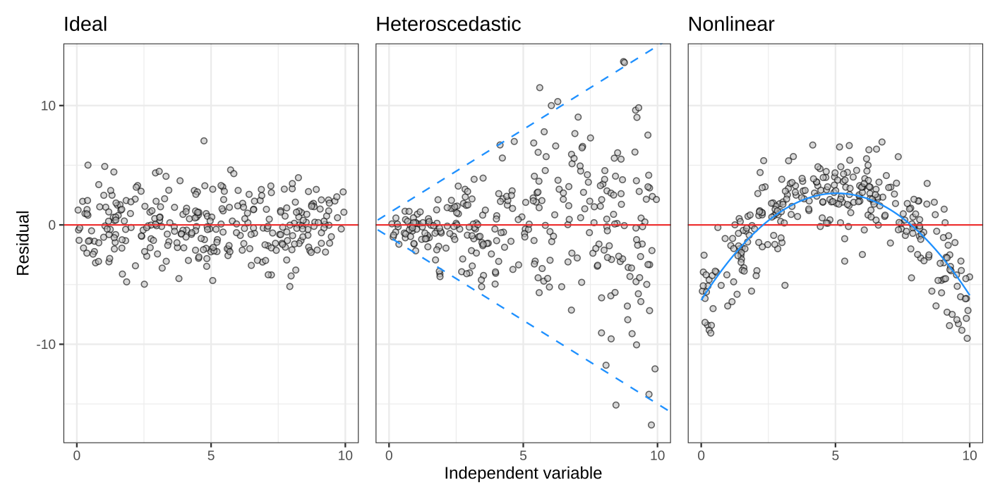{fig-align="center"}

## Q-Q plots

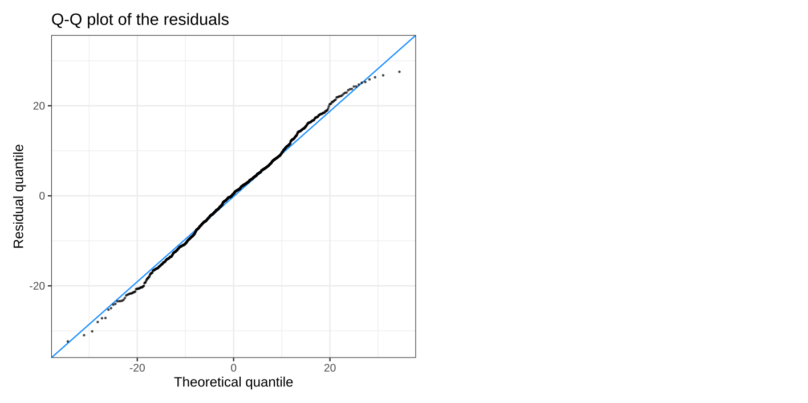{fig-align="center"}

## Q-Q plots

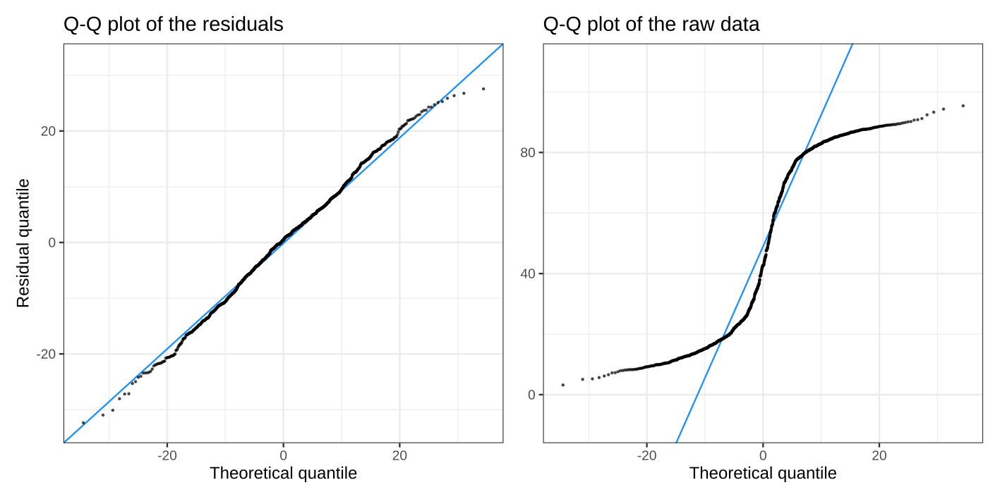{fig-align="center"}

## Q-Q plots

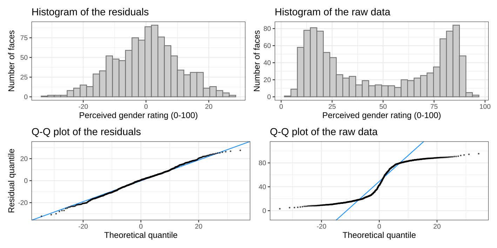{fig-align="center"}

## Recap

::: {style="font-size: 90%;"}
So far we've learned...

1. How to find $a$ and $b$ that minimize the SSE.
2. How much variance is explained by the regression line ($R^2$).
3. How to test $a$ and $b$ using $t$-tests and compare models using the $F$-test.
5. How to check the assumptions by examining the residuals.

... when the predictor is _continuous_

:::

. . .

What if the predictor is binary?

   - What changes and what stays the same?
   - We'll focus on $a$ and $b$, $R^2$, testing, and the assumptions

## Binary predictors are common!

- Nominal (no natural order):
  * Biological sex (male/female)
  * Student status (Dutch/international)
  * Device type (mobile/desktop)

- Ordinal (natural order):
  * Performance on exam question (Fail/Pass)
  * Risk of disease (Low/High)
  * Customer satisfaction (Dissatisfied/Satisfied)

# Binary predictors

## Binary predictors are common!

- Treatment:
  * Medicine X vs. medicine Y: which treats patients better?
  * Teaching method X vs. Y: which helps students learn better?
  * Website design A vs. B: which leads to longer visits?

. . .

- Many online platforms use A/B testing:
  * Instagram: Test different algorithms for recommending content (maximizing doomscrolling)
  * ChatGPT: Compare model versions using user feedback and usage patterns
  * YouTube: Test titles and thumbnails to increase watch time

## Data Example
<!--
introduce anorexia data
 -->
Murrar & Brauer wondered, does entertainment-education reduce people's prejudice?

. . .

That's a very broad statement, let's look at the design an operationalization.

::: footer
Murrar, Sohad, and Markus Brauer. “Entertainment-Education Effectively Reduces Prejudice.” Group Processes &amp; Intergroup Relations, vol. 21, no. 7, 2017, pp. 1053–1077., <https://doi.org/10.1177/1368430216682350>.
:::

## Data Example

::: {style="font-size: 85%;"}
Participants ($N = 173$) made an Implicit Association Test, then watched 6 episodes of
:::

::: {.columns}

::: {.column width="50%" style="text-align: center;"}

{fig-align="center" width="45%"}

:::

::: {.column width="50%" style="text-align: center;"}

{fig-align="center" width="45%"}

:::

:::

::: {style="font-size: 85%;"}
then they made another Implicit Association Test.
:::

<!--
TODO: prepare a short but okay explanation of the IAT.
 -->

::: footer
Murrar, Sohad, and Markus Brauer. “Entertainment-Education Effectively Reduces Prejudice.” Group Processes &amp; Intergroup Relations, vol. 21, no. 7, 2017, pp. 1053–1077., <https://doi.org/10.1177/1368430216682350>.
:::

## Operationalization

So,

- "Entertainment-education" operationalized as watch a sitcom with a diverse or all-white cast.
- "Prejudice": the score on an IAT.

. . .

What the authors (and we) look at is:

- The _change_ in IAT score, $\mathrm{Prejudice} = \mathrm{IAT}_{\mathrm{post}} - \mathrm{IAT}_{\mathrm{pre}}$
- How Prejudice changes, if at all, between the two groups.

## Dummy Coding

If we put this into a regression we get:

$$
\widehat{\mathrm{Prejudice}} = a + b\times \mathrm{``Diverse''}
$$

. . .

but we can't multiply words with numbers.

We need to assign numbers to them.

This is called dummy coding

## Dummy Coding



::: {.fragment fragment-index="3" .fade-in}

So "diverse" is coded as 1 and "all-white" as 0.

:::

## Dummy Coding

Now can we do linear regression with the dummy coded variable!

But what does it mean?

## Let's look at the data

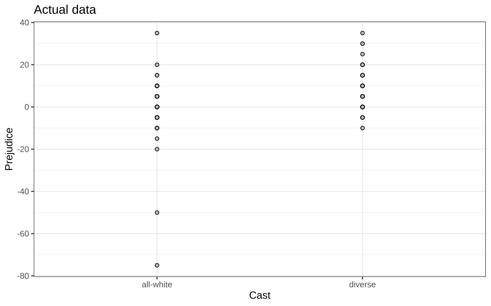{fig-align="center"}

## Let's look at the data

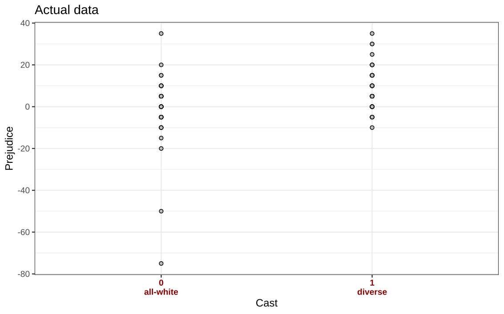{fig-align="center"}

## Let's look at the data

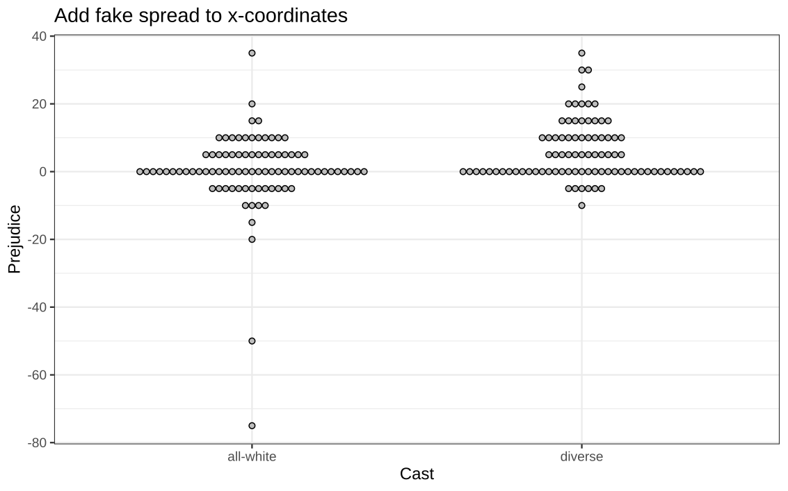{fig-align="center"}

## Let's look at the data

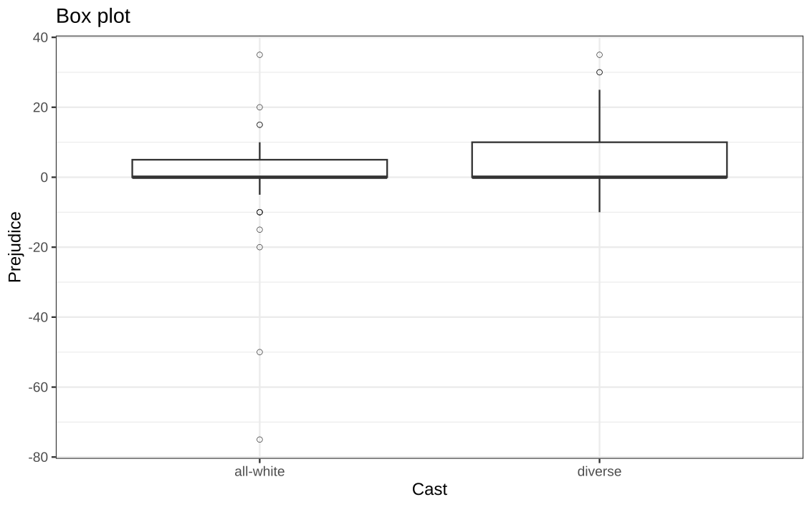{fig-align="center"}

## What was a boxplot again?

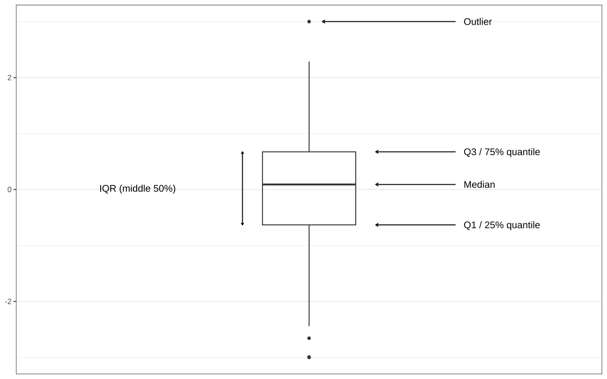{fig-align="center"}

## Let's look at the data

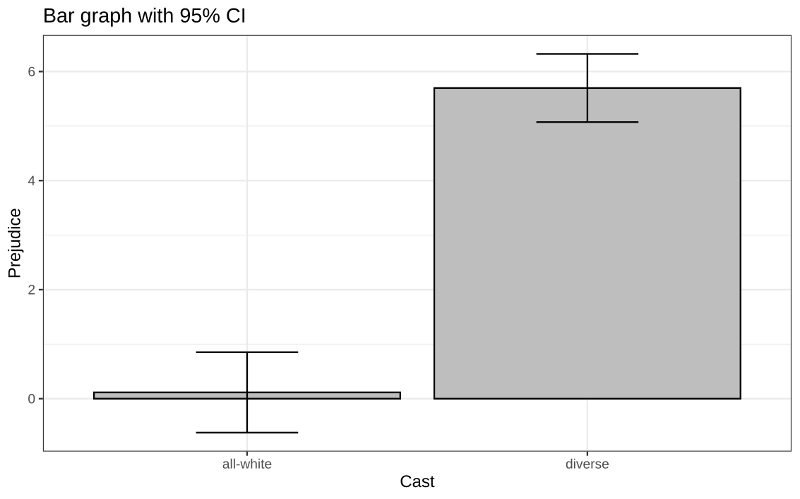{fig-align="center"}

## Let's look at the data

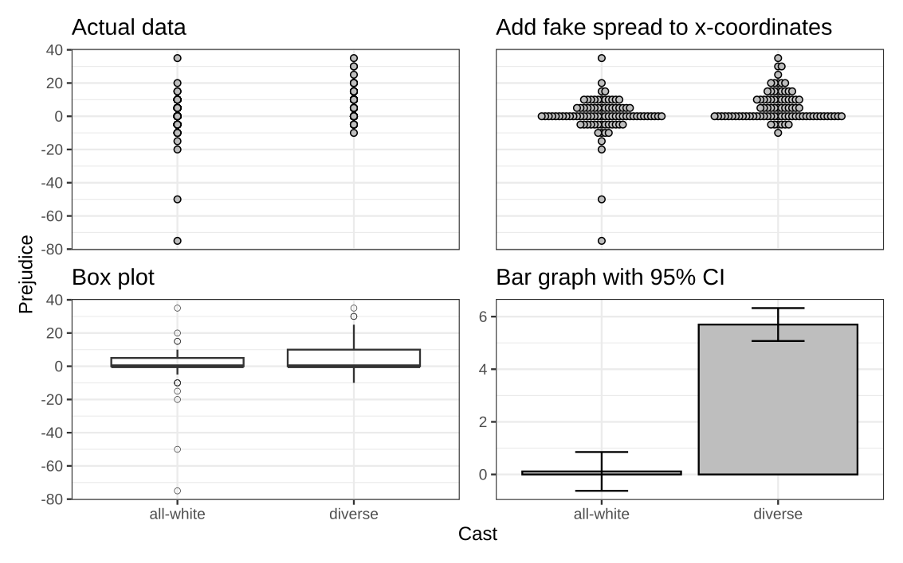{fig-align="center"}

## Let's look at the data

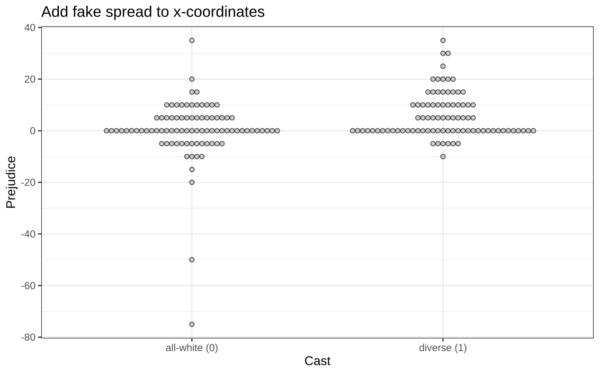{fig-align="center"}

## Let's look at the data

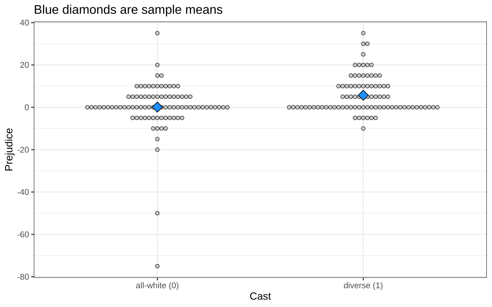{fig-align="center"}

## Let's look at the data

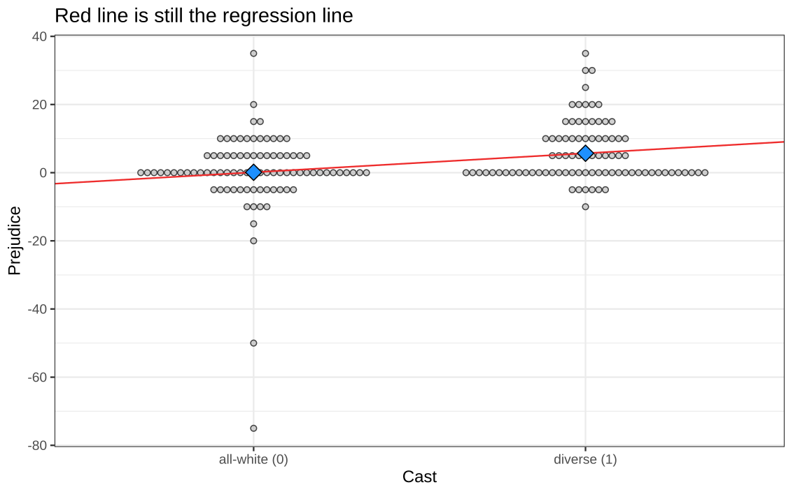{fig-align="center"}

## Meaning of $a$ and $b$
<!--
TODO: we can do some magic with equations here!
That change as we uncover the sentences!
 -->
When the predictor is continuous:

- the intercept $a$ is the predicted value for $x = 0$.
- the slope is the change in predicted value when $x$ increases by 1.

. . .

When the predictor is binary:

- the intercept $a$ is the predicted value for the group coded 0 ("all-white").
  * This is called the "Reference category"
- the intercept + slope is the predicted value for the group coded 1 ("diverse")

## Meaning of $a$ and $b$

Let's work this out!

$$
\widehat{\mathrm{Prejudice}} = a + b\times \mathrm{``Cast''}
$$

. . .

For "all-white", we use 0, so we get:

$$
\widehat{\mathrm{Prejudice}} = a + b\times 0 = a
$$

. . .

For "diverse", we use 1, so we get:

$$
\widehat{\mathrm{Prejudice}} = a + b\times 1 = a + b
$$

. . .

## Meaning of $a$ and $b$

Note that we predict only two values.

- $a=$ the mean Prejudice of "all-white"
- $a+b=$ the mean Prejudice of "diverse"

# Testing

## So what do tests for $a$ and $b$ mean?

When the predictor is continuous:

- If the intercept $a$ is nonzero, well, that depends on the application.
- If the slope $b$ is nonzero, there is an association between $x$ and $y$.

. . .

When the predictor is binary:

- If the intercept $a$ is nonzero, the mean in the reference category is significantly different from zero
- If the slope $b$ is nonzero, the mean of the nonreference category is significantly different from the reference category.

. . .

The test for $b$ is very meaningful! It is a test of whether there is a difference between the population means of two groups!

<!--
For continuous data...

When it's binary, "a one stpe increase in x" has little meaning.

 -->

