# Recap

::: {.hidden}
$$
\newcommand{\hypo}{\mathcal{H}}
\newcommand{\SE}{\mathrm{SE}}
\newcommand{\dnorm}[2]{\mathcal{N}\left(#1, #2\right)}
\newcommand{\res}{e}
\newcommand{\rep}{\epsilon}
\newcommand{\TSS}{\mathrm{TSS}}
\newcommand{\SSE}{\mathrm{SSE}}
\newcommand{\RSS}{\mathrm{RSS}}

\newcommand{\MSE}{\mathrm{MSE}}
\newcommand{\MSR}{\mathrm{MSR}}
$$
:::

## Trustworthy Faces

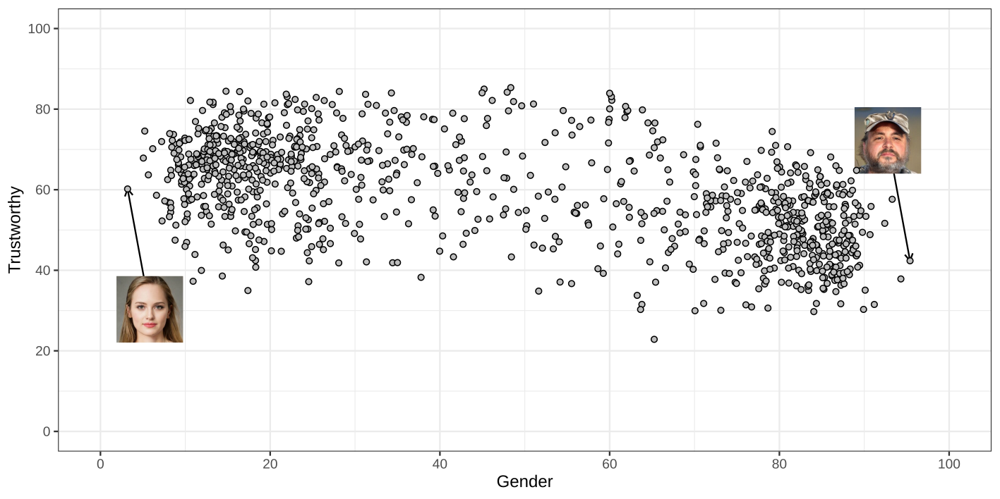{fig-align="center"}

## Trustworthy Faces

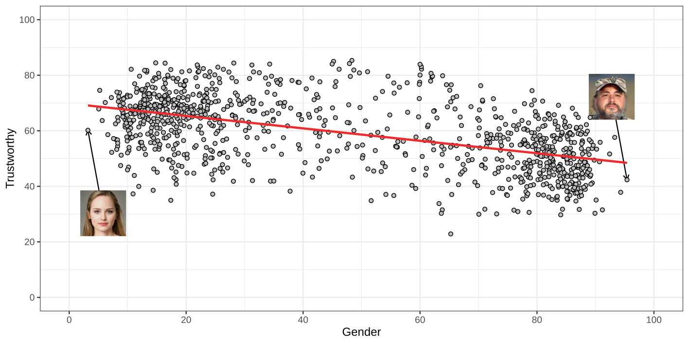{fig-align="center"}

## Trustworthy Faces

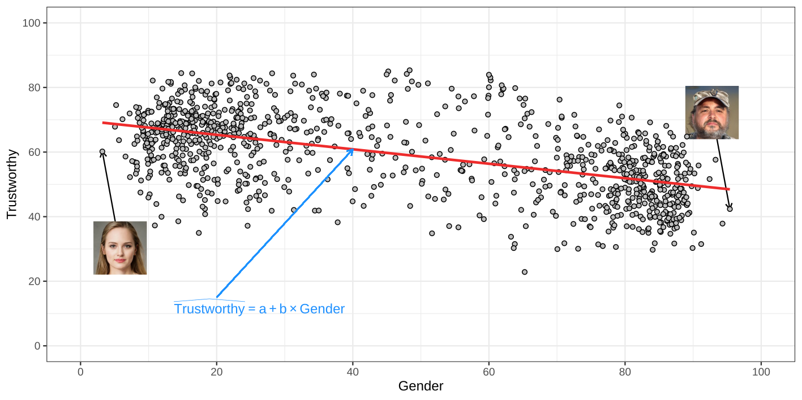{fig-align="center"}

## Trustworthy Faces

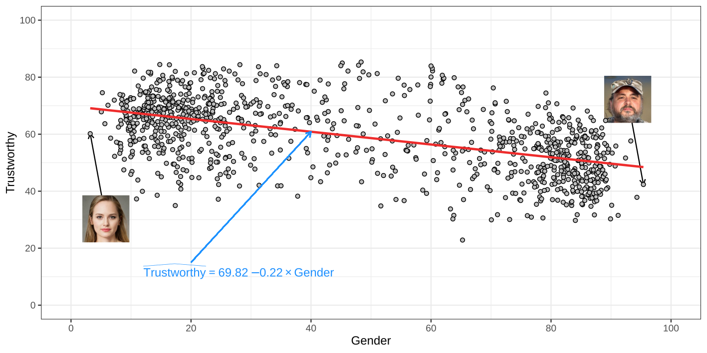{fig-align="center"}

## Residual plot

{fig-align="center"}

## Assumption checks

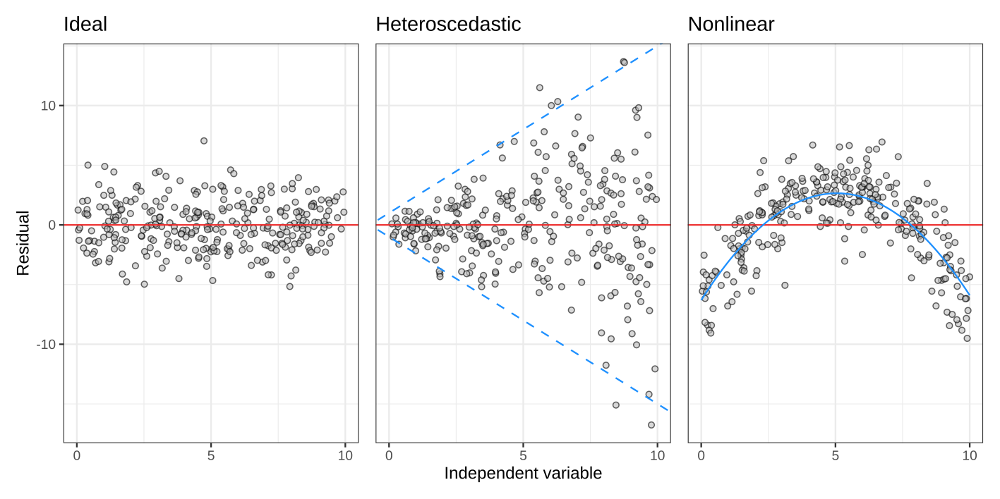{fig-align="center"}

## Q-Q plots

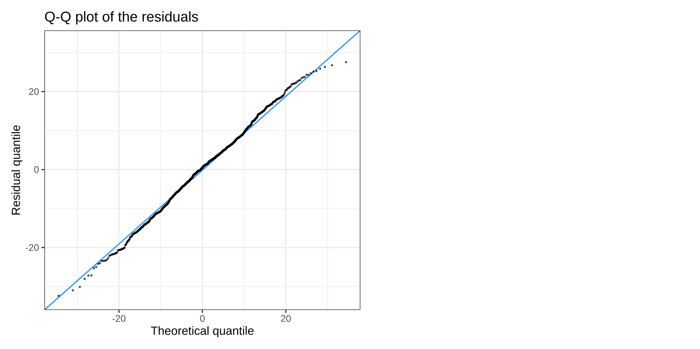{fig-align="center"}

## Q-Q plots

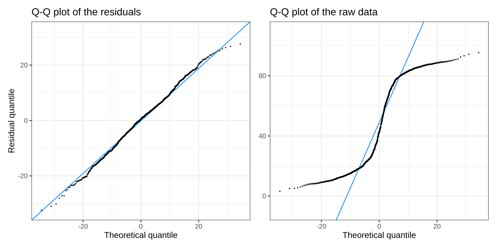{fig-align="center"}

## Q-Q plots

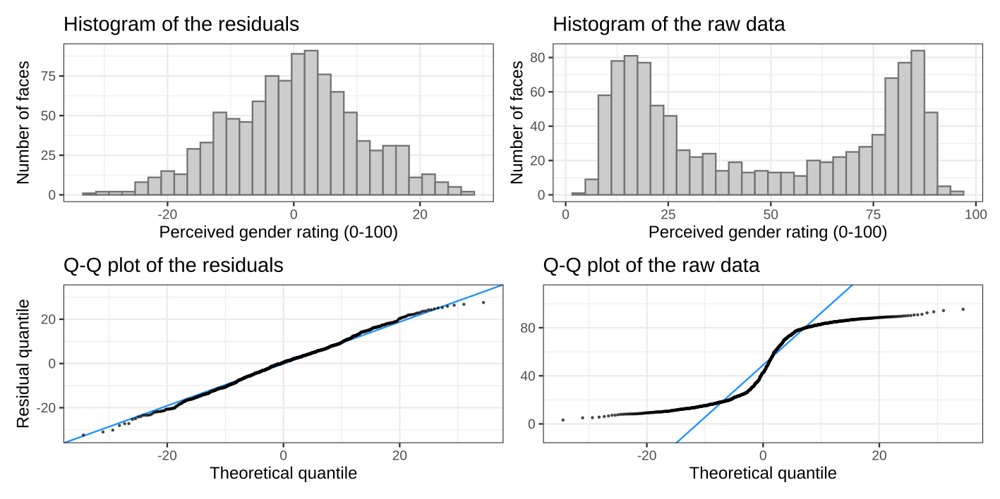{fig-align="center"}

## Recap

::: {style="font-size: 90%;"}
So far we've learned...

1. How to find $a$ and $b$ that minimize the SSE.
2. How much variance is explained by the regression line ($R^2$).
3. How to test $a$ and $b$ using $t$-tests and compare models using the $F$-test.
4. How to check the assumptions by examining the residuals.

... when the predictor is _continuous_

:::

. . .

What if the predictor is binary?

   - What changes and what stays the same?
   - We'll focus on $a$ and $b$, $R^2$, testing, and the assumptions

# Binary predictors

## Binary predictors are common!

- Nominal (no natural order):
  * Biological sex (male/female)
  * Student status (Dutch/international)
  * Device type (mobile/desktop)

- Ordinal (natural order):
  * Performance on an exam question (Fail/Pass)
  * Risk of disease (Low/High)
  * Customer satisfaction (Dissatisfied/Satisfied)

## Binary predictors are common!

- Treatment:
  * Medicine X vs. medicine Y: which treats patients better?
  * Teaching method X vs. Y: which helps students learn better?
  * Website design A vs. B: which leads to longer visits?

. . .

- Many online platforms use A/B testing:
  * Instagram: Test different algorithms for recommending content (maximizing doomscrolling)
  * ChatGPT: Compare model versions using user feedback and usage patterns
  * YouTube: Test titles and thumbnails to increase watch time

## Data Example
<!--
introduce anorexia data
 -->
Murrar & Brauer wondered, does entertainment-education reduce people's prejudice?

. . .

That's a very broad statement, let's look at the design an operationalization.

::: footer
Murrar, Sohad, and Markus Brauer. “Entertainment-Education Effectively Reduces Prejudice.” Group Processes &amp; Intergroup Relations, vol. 21, no. 7, 2017, pp. 1053–1077., <https://doi.org/10.1177/1368430216682350>.
:::

## Data Example

::: {style="font-size: 85%;"}
Participants' attitude towards Arabs was measured, then watched 6 episodes of
:::

::: {.columns}

::: {.column width="50%" style="text-align: center;"}

{fig-align="center" width="45%"}

:::

::: {.column width="50%" style="text-align: center;"}

{fig-align="center" width="45%"}

:::

:::

::: {style="font-size: 85%;"}
Afterward, their attitudes toward Arabs were measured again.
:::

::: footer
Murrar, Sohad, and Markus Brauer. “Entertainment-Education Effectively Reduces Prejudice.” Group Processes &amp; Intergroup Relations, vol. 21, no. 7, 2017, pp. 1053–1077., <https://doi.org/10.1177/1368430216682350>.
:::

## How do we measure prejudice?

The researchers measured participants' attitudes toward Arabs.

- Participants rated how warmly they felt toward Arabs.
- They also rated how much they liked Arabs.
- Both were measured on scales from 0 to 100.

. . .

These ratings were combined into one attitude score:

- Higher scores = more positive attitudes.
- Lower scores = more negative attitudes.

## Did watching the sitcom change attitudes?

Participants completed the attitude ratings before and after watching the sitcom.

We calculate:

$$
\mathrm{Prejudice} =
\mathrm{Attitude}_{\mathrm{post}} -
\mathrm{Attitude}_{\mathrm{pre}}
$$

. . .

- Positive scores = more positive attitudes after watching.
- Negative scores = less positive attitudes after watching.

. . .

Research question: Does the change in attitudes, prejudice, differ between the "all-white" group and "diverse" group?

## Prejudice and

What are the measurement levels of our variables, _Prejudice_ and _Cast_?

. . .

- Cast: Nominal (no order between _all-white_ and _diverse_)
- Prejudice: Interval

. . .

We can use regression with _Prejudice_ as the outcome and _Cast_ as a binary predictor.

## Dummy Coding

If we put this into a regression we get:

$$
\widehat{\mathrm{Prejudice}} = a + b\times \mathrm{``Diverse''}
$$

. . .

but we can't multiply words with numbers.

We need to assign numbers to them.

This is called dummy coding.

## Dummy Coding



::: {.fragment fragment-index="3" .fade-in}

So "diverse" is coded as 1 and "all-white" as 0.

:::

## Dummy Coding

Now we can do linear regression with the dummy coded variable!

But what does it mean?

## Let's look at the data

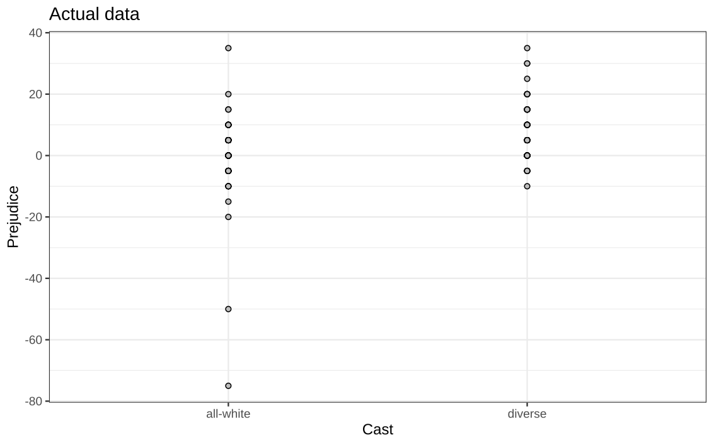{fig-align="center"}

## Let's look at the data

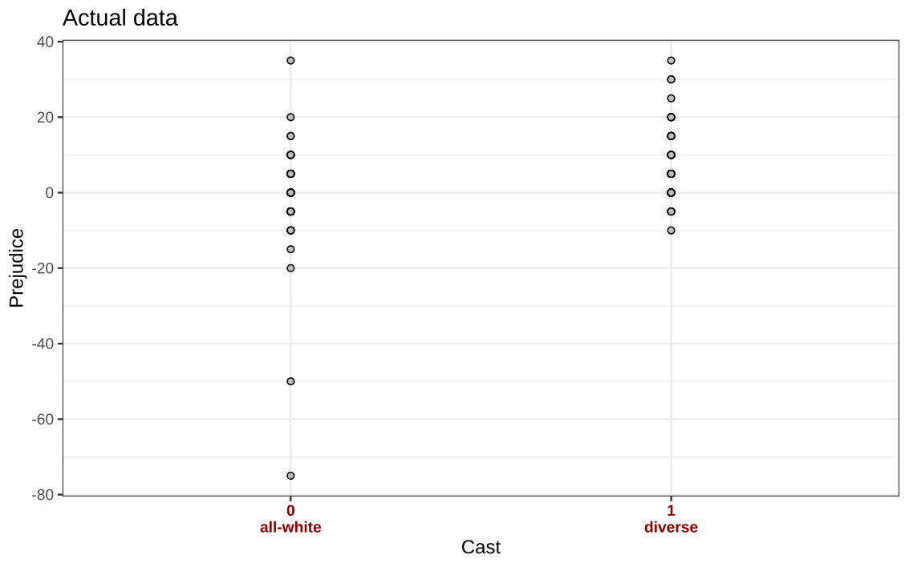{fig-align="center"}

## Let's look at the data

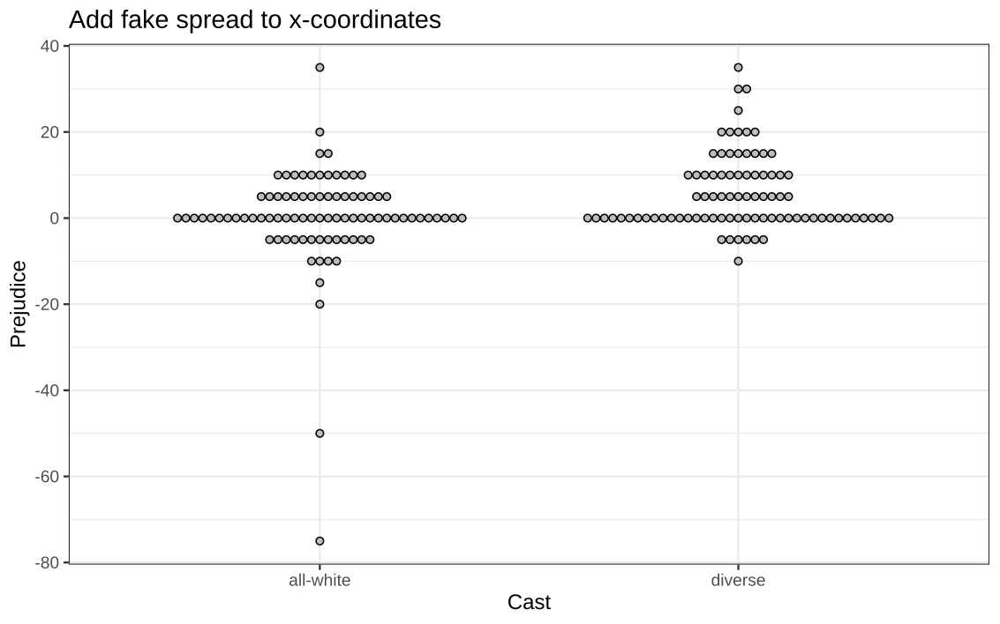{fig-align="center"}

## Let's look at the data

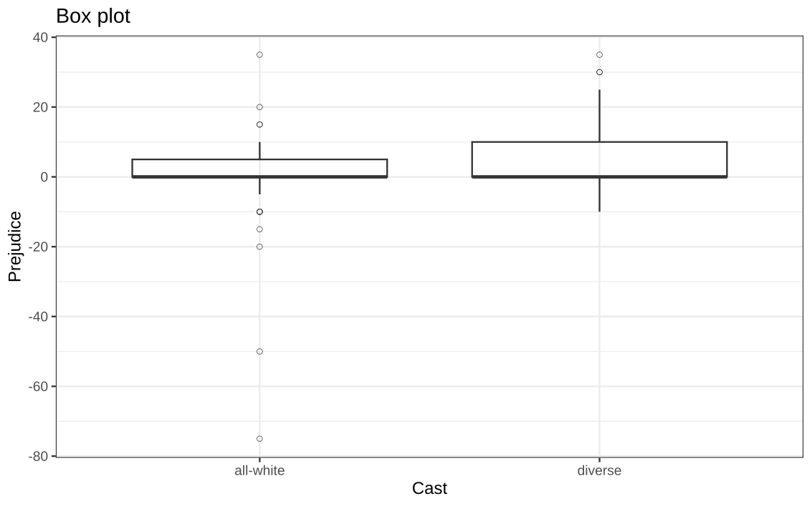{fig-align="center"}

## What was a boxplot again?

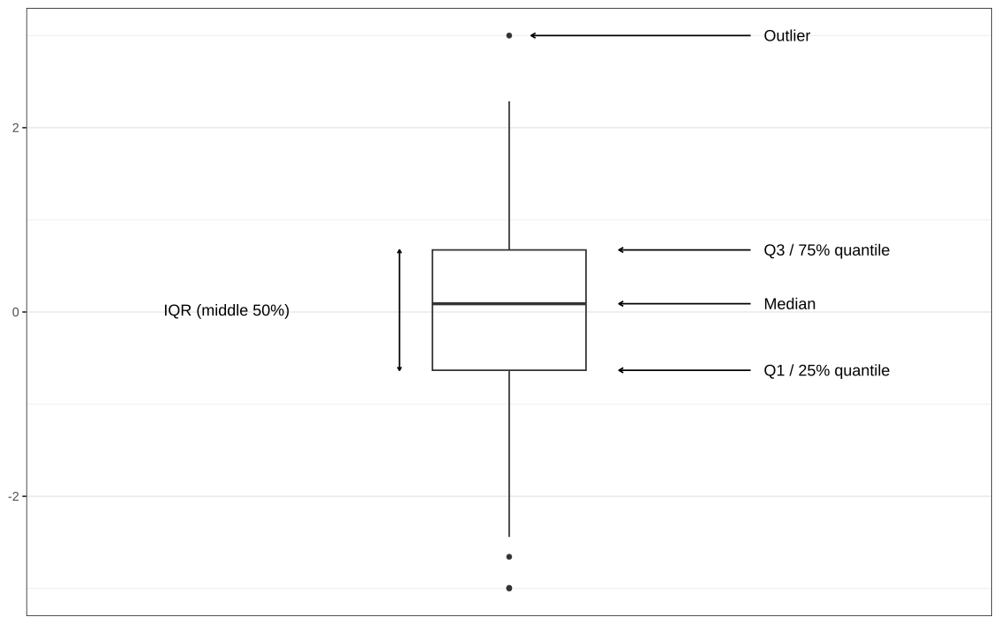{fig-align="center"}

## Let's look at the data

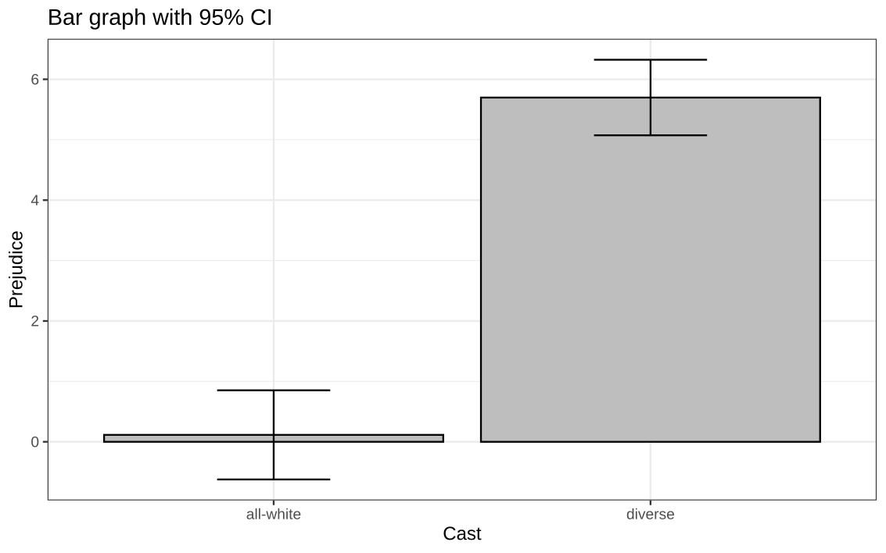{fig-align="center"}

## These are the same ~~picture~~ data!

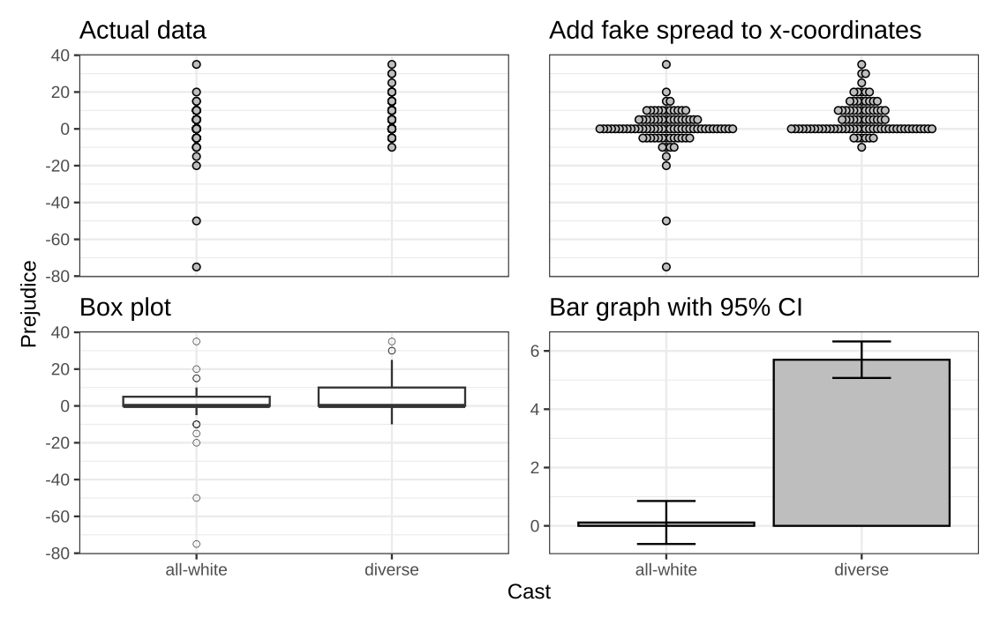{fig-align="center"}

## Let's look at the data

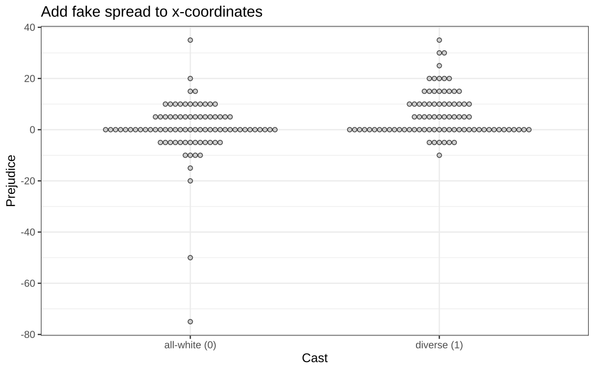{fig-align="center"}

## Let's look at the data

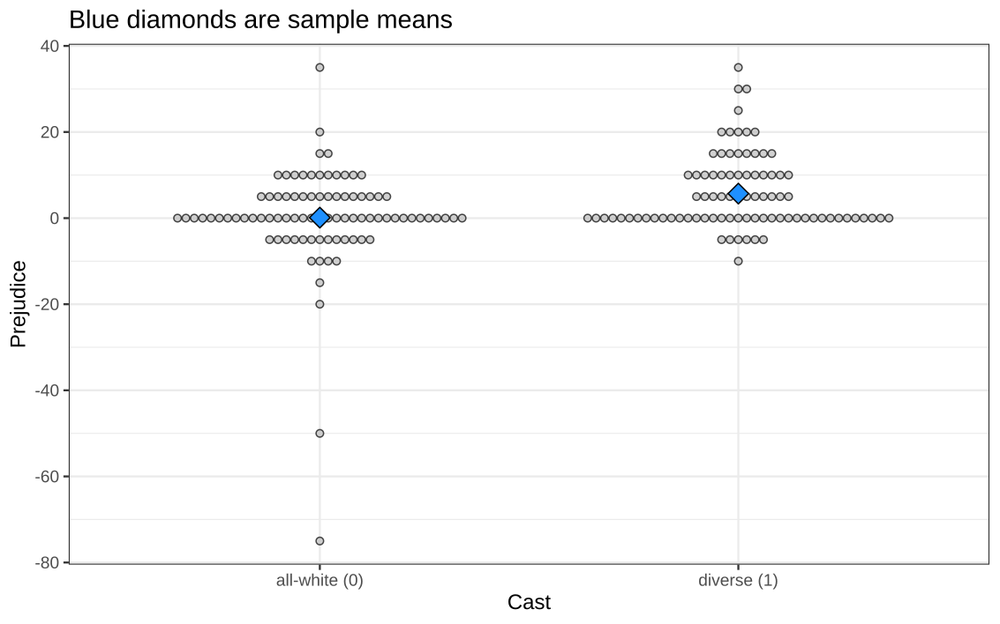{fig-align="center"}

## Let's look at the data

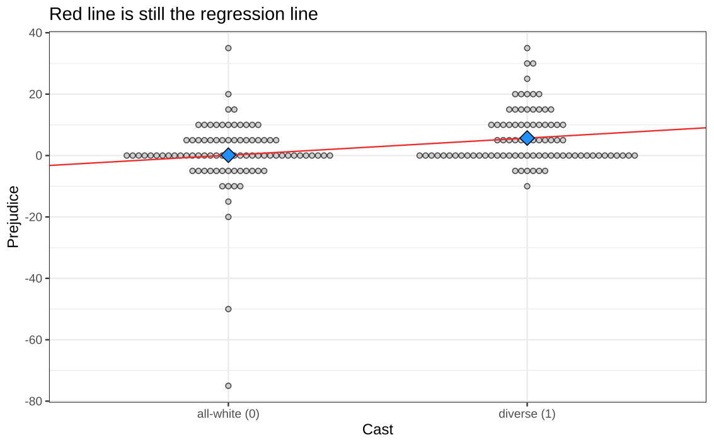{fig-align="center"}

## Meaning of $a$ and $b$

When the predictor is continuous:

- the intercept $a$ is the predicted value for $x = 0$.
- the slope is the change in predicted value when $x$ increases by 1.

. . .

When the predictor is binary:

- the intercept $a$ is the predicted value for the group coded 0 ("all-white").
  * This is called the "reference category"
- the intercept + slope is the predicted value for the group coded 1 ("diverse")

## Meaning of $a$ and $b$

Let's work this out!

$$
\widehat{\mathrm{Prejudice}} = a + b\times \mathrm{``Cast''}
$$

. . .

For "all-white", we use 0, so we get:

$$
\widehat{\mathrm{Prejudice}} = a + b\times 0 = a
$$

. . .

For "diverse", we use 1, so we get:

$$
\widehat{\mathrm{Prejudice}} = a + b\times 1 = a + b
$$

. . .

## Meaning of $a$ and $b$

Note that we predict only two values.

- $a=$ the mean Prejudice of "all-white"
- $a+b=$ the mean Prejudice of "diverse"

. . .

For the data example, we find:

$a = 0.12$ and $b = 5.58$

# Testing

## So what do tests for $a$ and $b$ mean?

::: {style="font-size: 80%;"}

When the predictor is continuous:

- If the intercept $a$ is nonzero, well, that depends on the application.
- If the slope $b$ is nonzero, there is an association between $x$ and $y$.
:::

. . .

When the predictor is binary:

- If the intercept $a$ is nonzero, the mean in the reference category is significantly different from zero
- If the slope $b$ is nonzero, the mean of the nonreference category is significantly different from the reference category.

. . .

The test for $b$ is very meaningful! It is a test of whether there is a difference between the population means of two groups!

## Test from regression output:

<table class="spss-coef" style="width: 100%; text-align: right;">
  <thead>
    <tr>
      <th rowspan="2" style="text-align: left;">Model</th>
      <th rowspan="2"></th>
      <th colspan="2">
        Unstandardized Coefficients
      </th>
      <th>
        Standardized Coefficients
      </th>
      <th rowspan="2">t</th>
      <th rowspan="2">Sig.</th>
    </tr>
    <tr>
      <th>B</th>
      <th>Std. Error</th>
      <th class="beta">Beta</th>
    </tr>
  </thead>
  <tbody>
    <tr>
      <td>1</td>
      <td style="text-align: left;">(Constant)</td>
      <td>0.115</td>
      <td>1.147</td>
      <td class="beta"></td>
      <td>0.100</td>
      <td>0.920</td>
    </tr>
    <tr>
      <td></td>
      <td class="fragment highlight-start" data-fragment-index="1" style="text-align: left;">diverse</td>
      <td class="fragment highlight-middle" data-fragment-index="1">5.583</td>
      <td class="fragment highlight-middle" data-fragment-index="1">1.626</td>
      <td class="fragment highlight-middle beta" data-fragment-index="1">0.254</td>
      <td class="fragment highlight-middle" data-fragment-index="1">3.433</td>
      <td class="fragment highlight-end" data-fragment-index="1">0.000</td>
    </tr>
  </tbody>
</table>

## Test from regression output:

In SPSS, $\beta_{\hypo_0} = 0$, from the table, $b = 5.58$ and $\SE_b = 1.63$, so

$$
t = \frac{b - \beta_{\hypo_0}}{\SE_b} = \frac{5.58 - 0}{1.63} = 3.43
$$

. . .

$$
df = N - 2 = 173-2 = 171
$$

Then examine $t$-table.

## Independent samples $t$-test

The independent samples $t$-test is used to compare the means of two independent groups.

. . .

It is identical to the $t$-test of the slope in regression with a binary predictor.

## Independent samples $t$-test {.small-slide}

<table class="spss-coef" style="width: 100%; text-align: right;">
  <thead>
    <tr>
      <th colspan="6" style="text-align: center;">Group Statistics</th>
    </tr>
    <tr>
      <th style="text-align: left;"></th>
      <th style="text-align: left;">Cast</th>
      <th>N</th>
      <th>Mean</th>
      <th>Std. Deviation</th>
      <th>Std. Error Mean</th>
    </tr>
  </thead>
  <tbody>
    <tr>
      <td style="text-align: left;">Prejudice</td>
      <td style="text-align: left;">all-white</td>
      <td>87</td>
      <td>0.115</td>
      <td>12.323</td>
      <td>1.321</td>
    </tr>
    <tr>
      <td></td>
      <td style="text-align: left;">diverse</td>
      <td>86</td>
      <td>5.698</td>
      <td>8.743</td>
      <td>0.943</td>
    </tr>
  </tbody>
</table>

<table class="spss-coef" style="width: 100%; text-align: right;">
  <thead>
    <tr>
      <th rowspan="2" style="text-align: left;"></th>
      <th rowspan="2" style="text-align: left;"></th>
      <th colspan="2">
        Levene's Test for Equality of Variances
      </th>
      <th colspan="4">
        t-test for Equality of Means
      </th>
    </tr>
    <tr>
      <th>F</th>
      <th>Sig.</th>
      <th>t</th>
      <th>df</th>
      <th>Sig. (2-tailed)</th>
      <th>Mean Difference</th>
    </tr>
  </thead>
  <tbody>
    <tr>
      <td style="text-align: left;">Prejudice</td>
      <td style="text-align: left;">Equal variances assumed</td>
      <td>0.315</td>
      <td>0.575</td>
      <td class="fragment highlight-start" data-fragment-index="1">-3.433</td>
      <td class="fragment highlight-middle" data-fragment-index="1">171</td>
      <td class="fragment highlight-middle" data-fragment-index="1">0.001</td>
      <td class="fragment highlight-end" data-fragment-index="1">-5.583</td>
    </tr>
    <tr>
      <td></td>
      <td style="text-align: left;">Equal variances not assumed</td>
      <td></td>
      <td></td>
      <td>-3.440</td>
      <td>155.270</td>
      <td>0.001</td>
      <td>-5.583</td>
    </tr>
  </tbody>
</table>

## $t$-test vs. regression

The regression gives us $t = 3.433$.

The t-test gives us $t = -3.433$.

Why?

. . .

Because the dummy coding is differs!

We assigned $\text{all-white}=0$ and $\text{diverse}=1$
and got\
$a = 0.12,\,b=5.58,\,t=3.433,p<0.001$.

. . .

Had we assigned $\text{all-white}=1$ and $\text{diverse}=0$, then we'd get\
$a = 5.70,\,b=-5.58,\,t=-3.433,p<0.001$

## $t$-test vs. regression with binary predictor

- The estimates and significance results are identical!
- To obtain the mean for the non-reference category, we have to do a little bit more work.

. . .

The math does work out a bit simpler for the t-test.

## Independent samples $t$-test

Hypotheses:

$$
\begin{align}
\hypo_0:\mu_1&=\mu_2,\enspace\text{or equivalently,}\enspace \hypo_0:\mu_1 -\mu_2 &&= 0\\
\hypo_1:\mu_1&\neq\mu_2, \enspace\text{or equivalently,}\enspace \hypo_1:\mu_1 -\mu_2 &&\neq 0
\end{align}
$$

. . .

One-sided tests are also possible:

$$
\begin{align}
\hypo_0:\mu_1&\geq\mu_2,\enspace\text{or equivalently,}\enspace \hypo_0:\mu_1 -\mu_2 &&\geq 0\\
\hypo_1:\mu_1&<\mu_2, \enspace\text{or equivalently,}\enspace \hypo_1:\mu_1 -\mu_2 &&< 0
\end{align}
$$

## Student's $t$-test

::: {style="font-size: 90%;"}

Test statistics are given by:

$$
t = \frac{(\bar{x}_\text{diverse} - \bar{x}_{\text{all-white}}) - (\mu_\text{diverse}-\mu_\text{all-white})}{\SE_{x}}
$$

. . .

$$
\begin{align}
\SE_{\bar{x}_\text{diverse} - \bar{x}_{\text{all-white}}} &=
\sqrt{
  S^2_{\text{pooled}} \times \left(\frac{1}{n_\text{diverse}} + \frac{1}{n_\text{all-white}}\right)
}\\
S^2_{\text{pooled}} &= \frac{
(n_\text{diverse} - 1) \times s^2_{\text{diverse}} +
(n_\text{all-white} - 1) \times s^2_{\text{all-white}}
}{
n_\text{diverse} + n_\text{all-white} - 2
}
\end{align}
$$

:::

::: footer

These equations will be on the formula sheet.

:::

## Student's samples $t$-test

This looks complicated, but what if $n_\text{diverse} = n_\text{all-white} = n$?

. . .

Then,

$$
s^2_{\text{pooled}} =
\frac{s^2_\text{diverse} + s^2_\text{all-white}}{2}
$$

. . .

$$
\SE_{\bar{x}_\text{diverse} - \bar{x}_\text{all-white}} =
\sqrt{\frac{s^2_\text{diverse} + s^2_\text{all-white}}{n}}
$$

. . .

::: {style="font-size: 80%;"}

Were the variances also equal, then $\SE_{\bar{x}_\text{diverse} - \bar{x}_\text{all-white}}=\sqrt{s^2 / n}$, as in the one-sample Z-test.

<!-- note, actually s / sqrt(2/n) but let's not confuse students -->

:::

## Student's $t$-test

- The Student's $t$-test accounts for the fact that the _sample variances_ can differ in both groups.
- But it assumes that the _population variance_ is the same. Therefore, it pools both variance to combine them to estimate the single _population variance_.

. . .

But what if this assumption is unreasonable?

. . .

Then we can use Welch's $t$-test.

This is generalizes the Student's $t$-test and assumes that each group has its own population variance.

## Welch's $t$-test {.small-slide}

<table class="spss-coef" style="width: 100%; text-align: right;">
  <thead>
    <tr>
      <th colspan="6" style="text-align: center;">Group Statistics</th>
    </tr>
    <tr>
      <th style="text-align: left;"></th>
      <th style="text-align: left;">Cast</th>
      <th>N</th>
      <th>Mean</th>
      <th>Std. Deviation</th>
      <th>Std. Error Mean</th>
    </tr>
  </thead>
  <tbody>
    <tr>
      <td style="text-align: left;">Prejudice</td>
      <td style="text-align: left;">all-white</td>
      <td>87</td>
      <td>0.115</td>
      <td>12.323</td>
      <td>1.321</td>
    </tr>
    <tr>
      <td></td>
      <td style="text-align: left;">diverse</td>
      <td>86</td>
      <td>5.698</td>
      <td>8.743</td>
      <td>0.943</td>
    </tr>
  </tbody>
</table>

<table class="spss-coef" style="width: 100%; text-align: right;">
  <thead>
    <tr>
      <th rowspan="2" style="text-align: left;"></th>
      <th rowspan="2" style="text-align: left;"></th>
      <th colspan="2">
        Levene's Test for Equality of Variances
      </th>
      <th colspan="4">
        t-test for Equality of Means
      </th>
    </tr>
    <tr>
      <th>F</th>
      <th>Sig.</th>
      <th>t</th>
      <th>df</th>
      <th>Sig. (2-tailed)</th>
      <th>Mean Difference</th>
    </tr>
  </thead>
  <tbody>
    <tr>
      <td style="text-align: left;">Prejudice</td>
      <td style="text-align: left;">Equal variances assumed</td>
      <td>0.315</td>
      <td>0.575</td>
      <td>-3.433</td>
      <td>171</td>
      <td>0.001</td>
      <td>-5.583</td>
    </tr>
    <tr>
      <td></td>
      <td style="text-align: left;">Equal variances not assumed</td>
      <td></td>
      <td></td>
      <td class="fragment highlight-start" data-fragment-index="1">-3.440</td>
      <td class="fragment highlight-middle" data-fragment-index="1">155.270</td>
      <td class="fragment highlight-middle" data-fragment-index="1">0.001</td>
      <td class="fragment highlight-end" data-fragment-index="1">-5.583</td>
    </tr>
  </tbody>
</table>

## Welch's $t$-test

::: {.columns}

::: {.column}

::: {style="font-size: 80%;"}

The _Student's_ $t$-test assumes equal population variances and uses one pooled estimate:

$$
\SE_{\bar{x}_1 - \bar{x}_2} =
\sqrt{s^2_{\text{pooled}}\left(\frac{1}{n_1}+\frac{1}{n_2}\right)}
$$

$df = N - 2$

:::

:::

::: {.column}

. . .

::: {style="font-size: 80%;"}

The _Welch's_ $t$-test assumes unequal population variances:

$$
\SE_{\bar{x}_1 - \bar{x}_2} =
\sqrt{\frac{s_1^2}{n_1}+\frac{s_2^2}{n_2}}
$$

More complicated $df$

:::

:::

:::

. . .

When group sizes are equal, the standard errors are identical!

But the degrees of freedom (and thus $p$-values) are usually different.

# Assumptions

## Assumptions

. . .

- Linearity: The association between $x$ and $y$ is a straight line.
- Normality: Errors follow a normal distribution.
- Homoscedasticity: Errors have the same variance for all $x$.
- Independence: Errors are independent of each other.

## Assumptions

- Linearity: The association between $x$ and $y$ is a straight line.
  * Always met, two group means can always be connected by a straight line.
- Normality: Errors follow a normal distribution.
  * This now implies that the outcome is normally distributed in each group
  * The outcome variable overall need not be normally distributed!
- Homoscedasticity: Errors have the same variance for all $x$.
  * The two groups have the same variance.
- Independence: Errors are independent of each other.

## Levene's Test

We can test the assumption of homoscedasticity using Levene's test.

$$
\begin{aligned}
\hypo_0 &: \text{the variances of the groups are equal}\\
\hypo_1 &: \text{the variances of the groups are different}
\end{aligned}
$$

. . .

- Levene's test uses an F-statistic to test whether the group variances are equal.
- If Levene's test is *significant*, there is evidence that the two variances are not equal

## Levene's Test {.small-slide}

<table class="spss-coef" style="width: 100%; text-align: right;">
  <thead>
    <tr>
      <th colspan="6" style="text-align: center;">Group Statistics</th>
    </tr>
    <tr>
      <th style="text-align: left;"></th>
      <th style="text-align: left;">Cast</th>
      <th>N</th>
      <th>Mean</th>
      <th>Std. Deviation</th>
      <th>Std. Error Mean</th>
    </tr>
  </thead>
  <tbody>
    <tr>
      <td style="text-align: left;">Prejudice</td>
      <td style="text-align: left;">all-white</td>
      <td>87</td>
      <td>0.115</td>
      <td>12.323</td>
      <td>1.321</td>
    </tr>
    <tr>
      <td></td>
      <td style="text-align: left;">diverse</td>
      <td>86</td>
      <td>5.698</td>
      <td>8.743</td>
      <td>0.943</td>
    </tr>
  </tbody>
</table>

<table class="spss-coef" style="width: 100%; text-align: right;">
  <thead>
    <tr>
      <th rowspan="2" style="text-align: left;"></th>
      <th rowspan="2" style="text-align: left;"></th>
      <th colspan="2">
        Levene's Test for Equality of Variances
      </th>
      <th colspan="4">
        t-test for Equality of Means
      </th>
    </tr>
    <tr>
      <th>F</th>
      <th>Sig.</th>
      <th>t</th>
      <th>df</th>
      <th>Sig. (2-tailed)</th>
      <th>Mean Difference</th>
    </tr>
  </thead>
  <tbody>
    <tr>
      <td style="text-align: left;">Prejudice</td>
      <td class="fragment highlight-start" data-fragment-index="1" style="text-align: left;">Equal variances assumed</td>
      <td class="fragment highlight-middle" data-fragment-index="1">0.315</td>
      <td class="fragment highlight-end" data-fragment-index="1">0.575</td>
      <td>-3.433</td>
      <td>171</td>
      <td>0.001</td>
      <td>-5.583</td>
    </tr>
    <tr>
      <td></td>
      <td style="text-align: left;">Equal variances not assumed</td>
      <td></td>
      <td></td>
      <td>-3.440</td>
      <td>155.270</td>
      <td>0.001</td>
      <td>-5.583</td>
    </tr>
  </tbody>
</table>

## Normality

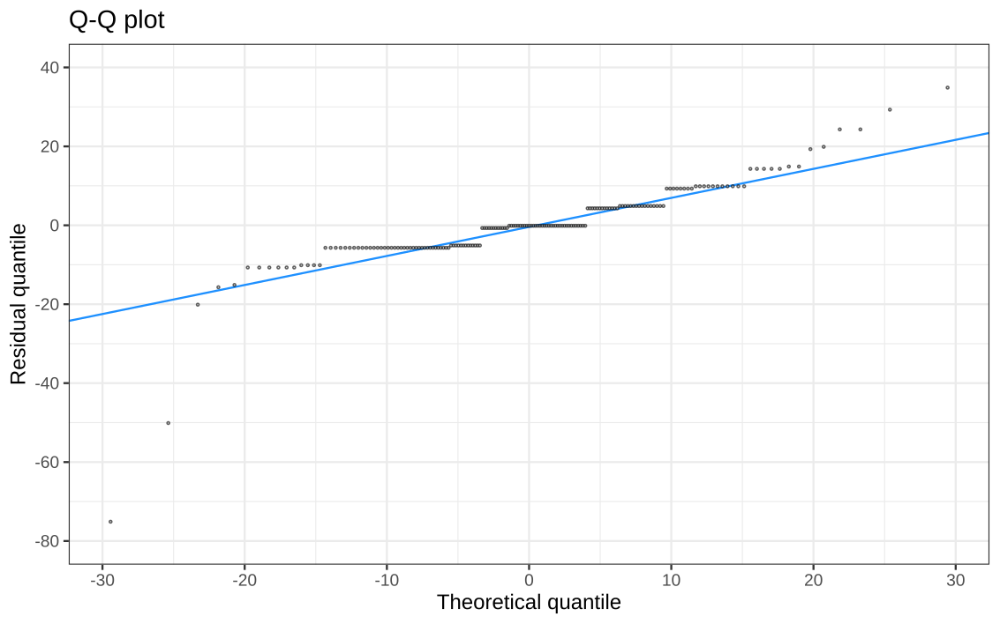{fig-align="center"}

## Normality

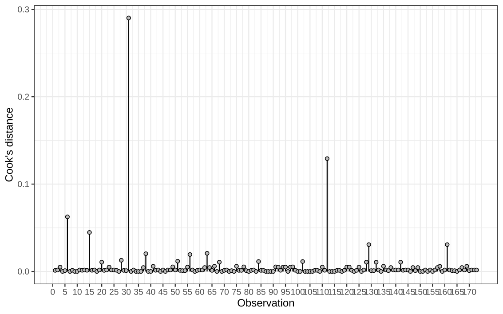{fig-align="center"}

## Normality

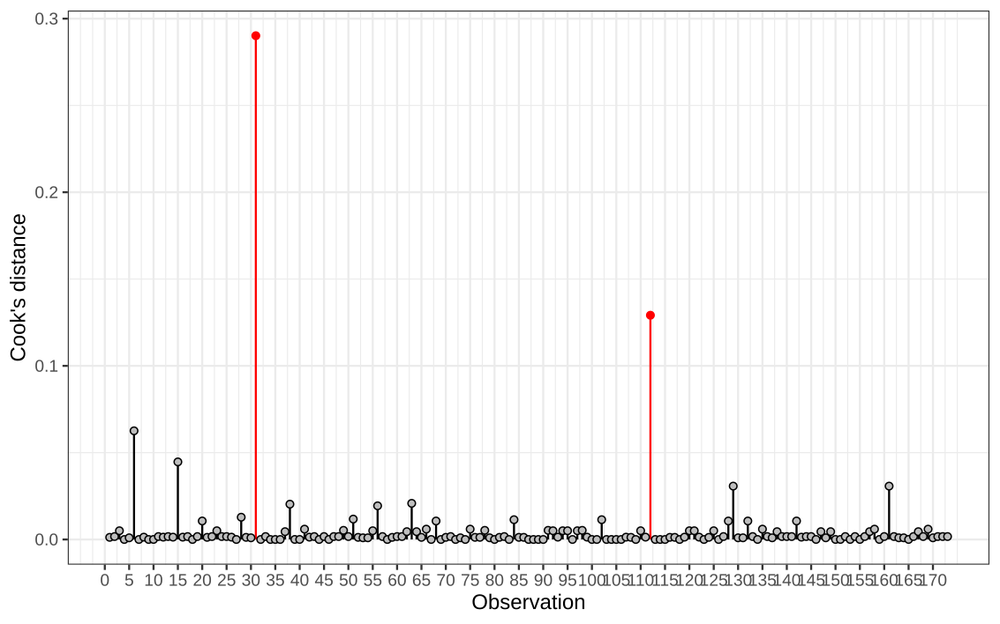{fig-align="center"}

## Normality

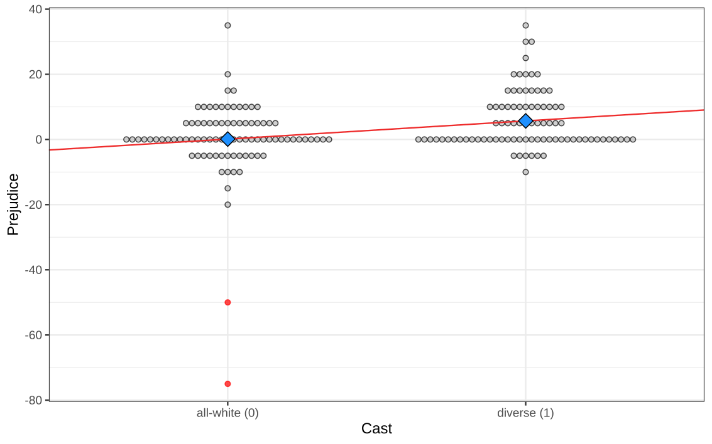{fig-align="center"}

## Normality

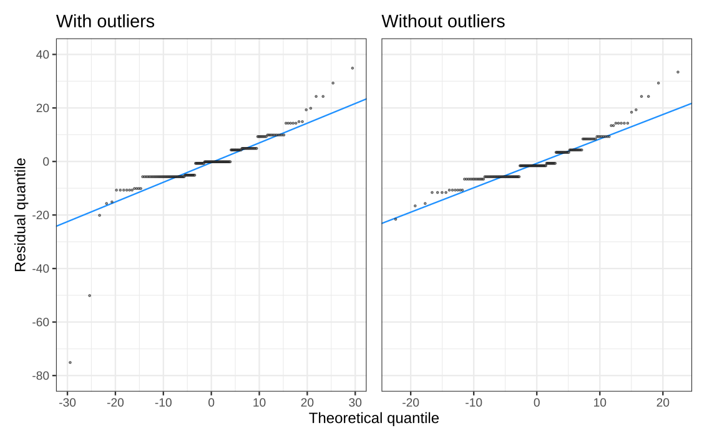{fig-align="center"}

## Normality

Based on these results, I would _not_ remove the two observations.

While they improve the QQ-plot, that shouldn't be a reason on its own.

. . .

Are the residuals normally distributed?

. . .

Probably not.

. . .

But does it matter?

. . .

Probably not a lot.

- sample size is not that small (~86 per group)
  * $t$-test is reasonably robust to normality at this sample size
- but extreme observations can still influence the estimated means and their difference

## Independence

Is independence a reasonable assumption in this study?

. . .

"The participants were randomly assigned to one of two conditions, the entertainment-education condition or the control condition."

. . .

Yes.

- Each participant contributes one Prejudice score.
- Different participants were assigned individually to the two conditions, at random.
- No reason to expect their observations to be dependent.

# Effect size

## Effect size

The t-test tells us whether the difference between groups is statistically significant

- But is it also  _practically_  significant?
- In a large enough sample, even trivial differences between groups become significant
  * We've seen how an R^2 of 0.01 was significant, and how normality tests were significant despite no strong deviations in the QQ-plots last week!

. . .

- Effect size measures standardize the difference between the group means
- This makes it interpretable on a meaningful scale (i.e., number of standard deviations)
  * Like the standardized regression coefficient

## Effect size

Now, the standardized regression coefficient for a binary predictor is not very intuitive.

Why?

. . .

- It tells us how much the outcome changes (in SDs) when the predictor increases by one SD.
- But the predictor only takes two values: 0 and 1!

. . .

Instead, we can express the difference between the two group means in standard deviations

This is called _Cohen's $d$_.

## Cohen's $d$

Cohen's $d$ expresses the difference between two group means in standard deviations.

$$
d = \frac{\bar{x}_1 - \bar{x}_2}{s_{\text{pooled}}}
$$

. . .

For example:

- $d \!=\!0.5$: group 1 scores _half a standard deviation higher_ than group 2.
- $d\!=\! -1$: group 1 scores _one standard deviation lower_ than group 2.
- $d\! =\! 0$: The group means are equal.

. . .

Unlike a $t$-value, Cohen's $d$ does not directly depend on the sample size.

## Statistical Power: Demo

Sampling distributions under $\hypo_0$ and $\hypo_1$, d = Cohen's $d$!



## Cohen's $d$: Data example

The difference between the group means was:

$$
\bar{x}_1 - \bar{x}_2 = 5.698 - 0.115 = 5.583
$$

. . .

The pooled standard deviation was about $10.73$.

$$
d = \frac{5.583}{10.73} = 0.52
$$

. . .

We conclude: The diverse-cast group scored about half a standard deviation higher on prejudice change than the all-white-cast group.

Is that a practically important difference?

## Interpreting Cohen's d

Larger Cohen's $d$: bigger difference between the groups

Rule of thumb:

- Small effect size:  $d \approx 0.2$
- Medium effect size: $d \approx 0.5$
- Large effect size:  $d \approx 0.8$

# Conclusions

## We've learned -- Binary predictors

- A binary predictor can be represented using _dummy coding_ (0 and 1).
- In regression with a binary predictor:
  - The intercept $a$ is the mean of the reference group (0).
  - The slope $b$ is the difference between the two group means (1 minus 0).
- Testing the slope is equivalent to Student's independent-samples $t$-test.
- Welch's $t$-test does not assume equal population variances.
- Cohen's $d$ expresses the difference between group means in standard deviations.

## We've learned -- Assumptions

| Assumption | Continuous predictor | Binary predictor |
|---|---|---|
| Linearity | Look for patterns in the residual plot | Always met |
| Outliers | Cook's distance | Same |
| Normality | Examine the Q-Q plot | Same + implies data within each group is normally distributed |
| Homoscedasticity | Examine the spread of residuals | Same + Levene's test |
| Independence | Consider how the data were collected | Same |

## Next Week

- What if the predictor has more than two categories?
  * ANOVA