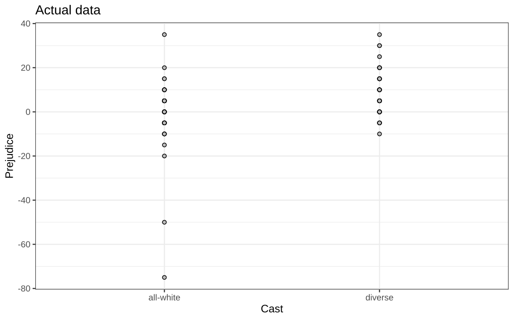
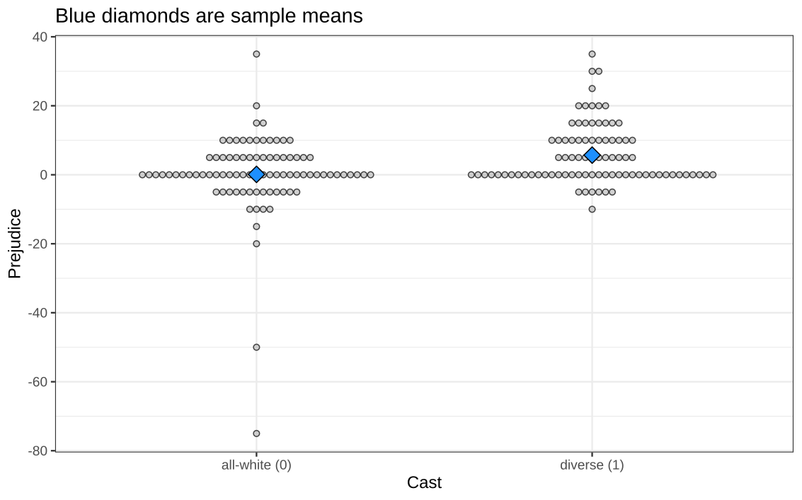
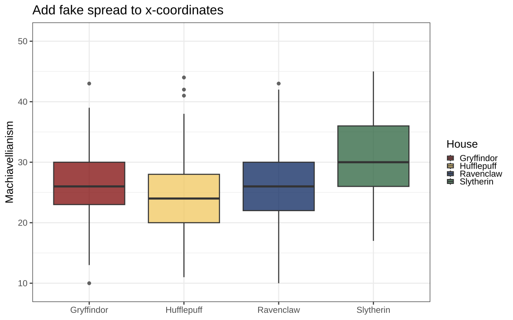

# Recap

<!--

Last week, linear regression with a binary predictor

can't multiply slope times word, therefore we used dummy coding.

group means

a = mean of reference category
a + b = mean of non-reference category

this was the same as independent samples t-test

This week, what if more than one category?

# Examples of when this occurs

Nominal:

Ordinal:
  Low, medium, high

# Dummy coding

we still can't multiply with a word
so we dummy code/ one-hot encoding

the dummy variable is 1 if it's that category and 0 otherwise:

Harry potter house:

|           | b_1 | b_2 | b_3 |
|-----------|-----|-----|-----|
Gryffindor  |  0  |  0  |  0  |
Ravenclaw   |  1  |  0  |  0  |
Huffelpuf   |  0  |  1  |  0  |
Slytherin   |  0  |  0  |  1  |

#  Regression with multiple dummies:

Now the regression equation becomes:

y_i = a + b_1 + b_2 + b_3

NOTE: underbrace what each b means, then ask what a means!

-->

::: {.hidden}
$$
\newcommand{\hypo}{\mathcal{H}}
\newcommand{\SE}{\mathrm{SE}}
\newcommand{\dnorm}[2]{\mathcal{N}\left(#1, #2\right)}
\newcommand{\res}{e}
\newcommand{\rep}{\epsilon}
\newcommand{\TSS}{\mathrm{TSS}}
\newcommand{\SSE}{\mathrm{SSE}}
\newcommand{\RSS}{\mathrm{RSS}}

\newcommand{\MSE}{\mathrm{MSE}}
\newcommand{\MSR}{\mathrm{MSR}}
$$
:::

## Trustworthy Faces

::: {.incremental .svg-stack}
- 
- 
- 
- 
:::

## Dummy Coding

If we put this into a regression we get:

$$
\widehat{\mathrm{Prejudice}} = a + b\times \mathrm{``Diverse''}
$$

. . .

but we can't multiply words with numbers.

We need to assign numbers to them.

This is called dummy coding.

## Dummy Coding



::: {.fragment fragment-index="3" .fade-in}

So "diverse" is coded as 1 and "all-white" as 0.

:::

## Dummy Coding

Now we can do linear regression with the dummy coded variable!

But what did that mean again?

## Meaning of $a$ and $b$

When the predictor is continuous:

- the intercept $a$ is the predicted value for $x = 0$.
- the slope is the change in predicted value when $x$ increases by 1.

. . .

When the predictor is binary:

- the intercept $a$ is the predicted value for the group coded 0 (the "reference category").
- the intercept + slope, $a+b$ is the predicted value for the group coded 1.

## Meaning of $a$ and $b$

Let's work this out!

$$
\widehat{\mathrm{Prejudice}} = a + b\times \mathrm{``Cast''}
$$

. . .

For "all-white", we use 0, so we get:

$$
\widehat{\mathrm{Prejudice}} = a + b\times 0 = a
$$

. . .

For "diverse", we use 1, so we get:

$$
\widehat{\mathrm{Prejudice}} = a + b\times 1 = a + b
$$

## Tests for $a$ and $b$

::: {style="font-size: 80%;"}

When the predictor is continuous:

- If the intercept $a$ is nonzero, well, that depends on the application.
- If the slope $b$ is nonzero, there is an association between $x$ and $y$.
:::

. . .

When the predictor is binary:

- If the intercept $a$ is nonzero, the mean in the reference category is significantly different from zero
- If the slope $b$ is nonzero, the mean of the nonreference category is significantly different from the reference category.

## Independent-samples t-test

$$
\begin{align}
\hypo_0:\mu_1&=\mu_2\\
\hypo_1:\mu_1&\neq\mu_2
\end{align}
$$

$$
t = \frac{(\bar{x}_\text{diverse} - \bar{x}_{\text{all-white}}) - (\mu_\text{diverse}-\mu_\text{all-white})}{\SE_{x}}
$$

::::: {.columns}

:::: {.column}

::: {style="font-size: 80%;"}

### Students $t$-test

- assumes equal population variances
- uses one pooled variance estimate
- $df = N - 2$
- test is identical to testing the slope in linear regression

$$
\SE_{\bar{x}_1 - \bar{x}_2} =
\sqrt{s^2_{\text{pooled}}\left(\frac{1}{n_1}+\frac{1}{n_2}\right)}
$$

:::

::::

:::: {.column}

. . .

::: {style="font-size: 80%;"}

### Welch's $t$-test

- assumes unequal population variances
- More complicated $df$

$$
\SE_{\bar{x}_1 - \bar{x}_2} =
\sqrt{\frac{s_1^2}{n_1}+\frac{s_2^2}{n_2}}
$$

:::

::::

:::::
<!--
## Recap

::: {style="font-size: 90%;"}

So far we've learned...

1. How to find $a$ and $b$ that minimize the SSE.
2. How much variance is explained by the regression line ($R^2$).
3. How to test $a$ and $b$ using $t$-tests and compare models using the $F$-test.
4. How to check the assumptions by examining the residuals.

... when the predictor is _continuous_ or _binary_

:::

. . .

What if the predictor is categorical?

   - What changes and what stays the same?
   - We'll focus on $a$ and $b$, $R^2$, testing, and the assumptions
 -->

# Categorical predictors

## Categorical predictors are common!

- Nominal (no natural order):
  * Biological sex (male/female)
  * Student status (Dutch/French/German/...)
  * Device type (mobile (android)/ mobile (iOS)/desktop / tablet)

- Ordinal (natural order):
  * Socio-economic status (Low/Medium/High)
  * Education (VMBO/ HAVO/ VWO)

## Categorical predictors are common!

- Treatment:
  * Medicine X vs. medicine Y: which treats patients better?
  * Teaching method X vs. Y: which helps students learn better?
  * Website design A vs. B: which leads to longer visits?

. . .

- Many online platforms use A/B testing:
  * Instagram: Test different algorithms for recommending content (maximizing doomscrolling)
  * ChatGPT: Compare model versions using user feedback and usage patterns
  * YouTube: Test titles and thumbnails to increase watch time

## Houses of Hogwarts and Personality

{fig-align="center" width="200px"}

::: footer

Jakob, L., Garcia-Garzon, E., Jarke, H., & Dablander, F. (2019). The science behind the magic? The relation of the Harry Potter “Sorting Hat Quiz” to personality and human values. Collabra: Psychology, 5(1), 31.

:::

## Houses of Hogwarts and Personality

| Hogwarts  | House Values |
|-----------|--------------|
|Gryffindor | Bravery, helping others, and chivalry. |
|Hufflepuff | Hard work, patience, loyalty, and fair play. |
|Ravenclaw  | Intelligence, knowledge, planning ahead, and wit. |
|Slytherin  | Ambition, cunningness, heritage, and resourcefulness. |

: Table 1 in Jakob _et al_., (2019).

::: footer

Jakob, L., Garcia-Garzon, E., Jarke, H., & Dablander, F. (2019). The science behind the magic? The relation of the Harry Potter “Sorting Hat Quiz” to personality and human values. Collabra: Psychology, 5(1), 31.

:::

## Houses of Hogwarts and Personality

- Harry Potter fans can be assigned to one of these Houses by filling out an eight-item questionnaire
  * the Sorting Hat Quiz, made by J.K. Rowling (<https://www.pottermore.com>)
- Crysel _et al._ (2015) did this and found relations with personality traits
- Jakob _et al._ (2019) wanted to replicate this

::: footer

Jakob, L., Garcia-Garzon, E., Jarke, H., & Dablander, F. (2019). The science behind the magic? The relation of the Harry Potter “Sorting Hat Quiz” to personality and human values. Collabra: Psychology, 5(1), 31.

:::

## The Short Dark Triad (Jones & Paulhus, 2013)

{.absolute top=450 right=50 width="150" height="150"}

::: {style="font-size: 48%; line-height: 1.12;"}

::: {.columns}

::: {.column width="33%"}

### Machiavellianism

1. It's not wise to tell your secrets.
2. I like to use clever manipulation to get my way.
3. Whatever it takes, you must get the important people on your side.
4. Avoid direct conflict with others because they may be useful in the future.
5. It's wise to keep track of information that you can use against people later.
6. You should wait for the right time to get back at people.
7. There are things you should hide from other people to preserve your reputation.
8. Make sure your plans benefit yourself, not others.
9. Most people can be manipulated.

:::

::: {.column width="33%"}

### Narcissism

1. People see me as a natural leader.
2. I hate being the center of attention. (R)
3. Many group activities tend to be dull without me.
4. I know that I am special because everyone keeps telling me so.
5. I like to get acquainted with important people.
6. I feel embarrassed if someone compliments me. (R)
7. I have been compared to famous people.
8. I am an average person. (R)
9. I insist on getting the respect I deserve.

:::

::: {.column width="33%"}

### Psychopathy

1. I like to get revenge on authorities.
2. I avoid dangerous situations. (R)
3. Payback needs to be quick and nasty.
4. People often say I'm out of control.
5. It's true that I can be mean to others.
6. People who mess with me always regret it.
7. I have never gotten into trouble with the law. (R)
8. I enjoy having sex with people I hardly know
9. I’ll say anything to get what I want

:::

:::

:::

::: {style="font-size: 50%; margin-top: 0.5em;"}

*Please indicate how much you agree with each statement.*

| **1** | **2** | **3** | **4** | **5** |
|:---:|:---:|:---:|:---:|:---:|
| Disagree strongly | Disagree | Neither agree nor disagree | Agree | Agree strongly |

:::

## Let's examine the data

::: {.incremental .svg-stack height="100%" width="100%"}
- 
- 
- 
- 
:::

## Dummy Coding

If we put predict Machiavellism using House with a regression we get:

$$
\widehat{\mathrm{Machiavellism}} = a + b\times \mathrm{``Gryffindor''}
$$

. . .

but like with binary predictors, we stil can't multiply words with numbers.

We need to assign numbers to them.

So we extent dummy coding to multiple categories.

## Dummy Coding {.small-slide}



## Dummy Coding

| Observed | Dummy_Ravenclaw | Dummy_Huffelpuf | Dummy_Slytherin |
|----|----|----|----|
| Gryffindor | 0 | 0 | 0 |
| Ravenclaw  | 1 | 0 | 0 |
| Huffelpuf  | 0 | 1 | 0 |
| Slytherin  | 0 | 0 | 1 |

## Dummy Coding

So _House_ has 4 categories, and we now have 3 dummy variables.

In general, for $k$ categories we have $k-1$ dummy variables.

Each of the dummy variables has its own regression coefficient.

. . .

The regression equation becomes:

$$
\begin{align}
\widehat{\mathrm{Machiavellism}} =
a &+
b_1\times \mathrm{``Dummy\_Ravenclaw''} \\
&+b_2\times \mathrm{``Dummy\_Huffelpuf''} \\
&+b_3\times \mathrm{``Dummy\_Slytherin''}
\end{align}
$$

we now one intercept $a$ and 3 slope parameters, $b_1, b_2, b_3$!

So what do they mean?

## Dummy Coding

| Observed | Dummy_Ravenclaw | Dummy_Huffelpuf | Dummy_Slytherin |
|----|----|----|----|
|          | $b_1$           | $b_2$           | $b_3$ |
| Gryffindor | 0 | 0 | 0 |
| Ravenclaw  | 1 | 0 | 0 |
| Huffelpuf  | 0 | 1 | 0 |
| Slytherin  | 0 | 0 | 1 |

:::{.incremental}

::: {.columns}

::: {.column}

- $\mathrm{Gryffindor} = a$
- $\mathrm{Ravenclaw} = a + b_1$

:::

::: {.column}

- $\mathrm{Huffelpuf} = a + b_2$
- $\mathrm{Slytherin} = a + b_3$

:::

:::

:::

. . .

So what do the slopes mean?

## Dummy coding: Hogwarts houses

$$
\widehat{y}_i = a + b_1 \times x_{i1} + b_2 \times x_{i2} + b_3 \times x_{i3}
$$

::: {.fragment data-fragment-index="1"}

<table style="font-size: 55%; width: 70%; margin: 0 auto 0.4em; line-height: 0.8;">
  <thead>
    <tr>
      <th>House</th>
      <th>Ravenclaw ($x_{i1}$)</th>
      <th>Huffelpuf ($x_{i2}$)</th>
      <th>Slytherin ($x_{i3}$)</th>
    </tr>
  </thead>
  <tbody>
    <tr><td>Gryffindor</td><td>0</td><td>0</td><td>0</td></tr>
    <tr><td>Ravenclaw</td><td>1</td><td>0</td><td>0</td></tr>
    <tr><td>Huffelpuf</td><td>0</td><td>1</td><td>0</td></tr>
    <tr><td>Slytherin</td><td>0</td><td>0</td><td>1</td></tr>
  </tbody>
</table>

:::

::: {.columns style="font-size: 75%;"}

::: {.column width="50%"}

::: {.fragment data-fragment-index="2"}
$$
\begin{aligned}
\widehat{\mathrm{Gryffindor}}
&= a + b_1\times 0 + b_2 \times 0 + b_3 \times 0 \\
&= a
\end{aligned}
$$
:::

::: {.fragment data-fragment-index="3"}
$$
\begin{aligned}
\widehat{\mathrm{Ravenclaw}}
&= a + b_1\times 1 + b_2 \times 0 + b_3 \times 0 \\
&= a + b_1
\end{aligned}
$$
:::

:::

::: {.column width="50%"}

::: {.fragment data-fragment-index="4"}
$$
\begin{aligned}
\widehat{\mathrm{Huffelpuf}}
&= a + b_1\times 1 + b_2 \times 1 + b_3 \times 0 \\
&= a + b_2
\end{aligned}
$$
:::

::: {.fragment data-fragment-index="5"}
$$
\begin{aligned}
\widehat{\mathrm{Slytherin}}
&= a + b_1\times 1 + b_2 \times 0 + b_3 \times 1 \\
&= a + b_3
\end{aligned}
$$
:::

:::

:::

## Parameter meaning

- The intercept is the _mean of the reference category_
  * In our case, the mean Machiavellism of Gryffindors
- Each slope is the mean difference between that group's and the reference category
  * So $b_1$ is the mean difference between Gryffindors and Ravenclaws
  * So $b_2$ is the mean difference between Gryffindors and Huffelpufs
  * So $b_3$ is the mean difference between Gryffindors and Slytherins

## Changing the reference category

| Observed | Dummy_Gryffindor | Dummy_Huffelpuf | Dummy_Slytherin |
|----|----|----|----|
|          | $b_1$           | $b_2$           | $b_3$ |
| Gryffindor | 1 | 0 | 0 |
| Ravenclaw  | 0 | 0 | 0 |
| Huffelpuf  | 0 | 1 | 0 |
| Slytherin  | 0 | 0 | 1 |

:::{.incremental}

::: {.columns}

::: {.column}

- $\mathrm{Gryffindor} = a + b_1$
- $\mathrm{Ravenclaw} = a$

:::

::: {.column}

- $\mathrm{Huffelpuf} = a + b_2$
- $\mathrm{Slytherin} = a + b_3$

:::

:::

:::

<!--
NOTE:

ask here, what does b_3 mean now?

 -->

# Testing

## Testing the slope

<table style="font-size: 55%; width: 70%; margin: 0 auto 0.4em; line-height: 0.8;">
  <thead>
    <tr>
      <th>House</th>
      <th>Ravenclaw ($x_{i1}$)</th>
      <th>Huffelpuf ($x_{i2}$)</th>
      <th>Slytherin ($x_{i3}$)</th>
    </tr>
  </thead>
  <tbody>
    <tr><td>Gryffindor</td><td>0</td><td>0</td><td>0</td></tr>
    <tr><td>Ravenclaw</td><td>1</td><td>0</td><td>0</td></tr>
    <tr><td>Huffelpuf</td><td>0</td><td>1</td><td>0</td></tr>
    <tr><td>Slytherin</td><td>0</td><td>0</td><td>1</td></tr>
  </tbody>
</table>

::: {.columns}

::: {.column}

- $\mathrm{Gryffindor} = a$
- $\mathrm{Ravenclaw} = a + b_1$

:::

::: {.column}

- $\mathrm{Huffelpuf} = a + b_2$
- $\mathrm{Slytherin} = a + b_3$

:::

:::

. . .

Suppose we we test if $b_3$ differs from 0. What does that mean?

. . .

Whether the mean Machiavellism differs between Gryffindors and Slytherins

## General regression formula

$$
\hat{y}_i = a + b_1 \times x_{i1}+ b_2 \times x_{i2}+ b_3 \times x_{i3} + \dots
$$

where $\dots$ goes on the number of categories minus 1.

So how do we test if there is an effect of _House_ on _Macchiavellism_?

When is there an effect?

. . .

Should _one_ of the slopes, $b_i$ be different from 0?

. . .

Should _all_ of the slopes, $b_i$ be different from 0?

. . .

In principle only one. But which one? How can we figure this out?

. . .

We can test each $b$ against 0!

But that has a problem.

## Multiple testing

Suppose we use $\alpha = 0.05$. If $\hypo_0$ is true, we make an error at most 5% of the time (the Type-I error).

Now we test each $b$ individually against 0. What happens?

:::{.incremental}
- Probability of a type I error after 1 test: 5%
- After 2 independent tests: 9.8%
- After 3 independent tests: 14.3%
- The more tests we perform, the greater the risk of a false positive!
<!-- 1 - (1 - \alpha)^k -->
:::
<!-- Note: mention this is an illustration if the tests were independent, they are not -->

. . .

Can we test all slopes simultaneously, using just one test?

## Comparing two models -- two weeks ago

When discussing bivariate linear regression, we saw that instead of individually comparing $b$ against 0 we could compare two models:

:::: {.r-stack}

::: {.fragment .fade-out fragment-index="2"}
$$
\begin{align}
\hypo_0:& \text{ the null model},       &&y_i = a \phantom{+ b\times x_i }\;\,+\res_i\\
\hypo_1:& \text{ the regression model}, &&y_i = a + b\times x_i +\res_i
\end{align}
$$
:::

::: {.fragment .fade-in fragment-index="2"}
$$
\begin{align}
\hypo_0:& \text{ the null model},       &&y_i = a + 0\times x_i +\res_i\\
\hypo_1:& \text{ the regression model}, &&y_i = a + b\times x_i +\res_i
\end{align}
$$
:::

::::

::: {.columns}

::: {.column}

::: {.fragment fragment-index="1"}
1. $\hypo_0: \beta = 0$ vs $\hypo_1: \beta \neq 0$.
:::

::: {.fragment fragment-index="3"}
2. $\hypo_0: \rho^2 = 0$ vs $\hypo_1: \rho^2 > 0$.

Here, $\rho^2$ is the _population_ value for $R^2$
:::

:::

::: {.column}

::: {.fragment fragment-index="4"}
1. Meaning 1 applies only for bivariate linear regression.
:::
::: {.fragment fragment-index="5"}
2. Meaning 2 applies in general!
:::

:::

:::

## Model comparison
<!--
$$
\begin{align}
\hypo_0\!:& \text{ the null model}, y_i = a+\res_i\\
\hypo_1\!:& \text{ the full model}, y_i = a + b_1\!\times\! x_{i1}+ b_2 \!\times\! x_{i2}+ b_3 \!\times\! x_{i3} +\res_i
\end{align}
$$
 -->
:::: {.r-stack}

::: {.fragment .fade-out fragment-index="3"}
$$
\begin{align}
\hypo_0\!:& \text{ the null model}, y_i = a\phantom{+0\!\times\! x_{i1}+ 0 \!\times\! x_{i2}+ 0 \!\times\! x_{i3}}+\res_i\\
\hypo_1\!:& \text{ the full model}, y_i = a + b_1\!\times\! x_{i1}+ b_2 \!\times\! x_{i2}+ b_3 \!\times\! x_{i3} +\res_i
\end{align}
$$
:::

::: {.fragment .fade-in fragment-index="3"}
$$
\begin{align}
\hypo_0\!:& \text{ the null model}, y_i = a+0\!\times\! x_{i1}+ 0 \!\times\! x_{i2}+ 0 \!\times\! x_{i3}+\res_i\\
\hypo_1\!:& \text{ the full model}, y_i = a + b_1\!\times\! x_{i1}+ b_2 \!\times\! x_{i2}+ b_3 \!\times\! x_{i3} +\res_i
\end{align}
$$
:::

::::

::: {.fragment .fade-in fragment-index="1"}

What do we test here?

:::

::: {.fragment .fade-in fragment-index="2"}

Does including _House_ improve the predictions sufficiently to justify the additional predictors?

Here, "improve the predictions" means, does explained variance ($R^2$) differ significantly from zero?

:::

## The hypothesis

For our four Hogwarts houses, we test:

$$
\begin{aligned}
\hypo_0 &: b_1 = b_2 = b_3 = 0\\
\hypo_1 &: \text{At least one } b_i \neq 0
\end{aligned}
$$

. . .

What does this mean in terms of group means?

. . .

$$
\begin{aligned}
\hypo_0 &: \mu_G = \mu_R = \mu_H = \mu_S\\
\hypo_1 &: \text{At least two means differ}
\end{aligned}
$$

. . .

We call this an _omnibus test_: it tests whether there is
an overall effect of House on Machiavellianism.

It does not tell us which houses differ!

## The $F$-test

:::: {.r-stack}

::: {.fragment .fade-out fragment-index="1"}

Recall the $F$-test from bivariate regression

$$
F = (N-2)\times\frac{\text{Explained variance}}
         {\text{Unexplained variance}}
$$

:::
::: {.fragment .fade-in fragment-index="1"}

We use a generalized version:

$$
F = \frac{N-p}{p-1}\times\frac{\text{Explained variance}}
         {\text{Unexplained variance}}
$$
Here, $p$ is the number of parameters in the model.
:::
::::

::: {.fragment fragment-index="2"}
- In bivariate regression, we have a $a$ and $b$, so $p = 2$.
  * $\frac{N-p}{p-1} = N - 2$.
- For Macchiavellism data, we have $a$, $b_1$, $b_2$, $b_3$, so $p = 4$.
  * $\frac{N-p}{p-1} = \frac{N-4}{2}$.
:::

<!--
Keep the slides above this comment unchanged.
 -->

## Why is it called ANOVA?

**AN**alysis **O**f **VA**riance

. . .

We want to know whether the **means** of our four houses differ.

So why are we analyzing variance?

. . .

Because we can split the total variation in Machiavellianism into:

::: {.incremental}

1. **Between-group variation:** differences between the house means.
2. **Within-group variation:** differences between students within the same house.

:::

. . .

**Idea:** If the houses really differ, between-group variation
should be large relative to within-group variation.

## Sums of squares

We already know these from regression!

$$
SST = SSR + SSE
$$

. . .

In ANOVA, we often use different names:

$$
\underbrace{SST}_{\text{Total}}
=
\underbrace{SSB}_{\text{Between groups}}
+
\underbrace{SSW}_{\text{Within groups}}
$$

. . .

::: {.columns}

::: {.column}

**Between groups (SSB)**

$$
\sum_i(\hat{y}_i-\bar{y})^2
$$

How much do group means differ from the overall mean?

:::

::: {.column}

**Within groups (SSW)**

$$
\sum_i(y_i-\hat{y}_i)^2
$$

How much do individuals differ from their group mean?

:::

:::

## The F-statistic

We compare the between-group and within-group variation.

$$
F = \frac{MS_B}{MS_W}
$$

. . .

Here, MS means *Mean Square*: a sum of squares divided
by its degrees of freedom.

$$
F =
\frac{SSB / df_B}
     {SSW / df_W}
$$

. . .

This is exactly the regression F-test!

$$
F =
\frac{SSR / df_R}
     {SSE / df_E}
$$

. . .

A larger F-statistic means more variation between groups,
relative to the variation within groups.

## Degrees of freedom

How many degrees of freedom do we have?

Remember our model:

$$
\hat{y}_i = a+b_1x_{i1}+b_2x_{i2}+b_3x_{i3}
$$

. . .

We have four groups, but only **three slopes**.

::: {.incremental}

- Between groups: $df_B = g-1 = 4-1 = 3$
- Within groups: $df_W = n-g = n-4$

:::

. . .

In general, with $g$ groups and $n$ observations:

$$
\boxed{F = \frac{SSB/(g-1)}{SSW/(n-g)}}
$$

## Calculating the F-statistic

Suppose our Hogwarts data give us:

- 4 houses and 20 students
- $SST = 200$
- $SSW = 120$

. . .

How much variation is explained by House?

$$
SSB = SST-SSW=200-120=80
$$

. . .

Now calculate the F-statistic:

$$
F = \frac{80/3}{120/16}
$$

. . .

$$
\boxed{F(3,16) = 3.56}
$$

<!-- Hypothetical teaching example, not actual Hogwarts data. -->

## What does this F-statistic tell us?

We obtained:

$$
F(3,16) = 3.56
$$

. . .

Is this sufficiently large to reject the null hypothesis?

. . .

As before, we compare it to an **F-distribution**.

- Numerator degrees of freedom: $df_1 = g-1$
- Denominator degrees of freedom: $df_2 = n-g$

. . .

The p-value is the probability, assuming the null hypothesis,
of obtaining an F-statistic at least this large.

. . .

For our example: $p \approx 0.038$.

At $\alpha = 0.05$, we reject the null hypothesis!

## What can we conclude?

Suppose our F-test for the Hogwarts data is significant.

What does this mean?

::: {.incremental}

- There is evidence that House is associated with Machiavellianism.
- At least two houses have different population means.
- The full regression model explains significantly more variation than the null model.

:::

. . .

**But which houses differ?**

We cannot conclude that from the omnibus F-test alone.

To investigate specific differences, we need follow-up comparisons.

# ANOVA

## ANOVA is regression!

One-way ANOVA is a regression model with:

- One categorical predictor
- A continuous outcome
- Dummy variables representing the categories

. . .

The omnibus F-test is exactly the same as the
overall regression F-test.

. . .

The difference is largely a matter of terminology!

| Regression | ANOVA |
|:---|:---|
| SSR | SSB |
| SSE | SSW |
| Explained variance | Between-group variation |
| Residual variance | Within-group variation |

<!-- ANOVA = Analysis of Variance -->

## Effect size: eta squared

Remember $R^2$?

$$
R^2 = \frac{SSR}{SST}
$$

. . .

In one-way ANOVA, we commonly call this **eta squared**:

$$
\boxed{\eta^2 = \frac{SSB}{SST} = R^2}
$$

. . .

It tells us what proportion of the variation in the outcome
is explained by group membership.

. . .

For example, $\eta^2 = 0.20$ means that House explains
20% of the observed variation in Machiavellianism.

## How large is the effect?

Some conventional rules of thumb for $\eta^2$:

| Effect | $\eta^2$ |
|:---|:---:|
| Small | 0.01 |
| Medium | 0.06 |
| Large | 0.14 |

. . .

But remember:

- These are only rough guidelines.
- $\eta^2$ is numerically identical to $R^2$ in one-way ANOVA.
- An effect being statistically significant does not necessarily mean it is large or important.

<!-- Cohen (1988) conventions; context matters. -->

## Interpreting ANOVA output

<!-- Original example: Environment predicts test scores. -->

What should we look for?

::: {.incremental}

1. The **F-statistic and p-value**: is there an overall effect?
2. **$R^2$ or $\eta^2$**: how much variation is explained?
3. The **group means**: what do the observed differences look like?
4. The **regression coefficients**: which groups differ from the reference group?

:::

## Interpreting the results

In the example, Environment predicts test scores:

$$
R^2 = .21,\quad F(2,2130)=284.65,\quad p<.001
$$

. . .

What does this mean?

::: {.incremental}

- Environment has a statistically significant association with test scores.
- Environment explains 21% of the variation in test scores.
- At least two environments have different population means.

:::

. . .

But the F-test does not tell us which environments differ!

## Which groups differ?

In the original example, the group means are:

| Environment | Mean test score |
|:---|---:|
| Urban | 61.75 |
| Suburban | 76.04 |
| Rural | 64.05 |

. . .

With Urban as the reference group, the dummy coefficients test:

::: {.incremental}

- **Suburban vs. Urban**
- **Rural vs. Urban**

:::

. . .

But what about **Suburban vs. Rural**?

. . .

We would need to change the reference category or
perform an appropriate pairwise comparison.

<!-- If testing multiple pairwise comparisons, consider multiple-testing corrections. -->

## Important remarks

::: {.incremental}

- The omnibus F-test tells us whether **any group means differ**, not which ones.
- Individual dummy coefficient tests compare each group to the **reference group**.
- Changing the reference group changes the coefficients, but **not** the overall F-test.
- Standardized regression coefficients are generally not useful for interpreting dummy variables.

:::

. . .

**Take-home message:** One-way ANOVA is simply regression
with a categorical predictor, using an omnibus F-test.

## Next Week

- What if the predictor has more than two categories?
  * ANOVA
