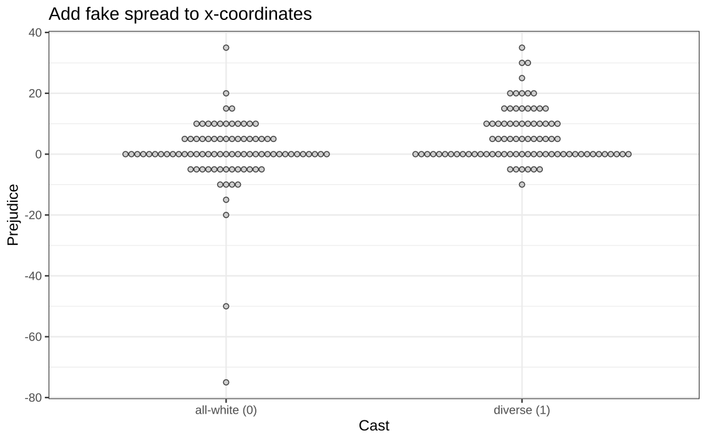
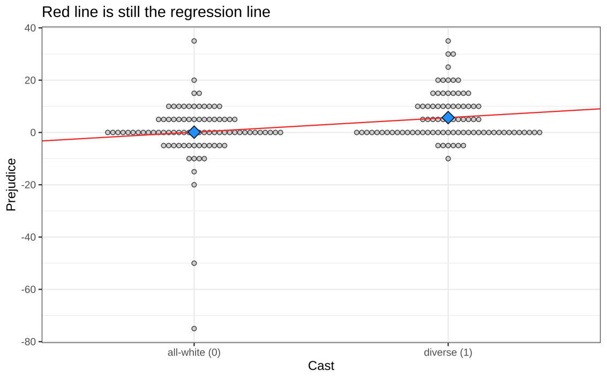
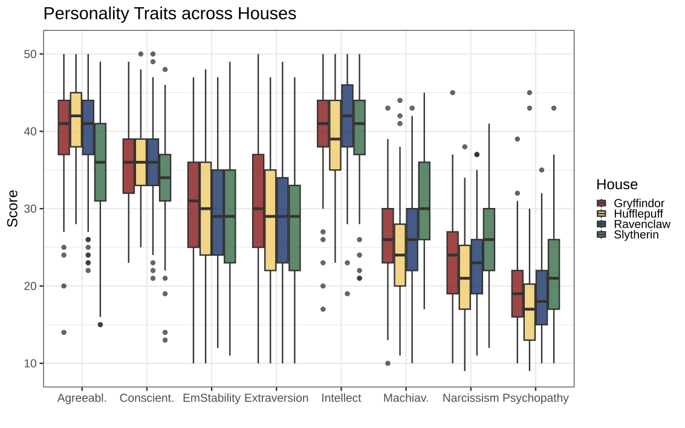
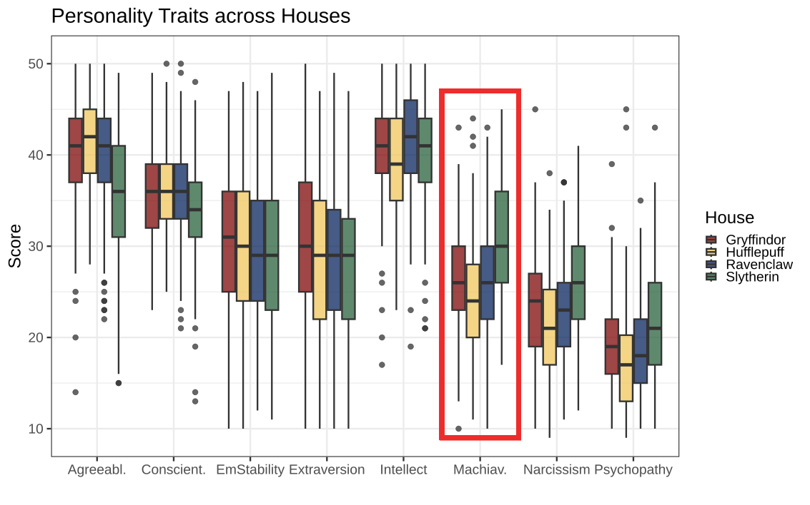
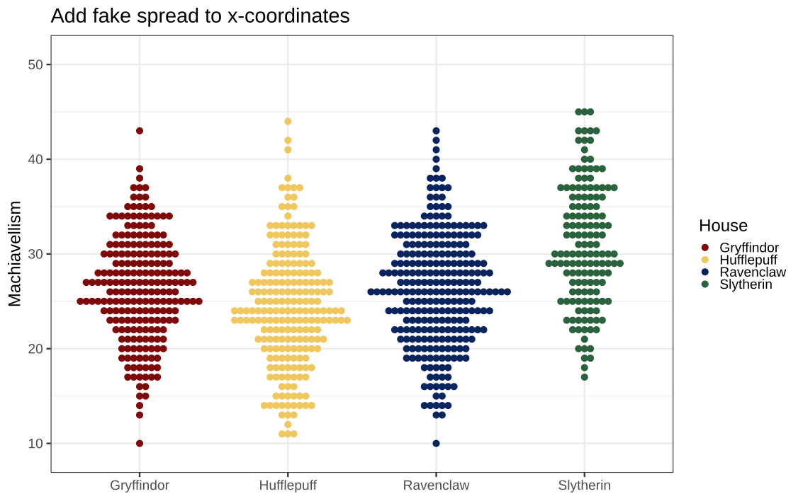
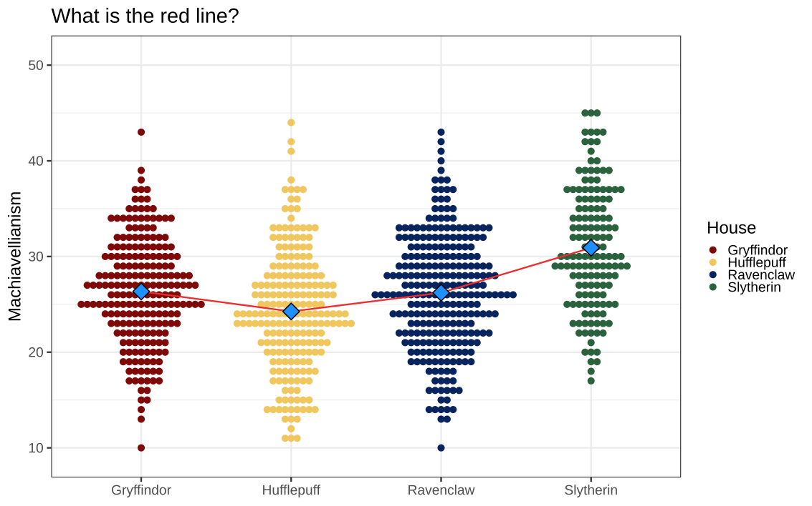
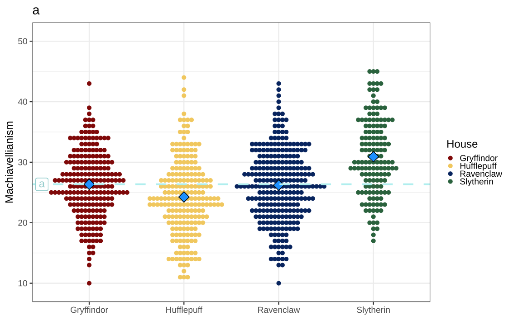
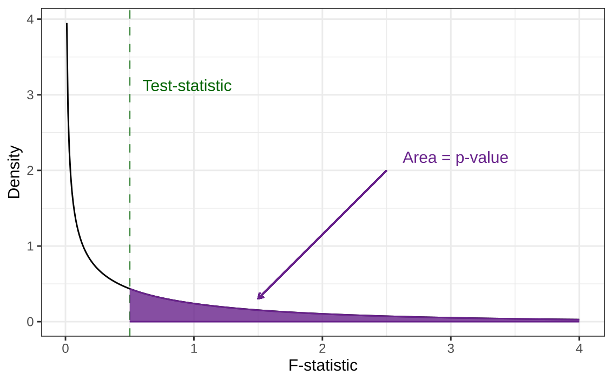
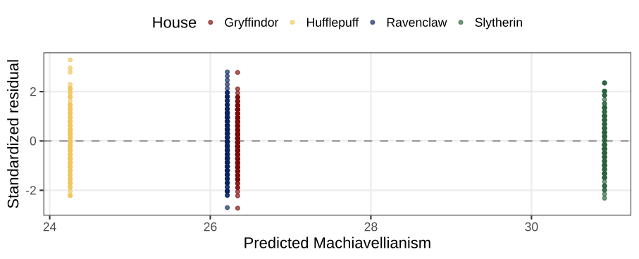
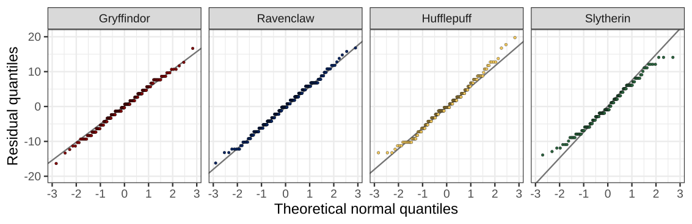

# Recap

<!--

Last week, linear regression with a binary predictor

can't multiply slope times word, therefore we used dummy coding.

group means

a = mean of reference category
a + b = mean of non-reference category

this was the same as independent samples t-test

This week, what if more than one category?

# Examples of when this occurs

Nominal:

Ordinal:
  Low, medium, high

# Dummy coding

we still can't multiply with a word
so we dummy code/ one-hot encoding

the dummy variable is 1 if it's that category and 0 otherwise:

Harry potter house:

|           | b_1 | b_2 | b_3 |
|-----------|-----|-----|-----|
Gryffindor  |  0  |  0  |  0  |
Hufflepuff  |  1  |  0  |  0  |
Ravenclaw   |  0  |  1  |  0  |
Slytherin   |  0  |  0  |  1  |

#  Regression with multiple dummies:

Now the regression equation becomes:

y_i = a + b_1 + b_2 + b_3

NOTE: underbrace what each b means, then ask what a means!

-->

::: {.hidden}
$$
\newcommand{\hypo}{\mathcal{H}}
\newcommand{\SE}{\mathrm{SE}}
\newcommand{\dnorm}[2]{\mathcal{N}\left(#1, #2\right)}
\newcommand{\res}{e}
\newcommand{\rep}{\epsilon}
\newcommand{\TSS}{\mathrm{TSS}}
\newcommand{\SSE}{\mathrm{SSE}}
\newcommand{\RSS}{\mathrm{RSS}}

\newcommand{\MSE}{\mathrm{MSE}}
\newcommand{\MSR}{\mathrm{MSR}}
$$
:::

## Trustworthy Faces

::: {.incremental .svg-stack .r-stretch}
- 
- 
- 
- 
:::

## Dummy Coding

If we put this into a regression we get:

$$
\widehat{\mathrm{Prejudice}} = a + b\times \mathrm{``Diverse''}
$$

. . .

but we can't multiply words with numbers.

We need to assign numbers to them.

This is called dummy coding.

## Dummy Coding



::: {.fragment fragment-index="3" .fade-in}

So "diverse" is coded as 1 and "all-white" as 0.

:::

## Dummy Coding

Now we can do linear regression with the dummy coded variable!

But what did that mean again?

## Meaning of $a$ and $b$

When the predictor is continuous:

- the intercept $a$ is the predicted value for $x = 0$.
- the slope is the change in predicted value when $x$ increases by 1.

. . .

When the predictor is binary:

- the intercept $a$ is the predicted value for the group coded 0 (the "reference category").
- the intercept + slope, $a+b$ is the predicted value for the group coded 1.

## Meaning of $a$ and $b$

Let's work this out!

$$
\widehat{\mathrm{Prejudice}} = a + b\times \mathrm{``Cast''}
$$

. . .

For "all-white", we use 0, so we get:

$$
\widehat{\mathrm{Prejudice}} = a + b\times 0 = a
$$

. . .

For "diverse", we use 1, so we get:

$$
\widehat{\mathrm{Prejudice}} = a + b\times 1 = a + b
$$

## Tests for $a$ and $b$

::: {style="font-size: 80%;"}

When the predictor is continuous:

- If the intercept $a$ is nonzero, well, that depends on the application.
- If the slope $b$ is nonzero, there is an association between $x$ and $y$.
:::

. . .

When the predictor is binary:

- If the intercept $a$ is nonzero, the mean in the reference category is significantly different from zero
- If the slope $b$ is nonzero, the mean of the nonreference category is significantly different from the reference category.

## Independent-samples t-test

$$
\begin{align}
\hypo_0:\mu_1&=\mu_2\\
\hypo_1:\mu_1&\neq\mu_2
\end{align}
$$

$$
t = \frac{(\bar{x}_\text{diverse} - \bar{x}_{\text{all-white}}) - (\mu_\text{diverse}-\mu_\text{all-white})}{\SE_{x}}
$$

::::: {.columns}

:::: {.column}

::: {style="font-size: 80%;"}

### Students $t$-test

- assumes equal population variances
- uses one pooled variance estimate
- $df = N - 2$
- test is identical to testing the slope in linear regression

$$
\SE_{\bar{x}_1 - \bar{x}_2} =
\sqrt{s^2_{\text{pooled}}\left(\frac{1}{n_1}+\frac{1}{n_2}\right)}
$$

:::

::::

:::: {.column}

. . .

::: {style="font-size: 80%;"}

### Welch's $t$-test

- assumes unequal population variances
- More complicated $df$

$$
\SE_{\bar{x}_1 - \bar{x}_2} =
\sqrt{\frac{s_1^2}{n_1}+\frac{s_2^2}{n_2}}
$$

:::

::::

:::::
<!--
## Recap

::: {style="font-size: 90%;"}

So far we've learned...

1. How to find $a$ and $b$ that minimize the SSE.
2. How much variance is explained by the regression line ($R^2$).
3. How to test $a$ and $b$ using $t$-tests and compare models using the $F$-test.
4. How to check the assumptions by examining the residuals.

... when the predictor is _continuous_ or _binary_

:::

. . .

What if the predictor is categorical?

   - What changes and what stays the same?
   - We'll focus on $a$ and $b$, $R^2$, testing, and the assumptions
 -->

# Categorical predictors

## Categorical predictors are common!

- Nominal (no natural order):
  * Nationality (Dutch/ French/ German/ ...)
  * Device type (mobile (android)/ mobile (iOS)/ desktop / tablet)
  * Media genre (sci-fi, documentary, comedy, true crime, ...)
  * Blood type (A, B, AB, O)
  * Workplace (Office/ Hybrid/ Remote)

- Ordinal (natural order):
  * Socio-economic status (Low/Medium/High)
  * Education (VMBO/ HAVO/ VWO)
  * Seniority (Junior / Medior / Senior)
  * Satisfaction (Very dissatisfied / Dissatisfied / Neutral / Satisfied / Very satisfied)

## Categorical predictors are common!

- Experimental treatments:
  * Medicine A / B / Placebo: which works best?
  * Teaching method A / B / C: which leads to higher exam scores?
  * Website design A / B / C: which keeps visitors engaged longer?

. . .

- Many online platforms use A/B testing:
  * Instagram: Different algorithms for recommending content (maximizing doomscrolling)
  * ChatGPT: Comparing model versions
  * YouTube: Multiple titles and thumbnails

. . .

What if we want to compare more than two groups?

## Houses of Hogwarts and Personality

{fig-align="center" width="200px"}

::: footer

Jakob, L., Garcia-Garzon, E., Jarke, H., & Dablander, F. (2019). The science behind the magic? The relation of the Harry Potter “Sorting Hat Quiz” to personality and human values. Collabra: Psychology, 5(1), 31.

:::

## Houses of Hogwarts and Personality

| Hogwarts  | House Values |
|-----------|--------------|
|Gryffindor | Bravery, helping others, and chivalry. |
|Hufflepuff | Hard work, patience, loyalty, and fair play. |
|Ravenclaw  | Intelligence, knowledge, planning ahead, and wit. |
|Slytherin  | Ambition, cunningness, heritage, and resourcefulness. |

: Table 1 in Jakob _et al_., (2019).

::: footer

Jakob, L., Garcia-Garzon, E., Jarke, H., & Dablander, F. (2019). The science behind the magic? The relation of the Harry Potter “Sorting Hat Quiz” to personality and human values. Collabra: Psychology, 5(1), 31.

:::

## Houses of Hogwarts and Personality

- Harry Potter fans can be assigned to one of these Houses by filling out an eight-item questionnaire
  * the Sorting Hat Quiz, made by J.K. Rowling (<https://www.pottermore.com>)
- Crysel _et al._ (2015) had participants use and examined relations with personality traits
- Jakob _et al._ (2019) wanted to replicate this

. . .

- 847 participants filled out the Sorting Hat Quiz and various personality questionnaires
  * Big 5/ OCEAN
  * The Short Dark Triad

::: footer

Jakob, L., Garcia-Garzon, E., Jarke, H., & Dablander, F. (2019). The science behind the magic? The relation of the Harry Potter “Sorting Hat Quiz” to personality and human values. Collabra: Psychology, 5(1), 31.

:::

## The Short Dark Triad (Jones & Paulhus, 2013)

<!-- {.absolute top=450 right=50 width="150" height="150"} -->
{.absolute top=450 right=50 width="150" height="150"}

::: {style="font-size: 48%; line-height: 1.12;"}

::: {.columns}

::: {.column width="33%"}

### Machiavellianism

1. It's not wise to tell your secrets.
2. I like to use clever manipulation to get my way.
3. Whatever it takes, you must get the important people on your side.
4. Avoid direct conflict with others because they may be useful in the future.
5. It's wise to keep track of information that you can use against people later.
6. You should wait for the right time to get back at people.
7. There are things you should hide from other people to preserve your reputation.
8. Make sure your plans benefit yourself, not others.
9. Most people can be manipulated.

:::

::: {.column width="33%"}

### Narcissism

1. People see me as a natural leader.
2. I hate being the center of attention. (R)
3. Many group activities tend to be dull without me.
4. I know that I am special because everyone keeps telling me so.
5. I like to get acquainted with important people.
6. I feel embarrassed if someone compliments me. (R)
7. I have been compared to famous people.
8. I am an average person. (R)
9. I insist on getting the respect I deserve.

:::

::: {.column width="33%"}

### Psychopathy

1. I like to get revenge on authorities.
2. I avoid dangerous situations. (R)
3. Payback needs to be quick and nasty.
4. People often say I'm out of control.
5. It's true that I can be mean to others.
6. People who mess with me always regret it.
7. I have never gotten into trouble with the law. (R)
8. I enjoy having sex with people I hardly know
9. I’ll say anything to get what I want

:::

:::

:::

::: {style="font-size: 50%; margin-top: 0.5em;"}

*Please indicate how much you agree with each statement.*

| **1** | **2** | **3** | **4** | **5** |
|:---:|:---:|:---:|:---:|:---:|
| Disagree strongly | Disagree | Neither agree nor disagree | Agree | Agree strongly |

:::

## Let's examine the data

::: {.incremental .svg-stack .r-stretch}
- 
- 
- 
- 
:::

## Dummy Coding

If we predict Machiavellianism using House with a regression we get:

$$
\widehat{\mathrm{Machiavellianism}} = a + b\times \mathrm{``Gryffindor''}
$$

. . .

but like with binary predictors, we still can't multiply words with numbers.

We need to assign numbers to them.

So we extend dummy coding to multiple categories.

## Dummy Coding {.small-slide}



## Dummy Coding

| Observed | Dummy_Hufflepuff | Dummy_Ravenclaw | Dummy_Slytherin |
|----|----|----|----|
| Gryffindor | 0 | 0 | 0 |
| Hufflepuff  | 1 | 0 | 0 |
| Ravenclaw  | 0 | 1 | 0 |
| Slytherin  | 0 | 0 | 1 |

## Dummy Coding

So _House_ has 4 categories, and we now have 3 dummy variables.

In general, for $k$ categories we have $k-1$ dummy variables.

Each of the dummy variables has its own regression coefficient.

. . .

The regression equation becomes:

$$
\begin{align}
\widehat{\mathrm{Machiavellianism}} =
a &+
b_1\times \mathrm{``Dummy\_Hufflepuff''} \\
&+b_2\times \mathrm{``Dummy\_Ravenclaw''} \\
&+b_3\times \mathrm{``Dummy\_Slytherin''}
\end{align}
$$

we now one intercept $a$ and 3 slope parameters, $b_1, b_2, b_3$!

So what do they mean?

<!--
## Dummy Coding

| Observed | Dummy_Hufflepuff | Dummy_Ravenclaw | Dummy_Slytherin |
|----|----|----|----|
|          | $b_1$           | $b_2$           | $b_3$ |
| Gryffindor | 0 | 0 | 0 |
| Hufflepuff  | 1 | 0 | 0 |
| Ravenclaw  | 0 | 1 | 0 |
| Slytherin  | 0 | 0 | 1 |

:::{.incremental}

::: {.columns}

::: {.column}

- $\mathrm{Gryffindor} = a$
- $\mathrm{Hufflepuff} = a + b_1$

:::

::: {.column}

- $\mathrm{Ravenclaw} = a + b_2$
- $\mathrm{Slytherin} = a + b_3$

:::

:::

:::

. . .

So what do the slopes mean?
-->

## Dummy coding: Hogwarts houses

$$
\widehat{y}_i = a + b_1 \times x_{i1} + b_2 \times x_{i2} + b_3 \times x_{i3}
$$

::: {.fragment data-fragment-index="1"}

<table style="font-size: 55%; width: 70%; margin: 0 auto 0.4em; line-height: 0.8;">
  <thead>
    <tr>
      <th>House</th>
      <th>Hufflepuff ($x_{i1}$)</th>
      <th>Ravenclaw ($x_{i2}$)</th>
      <th>Slytherin ($x_{i3}$)</th>
    </tr>
  </thead>
  <tbody>
    <tr><td>Gryffindor</td><td>0</td><td>0</td><td>0</td></tr>
    <tr><td>Hufflepuff</td><td>1</td><td>0</td><td>0</td></tr>
    <tr><td>Ravenclaw</td><td>0</td><td>1</td><td>0</td></tr>
    <tr><td>Slytherin</td><td>0</td><td>0</td><td>1</td></tr>
  </tbody>
</table>

:::

::: {.columns style="font-size: 75%;"}

::: {.column width="50%"}

::: {.fragment data-fragment-index="2"}
$$
\begin{aligned}
\widehat{\mathrm{Gryffindor}}
&= a + b_1\!\times\! 0 + b_2 \!\times\! 0 + b_3 \!\times\! 0 \\
&= a
\end{aligned}
$$
:::

::: {.fragment data-fragment-index="3"}
$$
\begin{aligned}
\widehat{\mathrm{Hufflepuff}}
&= a + b_1\!\times\! 1 + b_2 \!\times\! 0 + b_3 \!\times\! 0 \\
&= a + b_1
\end{aligned}
$$
:::

:::

::: {.column width="50%"}

::: {.fragment data-fragment-index="4"}
$$
\begin{aligned}
\widehat{\mathrm{Ravenclaw}}
&= a + b_1\!\times\! 0 + b_2 \!\times\! 1 + b_3 \!\times\! 0 \\
&= a + b_2
\end{aligned}
$$
:::

::: {.fragment data-fragment-index="5"}
$$
\begin{aligned}
\widehat{\mathrm{Slytherin}}
&= a + b_1\!\times\! 0 + b_2 \!\times\! 0 + b_3 \!\times\! 1 \\
&= a + b_3
\end{aligned}
$$
:::

:::

:::

## Parameter meaning

- The intercept is the _mean of the reference category_
  * In our case, the mean Machiavellianism of Gryffindors
- Each slope is the mean difference between that group's and the reference category
  * So $b_1$ is the mean difference between Gryffindors and Hufflepuffs
  * So $b_2$ is the mean difference between Gryffindors and Ravenclaws
  * So $b_3$ is the mean difference between Gryffindors and Slytherins

. . .

What is the mean difference between Slytherins and Ravenclaws?

. . .

::: {.columns style="font-size: 75%;"}

::: {.column width="30%"}

$$
\begin{align}
\widehat{\mathrm{Ravenclaws}}&= a + b_2 \\
\widehat{\mathrm{Slytherin}} &= a + b_3 \\
\end{align}
$$

:::

::: {.column width="70%"}

$$
\widehat{\mathrm{Ravenclaws} - \mathrm{Slytherin}} = a + b_2 - (a + b_3) = b_2 - b_3
$$

:::

:::

<!--
- The intercept is the _mean of the reference category_, Gryffindor.
- Each slope is a house mean minus the reference mean. For example, $b_3$ is Slytherin's mean minus Gryffindor's mean.

. . .

SPSS can calculate a standardized *Beta* for a dummy variable. Its size depends on the group proportions. Switching groups is a full step from 0 to 1, so a one-standard-deviation change has little meaning as a change in group membership.

Use the **unstandardized $B$** to read the difference between means in the original score units.
-->

## What does the regression look like?

::: {.incremental .svg-stack .r-stretch}
- 
- 
- 
- 
- 
:::

<!--
TODO: add here the slide with the spss betas, and show the values
those correspond to the previous plot!
-->

## Changing the reference category

| Observed | Dummy_Gryffindor | Dummy_Hufflepuff | Dummy_Slytherin |
|----|----|----|----|
|          | $b_1$           | $b_2$           | $b_3$ |
| Gryffindor | 1 | 0 | 0 |
| Hufflepuff  | 0 | 1 | 0 |
| Ravenclaw  | 0 | 0 | 0 |
| Slytherin  | 0 | 0 | 1 |

:::{.incremental}

::: {.columns}

::: {.column}

- $\mathrm{Gryffindor} = a + b_1$
- $\mathrm{Hufflepuff} = a + b_2$

:::

::: {.column}

- $\mathrm{Ravenclaw} = a$
- $\mathrm{Slytherin} = a + b_3$

:::

:::

:::

<!--
NOTE:

ask here, what does b_3 mean now?

 -->

 <!--
TODO:

show the same plot as before but now with the different reference category!
add horizontal line for intercept, this goes through Gryffindor
add vertical offset for each b

 -->

## Changing the reference category -- coefficients {.small-slide}

| House | Observed mean | [Gryffindor as reference]{.fragment data-fragment-index="1"} | [Ravenclaw as reference]{.fragment data-fragment-index="2"} |
|---|---:|---:|---:|
| Gryffindor | 26.34 | [$a=26.34$]{.fragment data-fragment-index="1"} | [$b_1=0.13$]{.fragment data-fragment-index="2"} |
| Hufflepuff | 24.25 | [$b_1=-2.09$]{.fragment data-fragment-index="1"} | [$b_2=-1.96$]{.fragment data-fragment-index="2"} |
| Ravenclaw | 26.21 | [$b_2=-0.13$]{.fragment data-fragment-index="1"} | [$a=26.21$]{.fragment data-fragment-index="2"} |
| Slytherin | 30.91 | [$b_3=4.57$]{.fragment data-fragment-index="1"} | [$b_3=4.70$]{.fragment data-fragment-index="2"} |

::: {.fragment data-fragment-index="3"}
What do you think happens to any significance tests when we change the reference category?
:::

::: {.fragment data-fragment-index="4"}
If the test still the same thing, nothing.
:::

# Testing

## Testing the slope

<table style="font-size: 55%; width: 70%; margin: 0 auto 0.4em; line-height: 0.8;">
  <thead>
    <tr>
      <th>House</th>
      <th>Hufflepuff ($x_{i1}$)</th>
      <th>Ravenclaw ($x_{i2}$)</th>
      <th>Slytherin ($x_{i3}$)</th>
    </tr>
  </thead>
  <tbody>
    <tr><td>Gryffindor</td><td>0</td><td>0</td><td>0</td></tr>
    <tr><td>Hufflepuff</td><td>1</td><td>0</td><td>0</td></tr>
    <tr><td>Ravenclaw</td><td>0</td><td>1</td><td>0</td></tr>
    <tr><td>Slytherin</td><td>0</td><td>0</td><td>1</td></tr>
  </tbody>
</table>

::: {.columns}

::: {.column}

- $\mathrm{Gryffindor} = a$
- $\mathrm{Hufflepuff} = a + b_1$

:::

::: {.column}

- $\mathrm{Ravenclaw} = a + b_2$
- $\mathrm{Slytherin} = a + b_3$

:::

:::

. . .

Suppose we we test if $b_3$ differs from 0. What does that mean?

. . .

Whether the mean Machiavellianism differs between Gryffindors and Slytherins

## Regression coefficients in SPSS {.small-slide .spss-regression-output}



  

:::: {.spss-notes}

Machiavellianism is the outcome variable. "(Constant)" is the mean for Gryffindor, the reference category.

::: {.fragment data-fragment-index="2"}
Slytherin scored about 4.57 points higher on average than Gryffindor.
:::

::::

## Testing a coefficient

Does the population mean differ between Slytherin and Gryffindor?

$$
\hypo_0:\beta_3=0
\qquad
\hypo_1:\beta_3\ne 0
$$

. . .

$$
t = \frac{b_3 - 0}{\SE_{b_3}} = \frac{4.569}{0.645} = 7.08
\qquad
df = N-4 = 843
$$

. . .

From the $t$-table (or SPSS output) we find $p<.001$. Gryffindor and Slytherin differ significantly in mean Macchiavellianism score.

## General regression formula

$$
\hat{y}_i = a + b_1 \times x_{i1}+ b_2 \times x_{i2}+ b_3 \times x_{i3} + \dots
$$

where $\dots$ goes on the number of categories minus 1.

So how do we test if there is an effect of _House_ on _Machiavellianism_?

When is there an effect?

. . .

Should _one_ of the slopes, $b_i$ be different from 0?

. . .

Should _all_ of the slopes, $b_i$ be different from 0?

. . .

In principle only one. But which one? How can we figure this out?

. . .

We can test each $b$ against 0!

But that has a problem.

## Multiple testing

Suppose we use $\alpha = 0.05$. If $\hypo_0$ is true, we make an error at most 5% of the time (the Type-I error).

Now we test each $b$ individually against 0. What happens?

:::{.incremental}
- Probability of a type I error after 1 test: 5%
- After 2 independent tests: 9.8%
- After 3 independent tests: 14.3%
- The more tests we perform, the greater the risk of a false positive!
<!-- 1 - (1 - \alpha)^k -->
:::
<!-- Note: mention this is an illustration if the tests were independent, they are not -->

. . .

Can we test all slopes simultaneously, using just one test?

## Comparing two models -- two weeks ago

When discussing bivariate linear regression, we saw that instead of individually comparing $b$ against 0 we could compare two models:

:::: {.r-stack}

::: {.fragment .fade-out fragment-index="2"}
$$
\begin{align}
\hypo_0:& \text{ the null model},       &&y_i = a \phantom{+ b\times x_i }\;\,+\res_i\\
\hypo_1:& \text{ the regression model}, &&y_i = a + b\times x_i +\res_i
\end{align}
$$
:::

::: {.fragment .fade-in fragment-index="2"}
$$
\begin{align}
\hypo_0:& \text{ the null model},       &&y_i = a + 0\times x_i +\res_i\\
\hypo_1:& \text{ the regression model}, &&y_i = a + b\times x_i +\res_i
\end{align}
$$
:::

::::

::: {.columns}

::: {.column}

::: {.fragment fragment-index="1"}
1. $\hypo_0: \beta = 0$ vs $\hypo_1: \beta \neq 0$.
:::

::: {.fragment fragment-index="3"}
2. $\hypo_0: \rho^2 = 0$ vs $\hypo_1: \rho^2 > 0$.

Here, $\rho^2$ is the _population_ value for $R^2$
:::

:::

::: {.column}

::: {.fragment fragment-index="4"}
1. Meaning 1 applies only for bivariate linear regression.
:::
::: {.fragment fragment-index="5"}
2. Meaning 2 applies in general!
:::

:::

:::

## Model comparison
<!--
$$
\begin{align}
\hypo_0\!:& \text{ the null model}, y_i = a+\res_i\\
\hypo_1\!:& \text{ the full model}, y_i = a + b_1\!\times\! x_{i1}+ b_2 \!\times\! x_{i2}+ b_3 \!\times\! x_{i3} +\res_i
\end{align}
$$
 -->
:::: {.r-stack}

::: {.fragment .fade-out fragment-index="3"}
$$
\begin{align}
\hypo_0\!:& \text{ the null model}, y_i = a\phantom{+0\!\times\! x_{i1}+ 0 \!\times\! x_{i2}+ 0 \!\times\! x_{i3}}+\res_i\\
\hypo_1\!:& \text{ the full model}, y_i = a + b_1\!\times\! x_{i1}+ b_2 \!\times\! x_{i2}+ b_3 \!\times\! x_{i3} +\res_i
\end{align}
$$
:::

::: {.fragment .fade-in fragment-index="3"}
$$
\begin{align}
\hypo_0\!:& \text{ the null model}, y_i = a+0\!\times\! x_{i1}+ 0 \!\times\! x_{i2}+ 0 \!\times\! x_{i3}+\res_i\\
\hypo_1\!:& \text{ the full model}, y_i = a + b_1\!\times\! x_{i1}+ b_2 \!\times\! x_{i2}+ b_3 \!\times\! x_{i3} +\res_i
\end{align}
$$
:::

::::

::: {.fragment .fade-in fragment-index="1"}

What do we test here?

:::

::: {.fragment .fade-in fragment-index="2"}

Does including _House_ improve the predictions sufficiently to justify the additional predictors?

Here, "improve the predictions" means, does explained variance ($R^2$) differ significantly from zero?

:::

## The hypothesis

For our four Hogwarts houses, we test:

$$
\begin{aligned}
\hypo_0 &: \beta_1 = \beta_2 = \beta_3 = 0\\
\hypo_1 &: \text{At least one } \beta_i \neq 0
\end{aligned}
$$

. . .

What does this mean in terms of group means?

. . .

$$
\begin{aligned}
\hypo_0 &: \mu_G = \mu_H = \mu_R = \mu_S\\
\hypo_1 &: \text{At least two means differ}
\end{aligned}
$$

. . .

We call this an _omnibus test_: it tests whether there is
an overall effect of House on Machiavellianism.

It does not tell us which houses differ!

## The $F$-test

:::: {.r-stack}

::: {.fragment .fade-out fragment-index="1"}

Recall the $F$-test from bivariate regression

$$
F = (N-2)\times\frac{\text{Explained variance}}
         {\text{Unexplained variance}}
$$

:::
::: {.fragment .fade-in fragment-index="1"}

We use a generalized version:

$$
F = \frac{N-p}{p-1}\times\frac{\text{Explained variance}}
         {\text{Unexplained variance}}
$$
Here, $p$ is the number of parameters in the model.
:::
::::

::: {.fragment fragment-index="2"}
- In bivariate regression, we have a $a$ and $b$, so $p = 2$.
  * $\frac{N-p}{p-1} = N - 2$.
- For Machiavellianism data, we have $a$, $b_1$, $b_2$, $b_3$, so $p = 4$.
  * $\frac{N-p}{p-1} = \frac{N-4}{3}= \frac{847-4}{3}= \frac{843}{3}$.
:::

<!--
Keep the slides above this comment unchanged.
-->

## Degrees of freedom for the $F$-test

There are two degrees of Freedom for the $F$-test:

- Numerator (Regression): $p-1 = 4-1 = 3$. The full model adds three house coefficients to the intercept-only model.
- Denominator (Residual): $N-p = 847-4 = 843$. The full model fits four parameters to 847 observations.

. . .

We report the numerator degrees of freedom first.

$$
F(3,843) = ...
$$

## Testing all coefficients for House {.small-slide}

:::: {.columns}

::: {.column width="57%"}

1. Hypothesis: Under $\hypo_0$, all four population means are equal.
2. Test statistic: Compare $F=36.26$ with an $F$-distribution with $3$ and $843$ degrees of freedom.
3. $p$-value: Under $\hypo_0$ and the model assumptions, this is the probability of an $F$ of $36.26$ or larger. SPSS reports $p<.001$.
4. Conclusion: Reject $\hypo_0$ at $\alpha=.05$. There is evidence that at least two population means differ.

:::

::: {.column width="42%"}

{width="100%"}

:::

::::

## Regression output in SPSS {.small-slide .spss-regression-output}



  
  
  

# ANOVA

## Why is it called ANOVA?

**AN**alysis **O**f **VA**riance

We want to know whether the house *means* differ. Why are we analyzing variance?

. . .

We can split the total variation into two parts.

::: {.incremental}

- *Between houses*. How far are the house means from the overall mean?
- *Within houses*. How far are individual scores from their own house mean?

:::

. . .

If the population means differ, we expect more variation between houses relative to the variation within houses.

## Between-group and within-group variation



## Three sums of squares {.small-slide}

For participant $i$, $y_i$ is their score, $\bar{y}$ is the overall mean, and $\hat{y}_i$ is their fitted score (their house mean).

. . .

$$
\begin{aligned}
\TSS &= \sum_{i=1}^N(y_i-\bar{y})^2
&&\text{(total variation)}\\[8pt]
\SSE &= \sum_{i=1}^N(y_i-\hat{y}_i)^2
&&\text{(unexplained variation within houses)}\\[8pt]
\RSS &= \TSS-\SSE = \sum_{i=1}^N(\hat{y}_i-\bar{y})^2
&&\text{(explained variation between houses)}
\end{aligned}
$$

. . .

The regression sum of squares ($\RSS$) is the reduction in squared error when we use the house means to predict scores. The sum runs over participants, so a larger house contributes its mean more times.

## From sums of squares to mean squares

We divide each sum of squares by its degrees of freedom.

$$
\begin{aligned}
\MSR &= \frac{\RSS}{k-1}
&&\text{(between houses)}\\[8pt]
\MSE &= \frac{\SSE}{N-k}
&&\text{(within houses)}
\end{aligned}
$$

Here $k$ is the number of groups and $N$ is the number of observations. With $k=4$ and $N=847$, the degrees of freedom are $3$ and $843$.

. . .

If $\hypo_0$ is true, both mean squares estimate the same population error variance. The $F$-test compares them using $F=\MSR/\MSE$.

## From sums of squares to mean squares

We divide each sum of squares by its degrees of freedom.

$$
\begin{aligned}
\MSR &= \frac{\RSS}{k-1}
&&\text{(between houses)}\\[8pt]
\MSE &= \frac{\SSE}{N-k}
&&\text{(within houses)}
\end{aligned}
$$

With $k$ houses, the regression fits one intercept and $k-1$ dummy slopes, so $p=k$.

In Lecture 10, we fitted one intercept and one slope, so $p=2$ and the degrees of freedom were $1$ and $N-2$.

<!--
Notes:
shouldn't we use p rather than k?
 -->

## One-way ANOVA in SPSS {.small-slide}



. . .

$$
F
  = \frac{\RSS/3}{\SSE/843}
  = \frac{3935.10/3}{30496.52/843}
  = \frac{\MSR}{\MSE}
  = \frac{1311.70}{36.18}
  = 36.26
$$

The *Between Groups* row gives $\RSS$ and $\MSR$, the *Within Groups* row gives $\SSE$ and $\MSE$, and the *Total* row gives $\TSS$.

The $p$-value comes from the upper tail of the $F$-distribution with $3$ and $843$ degrees of freedom.

## ANOVA and regression give the same results {.small-slide .spss-comparison}

:::: {.columns}

::: {.column width="50%"}

### Regression



:::

::: {.column width="48%"}

### One-way ANOVA



:::

::::

Match _Regression_ with _Between Groups_, _Residual_ with _Within Groups_ (and _Total_ with _Total_).

. . .

Both give $F(3,843)=36.26$, $p<.001$. Regression's $R^2=.114$ is ANOVA's $\eta^2=.114$.

. . .

One-way ANOVA and regression with dummy variables are mathematically equivalent. They give exactly the same omnibus $F$-test.

. . .

Just like student's $t$-test and regression with a binary dummy-coded predictor last week.

## Which houses differ? {.small-slide}

The omnibus test asks whether all four population means are equal. How do we compare Slytherin with Hufflepuff?

$$
\bar y_S-\bar y_H=30.91-24.25=6.66
$$

Which regression coefficient tells us whether this difference is significant?

. . .

With Gryffindor as reference, this difference is $b_3-b_1$.

. . .

- If we use Hufflepuff as the reference group, then Slytherin's new slope estimates and tests this difference ($b_3-b_1$).
  * We'd get $t(843)=10.31$, $p<.001$.
  * You can't read this from the standard output from ANOVA or regression.

## Effect size {.small-slide}

:::: {.columns}

::: {.column width="56%"}

In one-way ANOVA, *eta squared* is the proportion of observed variation explained by group membership.

$$
\eta^2 = \frac{\RSS}{\TSS} = R^2
$$

For the Hogwarts data,
$$
\eta^2 = 3935.10/34431.62 = .114
$$

:::

::: {.column width="40%"}

Common interpretation

| Effect | $\eta^2$ |
|---|---:|
| Small | .01 |
| Medium | .06 |
| Large | .14 |

:::

::::

Would the differences between these scores be meaningful in practice?

. . .

It falls between the medium and large benchmarks, so yes. Keep in mind that these are rough conventions, and that practical importance usually depends on the context.

. . .

::: {style="font-size: 80%;"}

I find it interesting that a Sorting hat questionnaire, _designed for entertainment_, has actual value when predicting/ explaining differences in personality scores, which were _designed to measure personality_.

:::

# Assumptions

## Assumptions for one-way ANOVA

The same assumptions apply to the dummy-coded regression and the classical one-way ANOVA.

::: {.incremental}

- *Linearity*. Each group gets its own fitted mean, so the mean model needs no straight-line trend across groups.
- *Normality*. Errors are normally distributed within each house. We can check this with Q–Q plots of the residuals by house.
- *Equal variances*. The population variance is the same in each house. Compare the within-house spread.
- *Independence*. Consider how scores were collected. Repeated scores from the same person or recruitment in clusters could lead to dependence.

:::

## Levene's Test

We can test the assumption of homoscedasticity using Levene's test.

$$
\begin{aligned}
\hypo_0 &: \text{the variances of the houses are equal}\\
\hypo_1 &: \text{the variances of at least two houses differs}
\end{aligned}
$$

. . .

- This is the same test as last week, but now for two or more groups
- Levene's test uses an F-statistic to test whether the group variances are equal.
- If Levene's test is *significant*, there is evidence that at least two variances are not equal

## Equal variances {.small-slide}

<table class="spss-table">
  <caption>Group Statistics</caption>
  <thead>
    <tr>
      <th scope="col" class="term">House</th>
      <th scope="col">N</th>
      <th scope="col">Mean</th>
      <th scope="col">Std. Deviation</th>
    </tr>
  </thead>
  <tbody>
    <tr><th scope="row" class="term">Gryffindor</th><td>217</td><td>26.34</td><td>5.53</td></tr>
    <tr><th scope="row" class="term">Hufflepuff</th><td>216</td><td>24.25</td><td>6.29</td></tr>
    <tr><th scope="row" class="term">Ravenclaw</th><td>269</td><td>26.21</td><td>5.96</td></tr>
    <tr><th scope="row" class="term">Slytherin</th><td>145</td><td>30.91</td><td>6.38</td></tr>
  </tbody>
</table>

. . .

Levene's test gives $F(3,843)=1.66$, $p=.174$. The test provides little evidence of unequal variances.

. . .

If the spreads differ substantially, Welch's ANOVA allows unequal variances, just like Welch's $t$-test for two groups.

## Equal variances -- residuals versus predicted values {.small-slide}

{fig-alt="Standardized residuals plotted against predicted Machiavellianism, with one vertical band per Hogwarts house and a dashed line at zero." fig-align="center" width="88%"}

Each house has one fitted mean, so the regression diagnostic shows four vertical bands. Do they have roughly equal spreads?

. . .

Really hard to tell due to the overlapping points.

## Normality within each house {.small-slide}

{fig-alt="Residual Q–Q plots for Gryffindor, Hufflepuff, Ravenclaw, and Slytherin" fig-align="center" width="100%"}

. . .

The middle of each plot follows the line fairly closely. The tails show some departures, and the steps reflect ties in the questionnaire scores.

## Independence

After accounting for House, the errors for different participants should be independent.

"We recruited participants through social media (Facebook, Twitter, and Reddit), private contacts, and student e-mail groups".

Do you think the assumption is violated or not?

. . .

Facebook/ twitter means there is a common factor, they are all connected/ friends with the authors! That can increase undesired dependencies which may violate the assumptions. Nevertheless, really hard to tell from the data themselves though.

Assess independence from the study design. Look for repeated scores from the same person or groups of people recruited together.

# Conclusions

## We've learned -- Categorical predictors

- With $k$ groups, use $k-1$ dummy variables (0 and 1).
  - The intercept $a$ is the reference group mean.
  - Each slope $b_i$ is a group mean minus the reference mean.
- A coefficient $t$-test compares a group mean with the reference mean.
- The overall regression $F$-test is equivalent to one-way ANOVA. It tests whether all population means are equal.
- $F=\MSR/\MSE$, with $k-1$ and $N-k$ degrees of freedom.
- Eta squared ($\eta^2=R^2$) is the proportion of observed variation explained by group membership.

## We've learned -- Assumptions

| Assumption | How do we check it? |
|---|---|
| Linearity | Automatically satisfied when each group has its own fitted mean |
| Normality | Examine Q–Q plots of the residuals by group |
| Equal variances | Compare group spreads and use Levene's test |
| Independence | Consider how the data were collected |

## Next week

- Continuation of ANOVA
- Q&A session

<!--
TODO: slide about next week
-->
