# General Linear Model (GLM)

$$
\newcommand{\hypo}{\mathcal{H}}
\newcommand{\SE}{\mathrm{SE}}
\newcommand{\dnorm}[2]{\mathcal{N}\left(#1, #2\right)}
\newcommand{\res}{e}
\newcommand{\rep}{\epsilon}
$$

## What is the GLM?

A family of models to analyze the relationship between one outcome and one or more predictors

* Today we introduce bivariate linear regression, one member of the family
* Describes a linear relationship between a continuous outcome variable and a continuous predictor
* Other family members can handle:
    + Predictors of any measurement level (continuous or categorical)
    + Multiple predictors
    + Transformations of Y
    + Transformations of X
    + Other error distributions than the normal distribution

## What is the GLM?

```{dot}
strict digraph GLM {
    graph [
        rankdir=TB,
        bgcolor="transparent",
        nodesep=0.35,
        ranksep=0.85,
        ordering=out
    ];

    node [
        shape=box,
        style="rounded,filled",
        fillcolor="#f1f5f9",
        color="#64748b",
        penwidth=1.5,
        fontname="Helvetica",
        fontsize=15,
        margin="0.18,0.12"
    ];

    edge [
        color="#64748b",
        penwidth=1.5,
        arrowsize=0.7,
        fontname="Helvetica",
        fontsize=11
    ];

    GLM [label="General Linear Models"];
    LM  [label="Linear model"];
    LOG [label="Logistic regression"];

    O [label="One-sample\nt-test"];
    S [label="Simple\nlinear\nregression"];
    I [label="Independent-samples\nt-test"];
    A [label="One-way\nANOVA"];
    M [label="Multiple\nregression"];

    GLM -> LM  [label="  Identity\nlink"];
    GLM -> LOG [label="Logit\nlink"];

    // Highlight the GLM -> LM -> ANOVA branch
    // GLM [penwidth=4, color="#2563eb"];
    // LM  [penwidth=4, color="#2563eb"];
    // O   [penwidth=4, color="#2563eb"];

    // GLM -> LM [penwidth=4, color="#2563eb"];
    // LM  -> O  [penwidth=4, color="#2563eb"];

    LM -> O [label="Intercept only"];
    LM -> S [label="One\ncontinuous\npredictor"];
    LM -> I [label="One\nbinary\npredictor"];
    LM -> A [label="One\ncategorical\npredictor\n(3+ groups)"];
    LM -> M [label="Multiple\npredictors"];

// Separate linear and logistic regression
    {
        rank=same;
        LM;
        spacer [shape=point, width=0.1, style=invis, label=""];
        LOG;
    }

    LM -> spacer -> LOG [
        style=invis,
        weight=100
    ];
    // Keep all five linear-model specializations at the same level
    { rank=same; O; S; I; A; M; }
}
```

## The $t$-test is a GLM!

```{dot}
strict digraph GLM {
    graph [
        rankdir=TB,
        bgcolor="transparent",
        nodesep=0.35,
        ranksep=0.85,
        ordering=out
    ];

    node [
        shape=box,
        style="rounded,filled",
        fillcolor="#f1f5f9",
        color="#64748b",
        penwidth=1.5,
        fontname="Helvetica",
        fontsize=15,
        margin="0.18,0.12"
    ];

    edge [
        color="#64748b",
        penwidth=1.5,
        arrowsize=0.7,
        fontname="Helvetica",
        fontsize=11
    ];

    GLM [label="General Linear Models"];
    LM  [label="Linear model"];
    LOG [label="Logistic regression"];

    O [label="One-sample\nt-test"];
    S [label="Simple\nlinear\nregression"];
    I [label="Independent-samples\nt-test"];
    A [label="One-way\nANOVA"];
    M [label="Multiple\nregression"];

    GLM -> LM  [label="  Identity\nlink"];
    GLM -> LOG [label="Logit\nlink"];

    // Highlight the GLM -> LM -> ANOVA branch
    GLM [penwidth=4, color="#2563eb"];
    LM  [penwidth=4, color="#2563eb"];
    O   [penwidth=4, color="#2563eb"];

    GLM -> LM [penwidth=4, color="#2563eb"];
    LM  -> O  [penwidth=4, color="#2563eb"];

    LM -> O [label="Intercept only"];
    LM -> S [label="One\ncontinuous\npredictor"];
    LM -> I [label="One\nbinary\npredictor"];
    LM -> A [label="One\ncategorical\npredictor\n(3+ groups)"];
    LM -> M [label="Multiple\npredictors"];

// Separate linear and logistic regression
    {
        rank=same;
        LM;
        spacer [shape=point, width=0.1, style=invis, label=""];
        LOG;
    }

    LM -> spacer -> LOG [
        style=invis,
        weight=100
    ];
    // Keep all five linear-model specializations at the same level
    { rank=same; O; S; I; A; M; }
}
```

## Today we talk about another part of the GLM

```{dot}
strict digraph GLM {
    graph [
        rankdir=TB,
        bgcolor="transparent",
        nodesep=0.35,
        ranksep=0.85,
        ordering=out
    ];

    node [
        shape=box,
        style="rounded,filled",
        fillcolor="#f1f5f9",
        color="#64748b",
        penwidth=1.5,
        fontname="Helvetica",
        fontsize=15,
        margin="0.18,0.12"
    ];

    edge [
        color="#64748b",
        penwidth=1.5,
        arrowsize=0.7,
        fontname="Helvetica",
        fontsize=11
    ];

    GLM [label="General Linear Models"];
    LM  [label="Linear model"];
    LOG [label="Logistic regression"];

    O [label="One-sample\nt-test"];
    S [label="Simple\nlinear\nregression"];
    I [label="Independent-samples\nt-test"];
    A [label="One-way\nANOVA"];
    M [label="Multiple\nregression"];

    GLM -> LM  [label="  Identity\nlink"];
    GLM -> LOG [label="Logit\nlink"];

    // Keep all five linear-model specializations at the same level
    { rank=same; O; S; I; A; M; }

    LM -> O [label="Intercept only"];
    LM -> S [label="One\ncontinuous\npredictor"];
    LM -> I [label="One\nbinary\npredictor"];
    LM -> A [label="One\ncategorical\npredictor\n(3+ groups)"];
    LM -> M [label="Multiple\npredictors"];

    // Highlight the GLM -> LM -> ANOVA branch
    GLM [penwidth=4, color="#2563eb"];
    LM  [penwidth=4, color="#2563eb"];
    S   [penwidth=4, color="#2563eb"];

    GLM -> LM [penwidth=4, color="#2563eb"];
    LM  -> S  [penwidth=4, color="#2563eb"];


// Separate linear and logistic regression
    {
        rank=same;
        LM;
        spacer [shape=point, width=0.1, style=invis, label=""];
        LOG;
    }

    LM -> spacer -> LOG [
        style=invis,
        weight=100
    ];
}
```
# Linear Regression

## Thought experiment...

If I told you that last year's average exam grade was: $\bar{Y} = 6.1$

What grade would you expect to get for this year's exam?

## Thought experiment...

If I also told you that hours studied is strongly associated with the exam grade

And you know that you studied far more than average...

Does that change your expectation for your grade?

## What does this demonstrate?

1. The mean is the best predictor (expected value) when there's no further relevant information
2. If you DO have information about other variables that are **associated** with the outcome, you can use that information to improve your predictions

This is regression.

## The Data

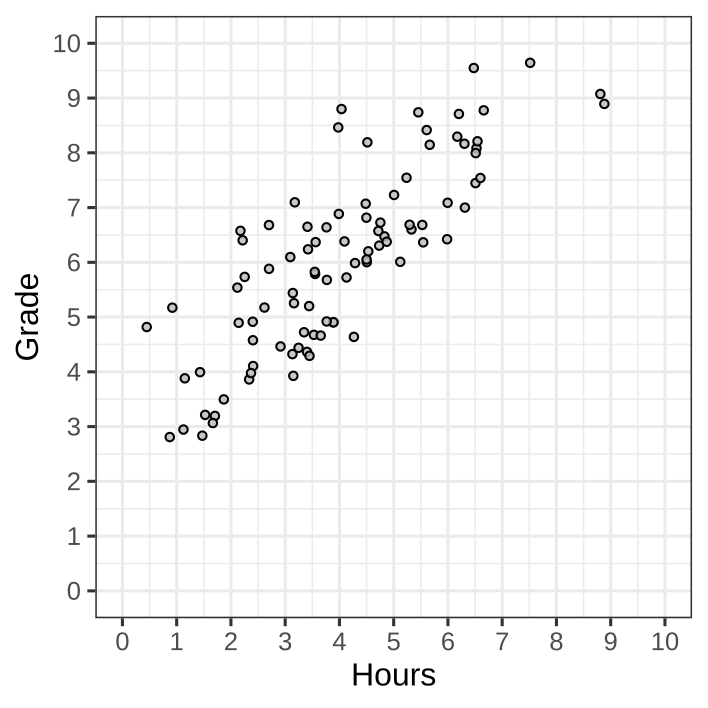{fig-align="center"}

## Null Model

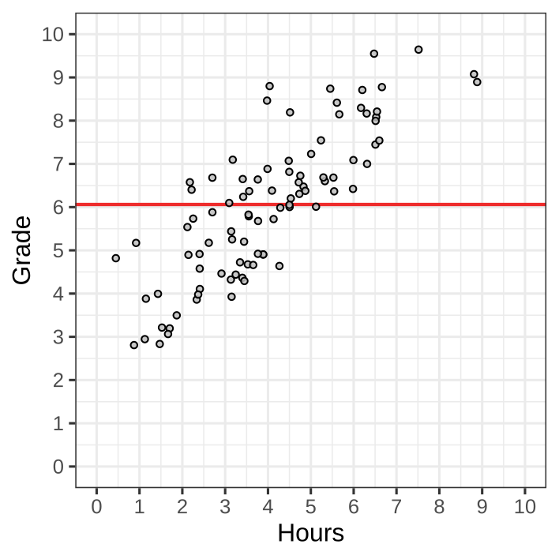{fig-align="center"}

## Prediction Error

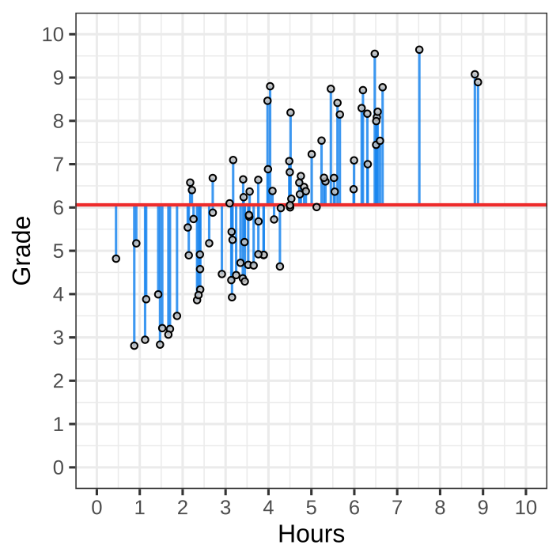{fig-align="center"}

## Association

{fig-align="center"}

## Association

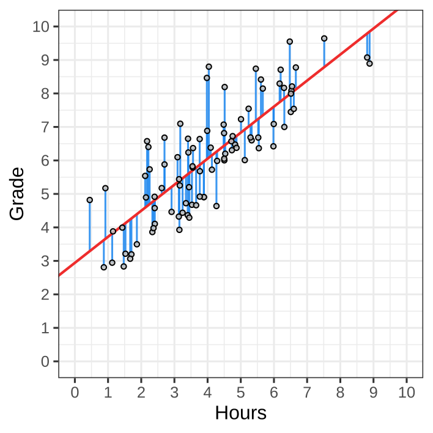{fig-align="center"}

## Other regression lines




## Equation
$$
\mathrm{Grade} = \mathrm{Intercept} + \mathrm{Slope}\times\text{Hours studied}
$$

. . .

Or in general,

$$
\underbrace{y}_{\substack{\text{outcome variable}\\\text{dependent variable}}}
=
\underbrace{a}_{\text{intercept}}
+
\underbrace{b}_{\text{slope}}
\times
\underbrace{x}_{\substack{\text{predictor variable}\\\text{independent variable}}}
$$

. . .

- $a$, the intercept, where the line crosses the $y$-axis.
  + $a$ is the predicted value when $x = 0$.
- $b$, the slope, how steep the line increases or decreases
  + $y$ increase by $b$ when $x$ increases by 1.

## Prediction Error

- The regression equation _predicts_ the observed $y_1,\,y_2,\,\dots,\,y_N$.
- Every prediction, $\hat{y}_i$ is usually slightly wrong.
- The _prediction error_ is $y_i - \hat{y}_i$.

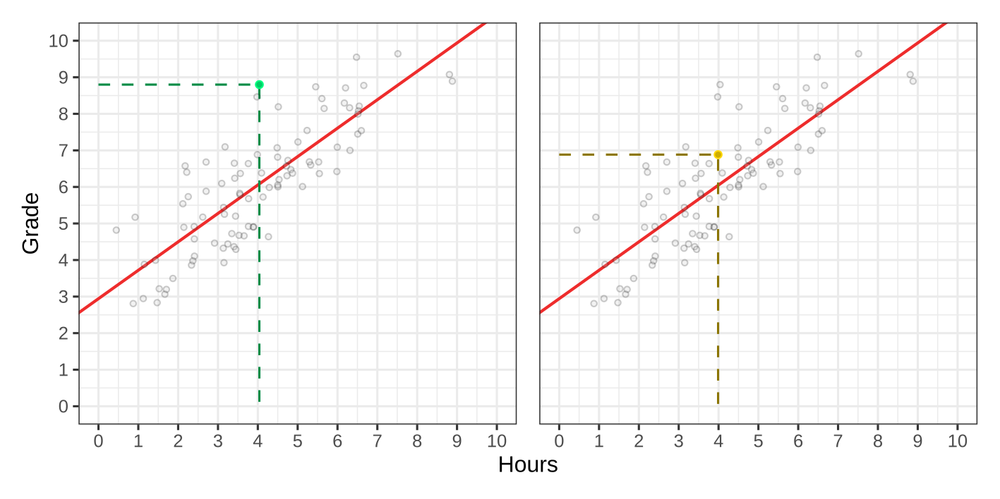{fig-align="center"}

## Squared Prediction Error

Let the _residual error_ be $\res_i = y_i - \hat{y}_i$

Suppose: $\res_1 = y_1 - \hat{y}_1 = -5$ and $\res_2 = y_2 - \hat{y}_2 = 5$

Then the total error $\res_1 + \res_2 = 0$.

Clearly this is wrong, the model is not perfect.

. . .

Just like for the variance, we _square the distances_

$$
\text{Sum of Squared Residuals} = \sum_{i=1}^N (y_i - \hat{y}_i)^2
$$

so that positive and negative errors don't cancel.

## Ordinary Least Squares

How do we find the line that best fits our data?

- Different values of $a$ and $b$ give us different lines
- Each line produces predictions $\hat y_i = a + b\times x_i$
- Each line makes different mistakes, i.e., different residuals
- OLS finds $a$ and $b$ by _minimizing the sum of squared residuals_

$$
\text{OLS finds}\; a\; \text{and}\; b\; \text{that minimize}\;
\sum_{i=1}^n (y_i - \hat y_i)^2
$$

## Example

OLS yields $a = 2.9$ and $b = 0.8$. So:

$$
\widehat{\mathrm{Grade}} = 2.9 + 0.8 \times \text{Hours studying}
$$

. . .

Student 9 spent 4 hours studying. The predicted grade is:

$$
\widehat{\mathrm{Grade}} = 2.9 + 0.8 \times 4 = 6.1
$$

The actual grade was 6.9, so the prediction error is:

$$
\res_9 = 6.9 - 6.1 = 0.8
$$

## The OLS without predictors

Suppose we don't have any predictors, so no $x_i$.

We predict the same value for everyone: $\hat{y}_i = a$.

The OLS then minimizes:

$$
\sum_{i=1}^N (y_i - \hat{y}_i)^2 = \sum_{i=1}^N (y_i - a)^2
$$

Which value for $a$ minimizes this?

. . .

$$
a = \bar{y}
$$

So the _sample mean_ is the OLS if we have no predictor variables!

## Why squared errors?

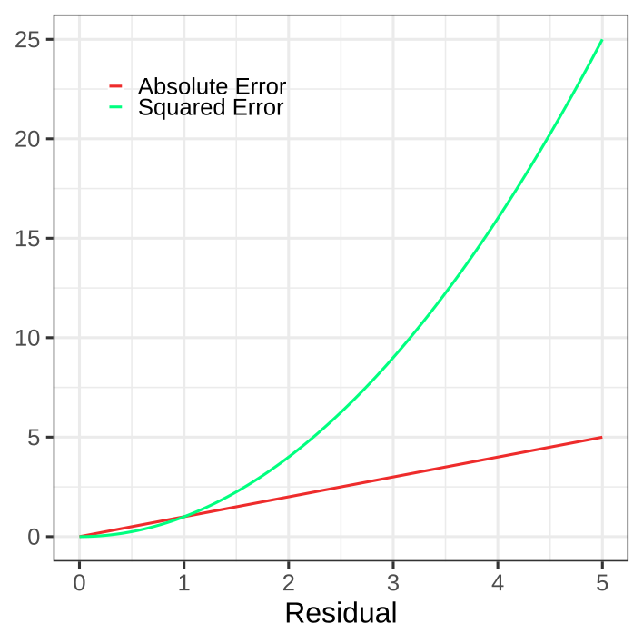{fig-align="center"}

## Regression Recap

The formula $\hat{y}_i = a + b \times x_i$ describes the regression line

The prediction error, the residual, is $\res_i = y_i - \hat{y}_i$

OLS finds the optimal $a$ and $b$ by minimizing the _sum of squared residuals_

## Regression Recap

$\hat{y}_i = a + b \times x_i$

Symbol         | Interpretation
-------------- | -----------------------------------------------------
$y_i$          | Individual $i$'s score on dependent variable $y$
$\hat{y}_i$    | Prediction for individual $i$'s score on dependent variable $y$
$a$            | Coefficient, intercept of the regression line
$b$            | Coefficient, slope of the regression line
$x_i$          | Individual $i$'s score on independent variable $x$
$\res_i$       | Difference between prediction and observation for individual $i$


# Break {.unlisted}

See you in ~10 minutes

## Introducing Uncertainty

So far, everything was deterministic.

$y$ appears a _deterministic_ function of $x$.

But we're dealing with a sample and want to generalize to the population.

Hence we must account for _sampling uncertainty_.

The slope, $b$, will rarely be zero in the sample.

But what about the population?

How can do a null hypothesis test that the slope equals 0?


# Recap NHST

## One sample t-test

Recall the one-sample $t$-test

$$
\begin{align}
\mathrm{df} &= N - 1\\
\SE_x &= \frac{s_x}{\sqrt{N}}\\
t &= \frac{\bar{x} - x_0}{\SE_x}
\end{align}
$$
where $x_0$ is the point determined by the null hypothesis $\hypo_0$

Next, we look up $t$ and $\mathrm{df}$ in the $t$-table.

Everything here follows from the assumption that $\bar{X}\mid\hypo_0\sim\mathcal{N}\left(\mu_{\hypo_0},\frac{\sigma^2}{N}\right)$ if $\hypo_0$ is true.


## Univariate Linear Regression {.small-slide}

So far, we have used our sample to estimate a regression line:

$$
\hat{y}_i = a + b \times x_i
$$

in the population, observations are not perfectly predicted by $x$.

. . .

We use the population model:

$$
Y_i = \alpha + \beta \times x_i + \rep_i
$$

- $\alpha$ and $\beta$ are the population intercept and slope.
- $\rep_i$ is the *error*: the difference between an observation and its population prediction.

. . .

We assume that these errors are normally distributed:

$$
\rep_i \sim \mathcal{N}(0,\sigma_\rep^2)
$$

## Unpacking this assumption

We assume that the errors are *independent and identically distributed*:

$$
\rep_i \overset{\mathrm{iid}}{\sim}\mathcal{N}(0,\sigma_\rep^2)
$$

This implies quite a few things:

- Normality.
- Mean zero: Predictions are correct on average at each value of $x$.
- Homoscedasticity: The spread of the error does not depend on $x$.
    + The error variance $\sigma_\rep^2$ is constant.
- Independence: Knowing one error tells us nothing about another.
    + $\rep_i$ and $\rep_j$ are _independent_

## Hypotheses and Sampling Distributions

Let $\alpha$ and $\beta$ be the population parameters for $a$ and $b$.
Then:

- Intercept is zero: $\hypo_0 : \alpha = 0$
- Slope is zero: $\hypo_0 : \beta = 0$

The sampling distributions are:

$$
\begin{align}
\mathrm{Intercept:} & a\mid \hypo_0 \sim \dnorm{\alpha_{\hypo_0}}{\sigma_\epsilon^2\times c_\alpha}\\
\mathrm{Slope:} & b\mid \hypo_0 \sim \dnorm{\beta_{\hypo_0}}{\sigma_\epsilon^2\times c_\beta}
\end{align}
$$

::: footer

$c_\alpha$ and $c_\beta$ are constants that depend on $x$ that will be discussed more next week.

:::

## Hypotheses and Sampling Distributions

$$
a\mid \hypo_0 \sim \dnorm{\alpha_{\hypo_0}}{\sigma_\epsilon^2\times c_\alpha}\quad
b\mid \hypo_0 \sim \dnorm{\beta_{\hypo_0}}{\sigma_\epsilon^2\times c_\beta}
$$

If we _do know_ $\sigma_\epsilon$, this is a $Z$-test, otherwise a $t$-test.

Almost always, $\sigma_\epsilon$ is unknown and estimated from the data, so standard software uses a $t$-test.

- The degrees of freedom are $\mathrm{df} = N - 2$
    + $-2$ because we estimate two parameters, slope and intercept

$$
t = \frac{\hat{\beta} - \beta_{\hypo_0}}{\SE_b}
$$

::: footer

$c_\alpha$ and $c_\beta$ are constants that depend on $x$ that will be discussed more next week.

:::

## In SPSS

## Testing coefficients SPSS

* This tests the intercept and slope
* Default null-hypothesis for the intercept is $H_0: \alpha = 0$
    + Is the intercept significantly different from zero? No.
* Default null-hypothesis for the slope is $H_0: \beta = 0$
    + Is the slope significantly different from zero? Yes.

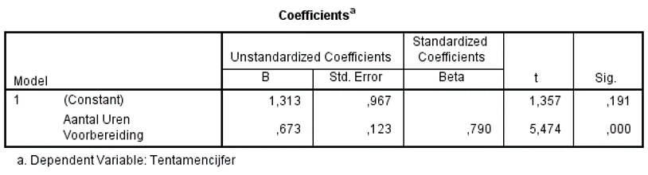{fig-align="center"}

## Custom tests using SPSS

Let's conduct a one-sided hypothesis, $H_0: \beta \leq 0$

* We expect the effect will be positive, $H_a: \beta > 0$
* If the effect is in the direction of $H_a$, we can divide the p-value by 2 for a one-sided test
* $p = .001/2 = .0005$, rounded to $p < .001$, so no practical difference

{fig-align="center"}

## Custom tests using SPSS

Or you might wonder: if I would study 0 hours, should I expect a passing grade? $H_0: \alpha \leq 5.5$

* $t = \frac{a-\alpha_0}{SE_a} = \frac{1.31-5.5}{.97} = -4.32$
* The effect is not in the direction of $H_a$; instead, it's congruent with $H_0$, so we will never reject it

{fig-align="center"}

## Reporting

> The effect of hours studied on exam grade was significant, $b = 0.67, t(90) = 5.47, p < .001.$ This means that for every additional hour studied, the expected grade increased by 0.67.


# Assumptions

## Assumptions

* A model is built on it's assumptions
* If assumptions are violated:
  + The model misrepresents the data
  + Tests are misleading
  + Inferences not justified

. . .

In practice, all models are wrong, but some are useful.

. . .

* We can try (and should try!) to check assumptions
    + But no evidence of violation is not the same as evidence of no violation
    + Sometimes assumptions are violated but with little impact on conclusions

::: notes

stress here that violations are often seen as all or nothing decision while in reality it's more delicate. E.g., minor deviations of normality are unlikely to change results.

:::

## Assumption checks

Dictionary definition: "something that you accept as true without question or proof"

* Assumptions are statements about the population
    + So we never really know if they're true
* Assumption checks are limited to the sample
* Tailoring your analysis based on assumption checks in the sample risks overfitting the model

## Assumptions of linear regression

1. Linearity
    + The relationship between X and Y is linear.
2. Homoscedasticity
    + Residuals are equally distributed for all values of the predictor
    + The variance of the errors is constant
3. Independence
    + The errors of different observations are independent.
4. Normality
    + Errors are normally distributed.

## Linearity (i)

Scatter plot: do the points follow a straight line?

## Linearity (i)

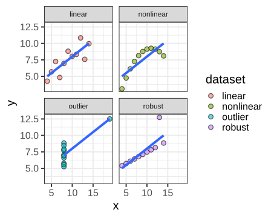{fig-align="center"}

## Linearity (ii)

Residual plot. Is there a leftover pattern?

- fit the regression model
- obtain the residuals
- Examine a scatter plot of:
    + fitted values vs residuals
    + observed predictors vs residuals

## Violations of Linearity

- Nonlinear (quadratic, cubic, other patterns)

## Violations of Linearity

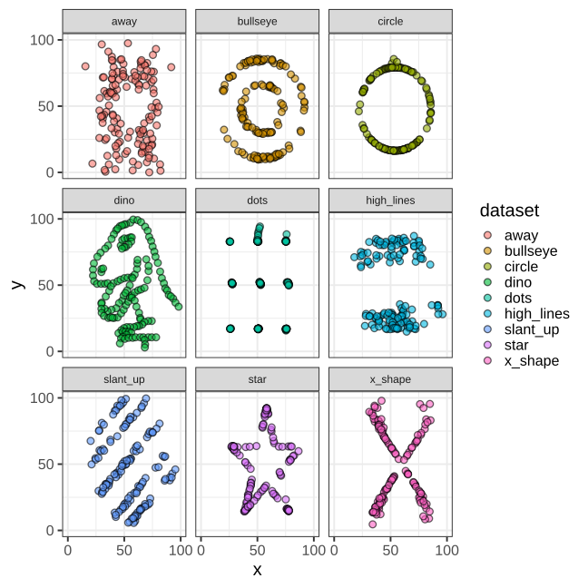{fig-align="center"}

## Violations of Linearity

::: {.r-stack style="height: 50vh;"}
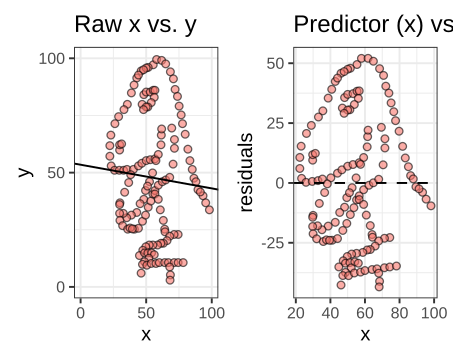{ style="max-width: 70vw; max-height: 50vh; width: auto; height: auto; object-fit: contain;"}

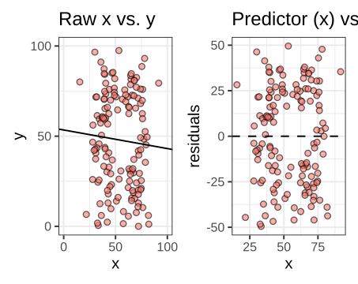{.fragment style="max-width: 70vw; max-height: 50vh; width: auto; height: auto; object-fit: contain;"}

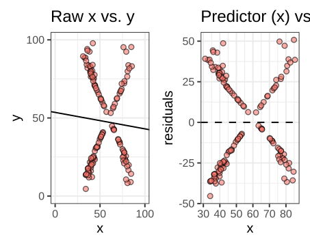{.fragment style="max-width: 70vw; max-height: 50vh; width: auto; height: auto; object-fit: contain;"}

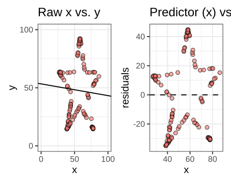{.fragment style="max-width: 70vw; max-height: 50vh; width: auto; height: auto; object-fit: contain;"}

:::


## Normality of Residuals

- Often, this is a "convenience" assumption
- You have to make an assumption for significance testing
- We often use the normal because of the central limit theorem
- If you know the distribution of the residuals, use a different link function in the GLM
    + Most common in engineering situations rather than social sciences.
    + More on this in later lectures

## Assessing Normality

- Visually: Histogram, Normal P-P plot, or Q-Q plot
- Kolgomorov-Smirnov or Shapiro-Wilk test

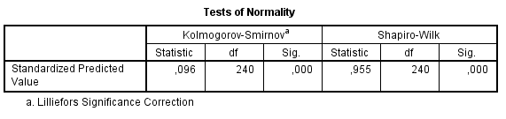{fig-align="center"}


# Example: Disgust and Authoritarianism

## Abstract {.small-slide}

Authoritarianism has resurfaced as a research topic in political psychology, as it appears relevant to explain current political trends. Authoritarian attitudes have been consistently linked to feelings of disgust, an emotion that is thought to have evolved to protect the organism from contamination. We hypothesized that body odour disgust sensitivity (BODS) might be associated with authoritarianism, as chemo-signalling is a primitive system for regulating interpersonal contact and disease avoidance, which are key features also in authoritarianism. We used well-validated scales for measuring BODS, authoritarianism and related constructs. Across two studies, we found that BODS is positively related to authoritarianism. In a third study, we showed a positive association between BODS scores and support for Donald Trump, who, at the time of data collection, was a presidential candidate with an agenda described as resonating with authoritarian attitudes. Authoritarianism fully explained the positive association between BODS and support for Donald Trump. Our findings highlight body odour disgust as a new and promising domain in political psychology research. Authoritarianism and BODS might be part of the same disease avoidance framework, and our results contribute to the growing evidence that contemporary social attitudes might be rooted in basic sensory functions.

::: footer

Liuzza, M. T., Lindholm, T., Hawley, C. B., Gustafsson Sendén, M., Ekström, I., Olsson, M. J., & Olofsson, J. K. (2018). Body odour disgust sensitivity predicts authoritarian attitudes. *Royal Society open science, 5*(2). <https://doi.org/10.1098/rsos.171091>

:::

## Can disgust predict political attitudes?

Liuzza et al. (2018): *Body odour disgust sensitivity predicts authoritarian attitudes*

- People differ in how easily they experience disgust.
- People also differ in their political attitudes.
- Liuzza and collegues examined if and how these are associated

_Research question_: Are people who are more sensitive to body odours also more authoritarian?

::: footer

Liuzza, M. T., Lindholm, T., Hawley, C. B., Gustafsson Sendén, M., Ekström, I., Olsson, M. J., & Olofsson, J. K. (2018). Body odour disgust sensitivity predicts authoritarian attitudes. *Royal Society open science, 5*(2). <https://doi.org/10.1098/rsos.171091>

:::

## The Data

Each participant ($N = 201$) completed questionnaires measuring:

- Body Odour Disgust Sensitivity (BODS)
    + How strongly do unpleasant body odours provoke disgust?
- Right-Wing Authoritarianism (RWA)
    + Attitudes toward authority, conformity, and traditional social norms.


We calculate a score for each participant on both scales.

## The Data


```{r}
#| echo: false
file <- file.path("data", 'Study1_raw.csv')
d <- read.csv(file)
library(dplyr)
bods_items <- paste0("BODS", 1:12)

rwa_items <- c(
  paste0("RWA", seq(1, 15, 2)),
  paste0("RWA", seq(2, 14, 2), "_R")
)
reverse_items <- paste0("RWA", seq(2, 14, 2), "_R")


d <- d |>
  mutate(across(all_of(reverse_items), ~ 8 - .x))

d <- d |>
  mutate(
    BODS = rowMeans(across(all_of(bods_items)), na.rm = TRUE),
    RWA  = rowMeans(across(all_of(rwa_items)), na.rm = TRUE)
  )

keep <- !startsWith(colnames(d), "TDD")
d <- d[keep]

d |>
  head(50) |>
  DT::datatable(
    options = list(
      searching = FALSE,
      info = FALSE,
      paging = FALSE,
      scrollX = TRUE,
      scrollY = "360px",
      scrollCollapse = TRUE
    ),
    rownames = FALSE
  )
```


## The Data

We have one (average) score for BODS and RWA per participant.

Which variable would you use to predict the other?

## The Regression Model

We want to predict authoritarianism from disgust sensitivity.

$$
\widehat{\mathrm{RWA}}_i =
a + b \times \mathrm{BODS}_i
$$

- $a$: Predicted authoritarianism when BODS is zero
- $b$: Expected change in authoritarianism for a one-point increase in BODS

Our hypothesis:

$$
\hypo_0: \beta = 0
\qquad
\hypo_1: \beta \neq 0
$$

## What Does the Relationship Look Like?

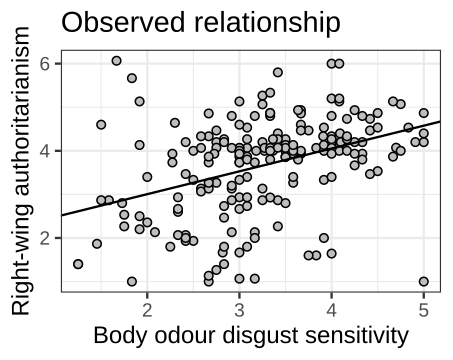{fig-align="center"}

::: notes

Discuss the direction of the association.

A positive association means that participants who report
greater disgust sensitivity tend to score higher on authoritarianism.

The relationship is correlational, not necessarily causal.

:::

## Can We Trust the Regression Model?

Before interpreting the significance test,
we should investigate whether the model is appropriate.

Recall our assumptions:

1. Linearity
2. Homoscedasticity
3. Independence
4. Normally distributed errors


## Linearity and Homoscedasticity

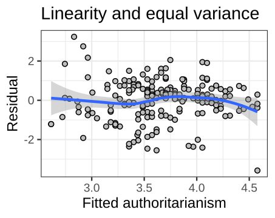{fig-align="center"}

. . .

:::{style="font-size:75%"}

- Linearity: No systematic curved pattern in the residuals.
- Homoscedasticity: Approximately equal spread across fitted values.
- A "good" residual plot looks like a random cloud around zero, with approximately constant vertical spread.

:::

## Normally Distributed Errors

Our model assumes:

$$
\epsilon_i \sim \mathcal{N}(0,\sigma_\epsilon^2)
$$

We can examine the residuals using:

- A histogram with a normal reference curve
- A normal P-P plot
- A normal Q-Q plot

## Normally Distributed Errors

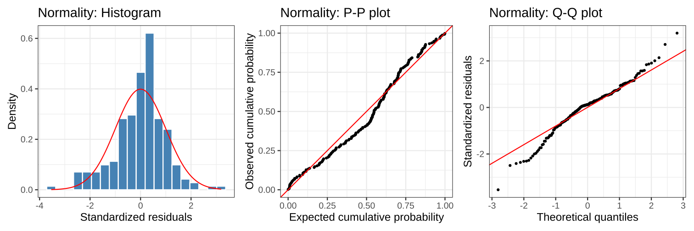{fig-align="center"}

## What Do the Normality Checks Tell Us?

The diagnostic plots show departures from normality.

. . .

Does this mean we must reject the regression model?

. . .

Not necessarily!

- OLS coefficients do not require normally distributed errors.
- The hypothesis tests do.
- Normality assumptions are more important for smaller samples.
- With sufficiently large samples, inference can be reasonably robust to moderate nonnormality.

The _severity_ of the violation matters.

## Regression Results

| Predictor | Estimate | Std. Error | $t$ | $p$ |
|:----------|---------:|-----------:|----:|----:|
| Intercept | 1.8833 | 0.3420 | 5.507 | < .001 |
| Disgust sensitivity (BODS) | 0.5359 | 0.1015 | 5.279 | < .001 |

## What Can We Conclude?

The published study reports a positive association between body odour disgust sensitivity and
authoritarianism.

The reanalysis confirms this.

. . .

However:

. . .

- Statistical significance does not establish causation.
    + "Correlation is not causation"
- The same goes for regression!
