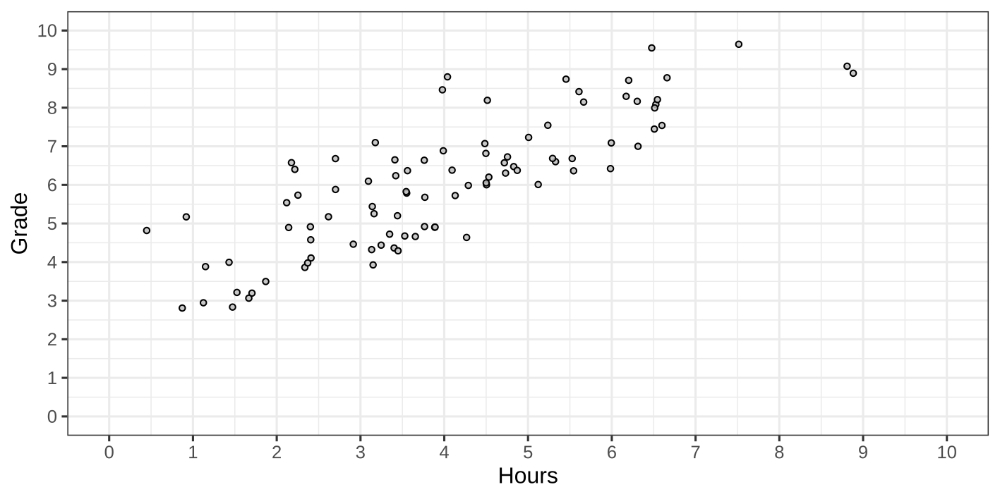
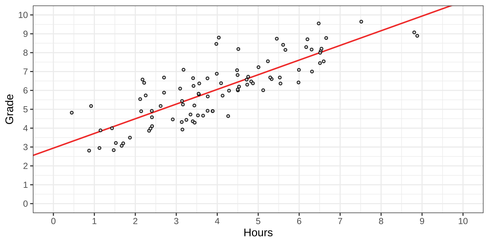
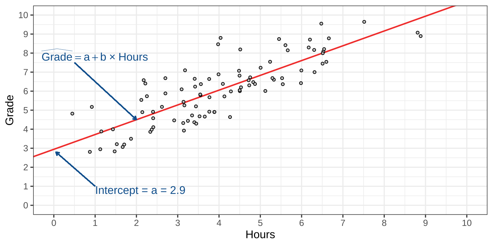
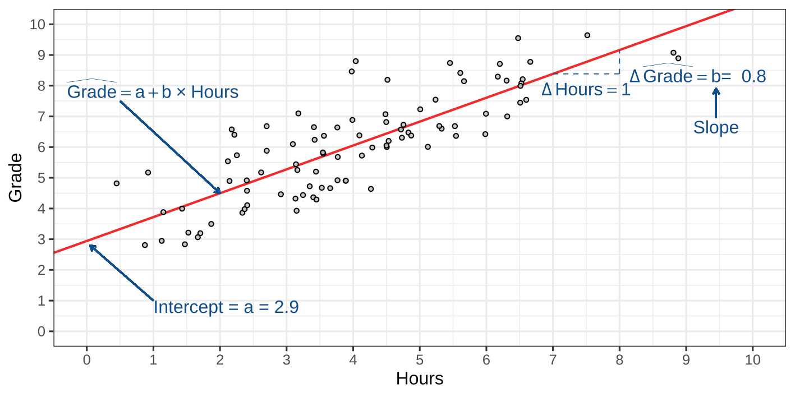
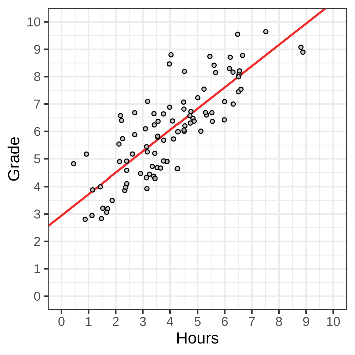
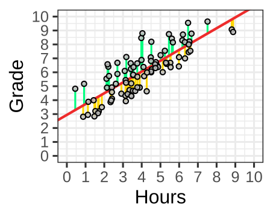
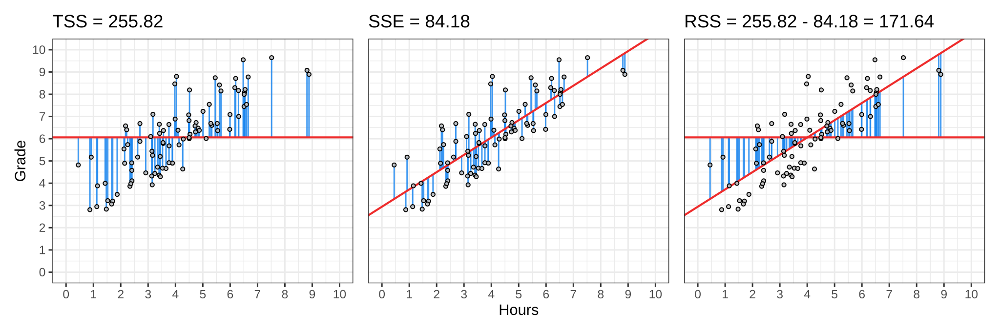
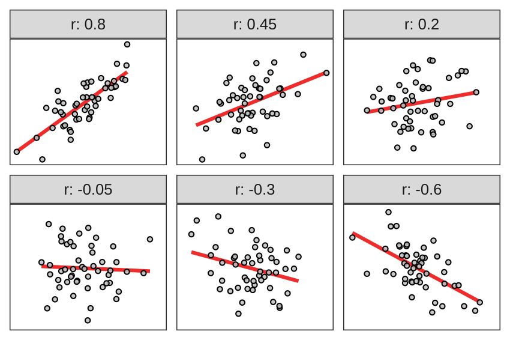

# Recap Linear Regression

## Grades vs. Hours Studied

{fig-align="center"}

## Grades vs. Hours Studied

{fig-align="center"}

## Grades vs. Hours Studied

{fig-align="center"}

## Grades vs. Hours Studied

{fig-align="center"}

## Grades vs. Hours Studied

{fig-align="center"}

## Recap

::: {.hidden}
$$
\newcommand{\hypo}{\mathcal{H}}
\newcommand{\SE}{\mathrm{SE}}
\newcommand{\dnorm}[2]{\mathcal{N}\left(#1, #2\right)}
\newcommand{\res}{e}
\newcommand{\rep}{\epsilon}
\newcommand{\TSS}{\mathrm{TSS}}
\newcommand{\SSE}{\mathrm{SSE}}
\newcommand{\RSS}{\mathrm{RSS}}
$$
:::

$$
\widehat{\mathrm{Grade}} = \mathrm{Intercept} + \mathrm{Slope}\times\text{Hours studied}
$$

. . .

In general,

$$
\underbrace{y}_{\substack{\text{outcome variable}\\\text{dependent variable}}}
=
\underbrace{a}_{\text{intercept}}
+
\underbrace{b}_{\text{slope}}
\times
\underbrace{x}_{\substack{\text{predictor variable}\\\text{independent variable}}} +
\underbrace{\res}_{\substack{\text{residual}}}
$$

. . .

- $a$, the intercept, is the predicted value when $x = 0$.
- $b$, the slope, describes how steep the line increases or decreases.
  + $\hat{y}$ increases by $b$ when $x$ increases by 1.

## Recap

$\hat{y}_i = a + b \times x_i, \qquad \res_i = y_i - \hat{y}_i$

Symbol         | Interpretation
-------------- | -----------------------------------------------------
$y_i$          | Individual $i$'s score on dependent variable $y$
$\hat{y}_i$    | Prediction for individual $i$'s score on dependent variable $y$
$a$            | Coefficient, intercept of the regression line
$b$            | Coefficient, slope of the regression line
$x_i$          | Individual $i$'s score on independent variable $x$
$\res_i$       | Observed minus predicted outcome for individual $i$

## Grades vs. Hours Studied

We found $a = 2.9$ and $b = 0.8$.

. . .

So our equation becomes:

$$
\widehat{\mathrm{Grade}} = 2.9 + 0.8 \times \text{Hours studied}
$$

## Grades vs. Hours Studied

::::: {.r-stack}

::: {.fragment .fade-out fragment-index=1}
The first three observations:
:::

:::: {.fragment .fade-in fragment-index=1}
::: {.fragment .fade-out fragment-index=3}
The predictions are

$$
\widehat{\mathrm{Grade}} = 2.9 + 0.8 \times \text{Hours studied}
$$
:::
::::

:::: {.fragment .fade-in fragment-index=3}
::: {.fragment .fade-out fragment-index=5}
The errors are

$$
\res = \mathrm{Grade} - \widehat{\mathrm{Grade}}
$$
:::
::::

::: {.fragment .fade-in fragment-index=5}
The Sum of Squared Errors (SSE) for these observations is:

$$
\mathrm{SSE} = \sum_{i=1}^3 \res_i^2
= 0.8^2 + 0.3^2 + (-0.6)^2 = 1.09
$$
:::

:::::

<table>
<thead><tr>
<th style="text-align:right;"> $\mathrm{Grade}$ </th>
   <th style="text-align:right;"> $\mathrm{Hours}$ </th>
   <th style="text-align:right;" class="fragment" data-fragment-index="2"> $\widehat{\mathrm{Grade}}$ </th>
   <th style="text-align:right;" class="fragment" data-fragment-index="4"> $\res$ </th>
  </tr></thead>
<tbody>
<tr>
<td style="text-align:right;"> 6.9 </td>
   <td style="text-align:right;"> 4 </td>
   <td style="text-align:right;" class="fragment" data-fragment-index="2"> 6.1 </td>
   <td style="text-align:right;" class="fragment" data-fragment-index="4"> 0.8 </td>
  </tr>
<tr>
<td style="text-align:right;"> 7.2 </td>
   <td style="text-align:right;"> 5 </td>
   <td style="text-align:right;" class="fragment" data-fragment-index="2"> 6.9 </td>
   <td style="text-align:right;" class="fragment" data-fragment-index="4"> 0.3 </td>
  </tr>
<tr>
<td style="text-align:right;"> 7.1 </td>
   <td style="text-align:right;"> 6 </td>
   <td style="text-align:right;" class="fragment" data-fragment-index="2"> 7.7 </td>
   <td style="text-align:right;" class="fragment" data-fragment-index="4"> -0.6 </td>
  </tr>
</tbody>
</table>

## Other regression lines



::: {.notes}

Before moving the sliders, ask: "If I make the slope much steeper, what do you predict will happen to the sum of squared errors?"

:::

## Recap

1. The Ordinary Least Squares finds $a$ and $b$ that minimize the SSE.
2. The mean is the best predictor when there's no further relevant information.
3. If we have information about other variables that are associated with the outcome, these can improve the predictions.

. . .

Goals for today:

- How much better are the predictions than simply using the mean?
- How does this relate to correlation?
<!-- something else? -->

# Sums of Squares

## Prediction error

- OLS finds the straight line with the smallest sum of squared residuals in this sample.
- Literally, this uses "sums of squares"
    + e.g., $\res_1^2 + \res_2^2 +\dots + \res_N^2$

## Ordinary Least Squares

Why squares?

. . .

Why not minimize the errors directly?

. . .

Last week

- Suppose: $\res_1 = y_1 - \hat{y}_1 = -5$ and $\res_2 = y_2 - \hat{y}_2 = 5$
- Then the total error $\res_1 + \res_2 = 0$.

## Ordinary Least Squares

::: {.columns}

::: {.column width="40%"}

This is not a coincidence!

<ul>
  <li class="fragment fade-in" data-fragment-index="4">
  Sum of the positive prediction errors: [36.25]{style="color: #00FF7F;"}
  </li>
  <li class="fragment fade-in" data-fragment-index="5">
  Sum of the negative prediction errors: [-36.25]{style="color: #FFD700;"}
  </li>
  <li class="fragment fade-in" data-fragment-index="6">
   Sum of all prediction errors: [36.25]{style="color: #00FF7F;"}+[-36.25]{style="color: #FFD700;"} = 0
  </li>
</ul>

::: {.fragment fragment-index=7}

The OLS by _design_ makes these equal

:::

:::

::: {.column width="60%"}

::: {.r-stack style="height: 45vh;"}

{.fragment  fragment-index=1 style="max-width: 70vw; max-height: 45vh; width: auto; height: auto; object-fit: contain;"}

{.fragment  fragment-index=2 style="max-width: 70vw; max-height: 45vh; width: auto; height: auto; object-fit: contain;"}

{.fragment fragment-index=3 style="max-width: 70vw; max-height: 45vh; width: auto; height: auto; object-fit: contain;"}

:::
<!-- rstack -->

:::
<!-- column -->

:::
<!-- columns -->

## Solution

Square the errors, so the negatives don't cancel against the positives.

This means:

- A Sum of Squared Errors (SSE) is always zero or positive.
- A Sum of Squared Errors (SSE) of zero means predictions are perfect.
- Minimizing SSE means finding the regression line that makes the "best" predictions.

## Goodness of fit

The OLS gives us the "best" regression line for the outcome given the predictor.

- But how well does it describe the data?
- We can examine the SSE:
    + (+) lower is better
    + (-) the scale is hard to interpret
        * it changes with sample size
        * it depends on the units

. . .

We fix the scale by comparing the sum of squared errors to a baseline.

## What should the baseline model be?

. . .

The null model:

$$
y_i = a + \res_i
$$

- The intercept $a$, the only parameter is the mean of $y$.
    + $a = \bar{y}$
    + $\hat{y}_i = \bar{y}$

. . .

Comparing to the null model tells us: "How much does this predictor add on top of the intercept?"

## Total Sum of Squares

What's the prediction error of the null model?

. . .

::: {.columns}

::: {.column}

$$
\begin{align}
\mathrm{TSS} &= \sum_{i=1}^N (y_i - \hat{y}_i)^2 \\
             &= \sum_{i=1}^N (y_i - \bar{y})^2 \\
             &= 255.82
\end{align}
$$

. . .

This is the same equation as for the SSE, except we use the predictions from the null model.

:::

::: {.column}

{fig-align="center"}

:::

:::

<!--
## Total sum of squares

$\mathrm{TSS} = \sum_{i=1}^N (y_i - \bar{y})^2 = 255.82$

. . .

We've seen TSS also in the equation for variance:

$$
s^2_y = \frac{\sum_{i=1}^{N}(y_i - \bar{y})^2}{N - 1}
$$

So TSS is the _variance_ of $y$ times $N - 1$
 -->
<!-- TODO: is this just a redundant fact for the story? -->

## Regression Sum of Squares

How much did our predictions improve?

This is the reduction in the sum of squared errors, relative to the null model:

$$
\underbrace{\RSS}_{\substack{\text{Regression Sum of Squares}}} =
\underbrace{\TSS}_{\substack{\text{Total Sum of Squares}}} -
\underbrace{\SSE}_{\substack{\text{Sum of Squared Errors}}}
$$

. . .

We found $\TSS = 255.82$ and $\SSE = 84.18$.

$$
RSS = 255.82 - 84.18 = 171.64
$$

<!--
TODO: the bridge here is not clear yet!
The formulas are just out of place
the story should immediately go to the Explain variance!
-->

## Three sums of squares

- TSS: Total Sum of Squares, Error of the null model
- SSE: Sum of Squared Errors, Error of the regression model
- RSS: Regression Sum of Squares, Reduction in squared prediction error

{fig-align="center"}

::: {.notes}

The RSS bars connect the mean-only prediction to the regression prediction. Square these distances and add them.

:::

## Three sums of squares

Name | Formula                                    | Also
-----|--------------------------------------------|---------------
$\SSE$  | $\sum_{i=1}^N{(y_i - \hat{y}_i)^2}$     | $\TSS - \RSS$
$\TSS$  | $\sum_{i=1}^N{(y_i - \bar{y})^2}$       | $\RSS + \SSE$
$\RSS$  | $\sum_{i=1}^N{(\hat{y}_i - \bar{y})^2}$ | $\TSS - \SSE$

# Explained Variance

## How can we use the RSS?

The RSS has the same problems as SSE:

- it changes with sample size
- it depends on the units

. . .

However,

- Suppose the predictor explains nothing on top of the mean
    + then $\SSE = \TSS$, so $\RSS = \TSS - \SSE = 0$.
- Suppose the predictor explains the data perfectly
    + then $\SSE = 0$, so $\RSS = \TSS - \SSE = \TSS$.

<!-- TODO: separate slide with the above in pictures?  -->

So RSS is bounded between 0 and TSS.

## How can we use the RSS?

We convert RSS into a proportion, called $R^2$ (R-squared):

$$
R^2 = \frac{\RSS}{\TSS}
$$

. . .

- Suppose the predictor explains nothing on top of the mean
    + then $\SSE = \TSS$, so $\RSS = \TSS - \SSE = 0$.
    + $R^2 = 0 / \TSS = 0$.
- Suppose the predictor explains the data perfectly
    + then $\SSE = 0$, so $\RSS = \TSS - \SSE = \TSS$.
    + $R^2 = \TSS / \TSS = 1$.

<!-- TODO: return of the other slide but now with values of R^2 the above the pictures?  -->

$R^2$ lies between 0 (nothing explained) and 1 (everything explained).

## Explained Variance

$R^2$ is also called the _proportion of explained variance_.

. . .

Recall the variance of y: $s^2_y = 1 / (N-1) \times \sum_{i=1}^N (y_i - \bar{y})^2$.

Since $\TSS = \sum_{i=1}^N (y_i - \bar{y})^2$, we have $\TSS / (N-1) = s^2_y$.

. . .

This means:

$$
\begin{align}
R^2 &= \frac{\RSS}{\TSS} &&\\
    &= \frac{\RSS / (N - 1)}{\TSS / (N - 1)} \quad&& \text{ multiply by }\frac{1 / (N - 1)}{1 / (N - 1)}\\
    &= \frac{\RSS / (N - 1)}{s_y^2} \quad && \text{substitute definition for TSS}
\end{align}
$$

## Explained Variance

$$
R^2 = \frac{\RSS}{\TSS} = \frac{\RSS / (N - 1)}{s_y^2}
$$

So $R^2$ is the proportion of the variance in $y$ that is explained by the regression model.

- If $R^2 = 0$, the model explains no variation in $y$.
- If $R^2 = 1$, the model explains all variation in $y$.

## Explained Variance: Grades

For the Grades example, we had

- $\TSS = 255.82$
- $\RSS = 171.64$

So $R^2 = \frac{171.64}{255.82} = 0.67$

. . .

In this sample, hours studied explains 67% of the variance in the grades.

## Explained Variance: Demo

::: {.notes}

- Confirm the TSS to variance relation

Q: "If I increase the mean of y, while keeping its variance and R-squared the same, which sums of squares will change?"

Wait!

Q: "If I increase R-squared while keeping the variance of y the same, what happens to TSS, SSE, and RSS?"

:::



## Conclusions:

- Changing the mean of $y$ does not change TSS, SSE, or RSS.
- An explained variance ($R^2$) of 0 means the slope of the regression is zero $(b = 0)$.
- An explained variance ($R^2$) above 0 doesn't tell us much about the slope of the regression
    * other than that the slope is not zero.
- An explained variance ($R^2$) of 1 tells us all observations lie exactly on the regression line.

<!--
Adding the same constant to every observation does not change TSS, SSE, RSS, or $R^2$.
 -->

<!-- # Wooclap -->

<!-- # Break -->

# Correlation

## Correlation

A standardized measure of the direction and strength of a linear association between two continuous variables

- Standardized: ranges from $[-1,\; 1]$
- Sample correlation: $r$
- Population correlation: $\rho$
- $r = -1$: Perfect negative association
- $r =  0$: No linear association
- $r =  1$: Perfect positive association

## Correlation

{fig-align="center"}

## Correlation

We'll see:

- how to compute a correlation.
- how correlation relates to regression.

## Correlation: Computation

In a nutshell:

$$
\underbrace{r_{xy}}_{\substack{\text{Correlation between}\\\text{$x$ and $y$}}} =
\frac{
\overbrace{s_{xy}}^{\substack{\text{Covariance between $x$ and $y$}}}
}{
\underbrace{s_{x}}_{\substack{\text{Standard deviation}\\\text{of $x$}}}
\times
\underbrace{s_{y}}_{\substack{\text{Standard deviation}\\\text{of $y$}}}
}
$$

## Correlation: Computation Example {.small-slide}

::::: {.r-stack}

::: {.fragment .fade-out fragment-index=0}
Suppose we have three observations
:::

:::: {.fragment .fade-in fragment-index=0}
::: {.fragment .fade-out fragment-index=3}
- $\mathrm{Grade} = y$. $\;\bar{y} = (7 + 4 + 7)/3 = 6$
- $\mathrm{Hours} = x$. $\;\bar{x} = (6 + 3 + 3)/3 = 4$
:::
::::

:::: {.fragment .fade-in fragment-index=3}
::: {.fragment .fade-out fragment-index=6}
<ul>
  <li>For each variance, sum the squared deviations and divide by $n-1 = 2$.</li>
  <li class="fragment fade-in" data-fragment-index="4">
    $s_x^2 = (4 + 1 + 1)/2 = 3$, and $s_y^2 = (1 + 4 + 1)/2 = 3$.
  </li>
</ul>
:::
::::

:::: {.fragment .fade-in fragment-index=6}
::: {.fragment .fade-out fragment-index=7}
<ul>
  <li>
    For $s_{xy}$, sum the products and divide by $n-1 = 2$: $s_{xy} = (2 + 2 - 1)/2 = 1.5$.
  </li>
</ul>
:::
::::

:::: {.fragment .fade-in fragment-index=7}
::: {.fragment .fade-out fragment-index=8}
With $s_x = s_y = \sqrt{3}$ and $s_{xy} = 1.5$, the correlation is

$$
r = \frac{s_{xy}}{s_x \times s_y}
= \frac{1.5}{\sqrt{3}\times\sqrt{3}}
= 0.50
$$
:::
::::

::: {.fragment .fade-in fragment-index=8}
Using all 92 original observations, $s_x = 1.77$, $s_y = 1.68$, and $s_{xy} = 2.43$.

$$
r = \frac{s_{xy}}{s_x \times s_y} = 0.82
$$
:::

:::::



## Correlation: Computation

$$
\underbrace{r_{xy}}_{\substack{\text{Correlation between}\\\text{$x$ and $y$}}} =
\frac{
\overbrace{s_{xy}}^{\substack{\text{Covariance between $x$ and $y$}}}
}{
\underbrace{s_{x}}_{\substack{\text{Standard deviation}\\\text{of $x$}}}
\times
\underbrace{s_{y}}_{\substack{\text{Standard deviation}\\\text{of $y$}}}
}
$$

. . .

The equation for the slope in linear regression is:

$$
\underbrace{b}_{\substack{\text{Slope}}} =
\frac{
\overbrace{s_{xy}}^{\substack{\text{Covariance between $x$ and $y$}}}
}{
\underbrace{s_{x}}_{\substack{\text{Standard deviation}\\\text{of $x$}}}
\times
\underbrace{s_{x}}_{\substack{\text{Standard deviation}\\\text{of $x$}}}
}
 =
 \frac{
\overbrace{s_{xy}}^{\substack{\text{Covariance between $x$ and $y$}}}
}{
\underbrace{s_{x}^2}_{\substack{\text{Variance of $x$}}}
}
$$

## Relation between correlation and regression

$$
\underbrace{b}_{\substack{\text{Slope}}} =
\underbrace{r_{xy}}_{\substack{\text{Correlation between}\\\text{$x$ and $y$}}}
\times
\frac{
\overbrace{s_{y}}^{\substack{\text{Standard deviation}\\\text{of $y$}}}
}{
\underbrace{s_{x}}_{\substack{\text{Standard deviation}\\\text{of $x$}}}
}
$$

## Correlation

Correlation and regression slope both use covariance, but divide it by different quantities.

* Correlation is standardized with respect to $x$ and $y$.
    + Correlation coefficient has no unit.
    + Correlation of $x$ with $y$ is the same as correlation of $y$ with $x$.
* Regression coefficient is unstandardized.
    + the parameters have units.
    + it is asymmetric. The regression slope of $x$ on $y$ is different from $y$ on $x$.

. . .

- slope = grade points per hour studied
- intercept = grade points.

<!-- TODO: double check the unit thing -->
<!--
isn't it that the unit of b is 1 the unit of x times the unit of y divided by the square of the unit of x? so then it's the unit of y over the unit of x?
-->

## Regression is asymmetric

- The regression of Hours studied on Grade does not give the same results as the regression of Grade on Hours studied.
    * unlike the correlation

. . .

For $\widehat{\mathrm{Grade}} = a + b\times\text{Hours studied}$, we found $a = 2.9$, $b = 0.8$.

. . .

For $\widehat{\text{Hours studied}} = a + b\times\mathrm{Grade}$, we'd find $a = -1.2$, $b = 0.9$.

. . .

In both cases, the correlation is $r = 0.82$.

## Correlation and explained variance

We've seen that the regression of Grade on Hours had $R^2= 0.67$.

What does this tell us about the correlation?

. . .

$$
r^2 = R^2
$$

Therefore:

$$
\begin{align}
r &= +\sqrt{R^2}, \qquad \text{if the slope is positive}\\
r &= -\sqrt{R^2}, \qquad \text{if the slope is negative}
\end{align}
$$

## Correlation -  from Z-scores

There is another way to compute the correlation.

::: {.incremental}
1. Z-transform $x$ and $y$: $z_x = \frac{x - \bar{x}}{s_x}$, the same for $y$
2. multiply the values: $z_{xy} =  z_x \times z_y$
3. Sum all $z_{xy}$ and divide by $N - 1$.
:::

<!--
TODO: the above should be done more slowly. Also highlight the fact that
the mean and sd of the z-scores are 0, 1
 -->

. . .

So we can either:

- Compute the covariance between $x$ and $y$, standardize by $s_x$ and $s_y$
- Standardize $x$ and $y$, then compute the covariance of the $z$-scores.

. . .

For regression we can do the same!

::: {.notes}

mention explicitly that the Z-scores have mean 0 and standard deviation 1.

:::

# Standardized Regression

## Standardized Regression Coefficients

Regression slopes depend on the units in which we measure $x$ and $y$.

Can we express regression coefficients in a way that does not depend on measurement units?

. . .

::: {.incremental}
1. Z-transform $x$ and $y$: $z_x = \frac{x - \bar{x}}{s_x}$, the same for $y$
2. Regress $\hat{z}_{y} =  a + b \times z_x$
:::

. . .

$$
\hat{Z}_\mathrm{Grade} = a + b\times Z_{\text{Hours studied}}
$$

## Standardized Regression Coefficients

We obtain $a = 0$ and $b = 0.82$

. . .

The intercept is always 0.

. . .

The slope equals the correlation we found before!

. . .

- In bivariate linear regression, the standardized regression slope equals the correlation coefficient.
    + This is no longer true when there is more than one predictor.

. . .

Interpretation: A student whose study time is _one standard deviation higher_ has a predicted grade _0.82 standard deviations higher_.

## Demo: Units and Standardized Regression



::: {.notes}

Q: "If I double the standard deviation of x while keeping the correlation and everything else the same, what happens to the original slope? What happens to the standardized slope?"

Give students time to think and explain their predictions, then change SD x to check. Follow up: "Will R-squared change?"

:::
## What did the demo show?

- Changing the means or measurement units can change the original regression coefficients.
- These changes leave the correlation and $R^2$ unchanged.
- After converting both variables to z-scores, the intercept is 0 and the slope equals $r$.

## Summary

- TSS: total variation in $y$ around its mean.
- SSE: variation left unexplained by the regression.
- RSS: variation explained by the regression: $\RSS = \TSS - \SSE$.
- $R^2 = \RSS / \TSS$: the proportion of variance explained.
- $r$: the direction and strength of the linear association.

For simple OLS regression with an intercept: $R^2 = r^2$, and the standardized slope equals $r$.

## Next Week

Testing and checking a regression model

- Test regression coefficients using $t$-tests.
- Test the regression model using the $F$-test in the ANOVA table.
- Check linearity, normality of residuals, homoscedasticity, and independence.
- Use SPSS examples to interpret and report the results.

