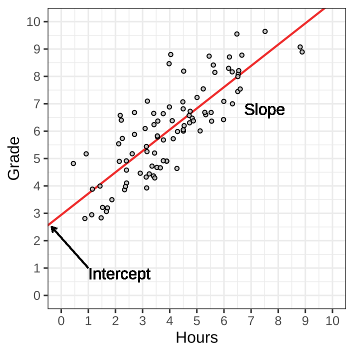

# Recap Linear Regression

## Recap

::: {.hidden}
$$
\newcommand{\hypo}{\mathcal{H}}
\newcommand{\SE}{\mathrm{SE}}
\newcommand{\dnorm}[2]{\mathcal{N}\left(#1, #2\right)}
\newcommand{\res}{e}
\newcommand{\rep}{\epsilon}
\newcommand{\TSS}{\mathrm{TSS}}
\newcommand{\SSE}{\mathrm{SSE}}
\newcommand{\RSS}{\mathrm{RSS}}
$$
:::

$$
\widehat{\mathrm{Grade}} = \mathrm{Intercept} + \mathrm{Slope}\times\text{Hours studied}
$$

. . .

Or in general,

$$
\underbrace{y}_{\substack{\text{outcome variable}\\\text{dependent variable}}}
=
\underbrace{a}_{\text{intercept}}
+
\underbrace{b}_{\text{slope}}
\times
\underbrace{x}_{\substack{\text{predictor variable}\\\text{independent variable}}}
$$

. . .

- $a$, the intercept, where the line crosses the $y$-axis.
  + $a$ is the predicted value when $x = 0$.
- $b$, the slope, how steep the line increases or decreases
  + $y$ increase by $b$ when $x$ increases by 1.

## Grades vs. Hours Studied

{fig-align="center"}

## Grades vs. Hours Studied

{fig-align="center"}

<!--
TODO: put here the grades figure that repeats each of these thing!
Add annotations to the plot about intercept and slope!
TODO; figure is incomplete braces are missing!
also the font is hideous?
 -->

## Recap

$\hat{y}_i = a + b \times x_i$

Symbol         | Interpretation
-------------- | -----------------------------------------------------
$y_i$          | Individual $i$'s score on dependent variable $y$
$\hat{y}_i$    | Prediction for individual $i$'s score on dependent variable $y$
$a$            | Coefficient, intercept of the regression line
$b$            | Coefficient, slope of the regression line
$x_i$          | Individual $i$'s score on independent variable $x$
$\res_i$       | Difference between prediction and observation for individual $i$

## Grades vs. Hours Studied

{fig-align="center"}

## Grades vs. Hours Studied

We found $a = 2.9$ and $b = 0.8$.

. . .

So the general equation: $\hat{y} = a + b \times x$

Becomes:

$$
\widehat{\mathrm{Grade}} = 2.9 + 0.8 \times \text{Hours studied}
$$

## Grades vs. Hours Studied

The first six observations:

| Grade| Hours|
|-----:|-----:|
|  8.08|  6.53|
|  4.72|  3.35|
|  8.78|  6.66|
|  8.21|  6.54|
|  6.47|  4.83|
|  5.17|  0.92|

## Grades vs. Hours Studied

The predictions are

$$
\widehat{\mathrm{Grade}} = 2.9 + 0.8 \times \text{Hours studied}
$$

| Grade| Hours| $\widehat{\mathrm{Grade}}$ |
|-----:|-----:|----:|
|  8.08|  6.53| 8.12|
|  4.72|  3.35| 5.58|
|  8.78|  6.66| 8.23|
|  8.21|  6.54| 8.14|
|  6.47|  4.83| 6.76|
|  5.17|  0.92| 3.64|

## Grades vs. Hours Studied

The errors are

$$
\res = \mathrm{Grade} - \widehat{\mathrm{Grade}} = \mathrm{Grade} - (2.9 + 0.8 \times \text{Hours studied})$$

| Grade| Hours| $\widehat{\mathrm{Grade}}$ | $\res$|
|-----:|-----:|----:|-----:|
|  8.08|  6.53| 8.12| -0.04|
|  4.72|  3.35| 5.58| -0.86|
|  8.78|  6.66| 8.23|  0.55|
|  8.21|  6.54| 8.14|  0.07|
|  6.47|  4.83| 6.76| -0.29|
|  5.17|  0.92| 3.64|  1.54|

## Grades vs. Hours Studied

The Sum of Squared Errors (SSE) is

$$
\mathrm{SSE} = \sum_{i}^N\res_i^2 = (-0.04)^2 + (-0.86)^2  + 0.55^2 + \dots = 84.53
$$

| Grade| Hours| $\widehat{\mathrm{Grade}}$ | $\res$|
|-----:|-----:|----:|-----:|
|  8.08|  6.53| 8.12| -0.04|
|  4.72|  3.35| 5.58| -0.86|
|  8.78|  6.66| 8.23|  0.55|
|  8.21|  6.54| 8.14|  0.07|
|  6.47|  4.83| 6.76| -0.29|
|  5.17|  0.92| 3.64|  1.54|

::: footer

The sum of squared residuals are computed on all 92 observations, not only those in the table

:::

## Other regression lines



## Recap

1. The OLS finds $a$ and $b$ that minimize the squared error.
2. The mean is the best predictor when there's no further relevant information.
3. If we have information about other variables that are associated with the outcome, these can improve your predictions.

# Sums of Squares

## Prediction error

- The regression line gives the "least prediction error" on average
- We find it using Ordinary Least Squares
- Literally, this uses "sums of squares"
    + e.g., $\res_1^2 + \res_2^2 +\dots + \res_N^2$

## Ordinary Least Squares

Why squares?

. . .

Why not minimize the errors directly?

. . .

Last week

- Suppose: $\res_1 = y_1 - \hat{y}_1 = -5$ and $\res_2 = y_2 - \hat{y}_2 = 5$
- Then the total error $\res_1 + \res_2 = 0$.

## Ordinary Least Squares

::: {.columns}

::: {.column width="40%"}

This is not a coincidence!

::: {.fragment fragment-index=4}

- Sum of the positive prediction errors: [36.25]{style="color: #00FF7F;"}
- Sum of the negative prediction errors: [-36.25]{style="color: #FFD700;"}
- Sum of all prediction errors: [36.25]{style="color: #00FF7F;"}+[-36.25]{style="color: #FFD700;"} = 0

The OLS by _design_ makes these equal

:::

:::

::: {.column width="60%"}

::: {.r-stack style="height: 45vh;"}

{.fragment  fragment-index=1 style="max-width: 70vw; max-height: 45vh; width: auto; height: auto; object-fit: contain;"}

{.fragment  fragment-index=2 style="max-width: 70vw; max-height: 45vh; width: auto; height: auto; object-fit: contain;"}

{.fragment fragment-index=3 style="max-width: 70vw; max-height: 45vh; width: auto; height: auto; object-fit: contain;"}

:::
<!-- rstack -->

:::
<!-- column -->

:::
<!-- columns -->

## Solution

Square the errors, so the negatives don't cancel against the positives.

This means:

- A Sum of Squared Errors (SSE) is always positive.
- A Sum of Squared Errors (SSE) of zero means predictions are perfect.
- Minimizing SSE means finding the regression line that makes the "best" predictions.

## Goodness of fit

The OLS gives us the "best" regression line for the outcome given the predictor.

- But how well does it describe the data?
- We can examine the SSE:
    + (+) lower is better
    + (-) the scale is hard to interpret
        * it changes with sample size
        * it depends on the units

. . .

We fix the scale by compare the sum of squared errors to a baseline.

## What should the baseline model be?

. . .

The null model:

$$
y_i = a + \res_i
$$

- The intercept $a$, the only parameter is the mean of $y$.
    + $a = \bar{y}$
    + $\hat{y}_i = \bar{y}$

. . .

Comparing to the null model tells us: "How much does this predictor add on top of the intercept?"

## Total Sum of Squares

What's the prediction error of the null model?

. . .

::: {.columns}

::: {.column}

$$
\begin{align}
\mathrm{TSS} &= \sum_{i=1}^N (y_i - \hat{y}_i)^2 \\
             &= \sum_{i=1}^N (y_i - \bar{y})^2 \\
             &= 255.82
\end{align}
$$

:::

::: {.column}

{fig-align="center"}

:::

:::

<!--
## Total sum of squares

$\mathrm{TSS} = \sum_{i=1}^N (y_i - \bar{y})^2 = 255.82$

. . .

We've seen TSS also in the equation for variance:

$$
s^2_y = \frac{\sum_{i=1}^{N}(y_i - \bar{y})^2}{N - 1}
$$

So TSS is the _variance_ of $y$ times $N - 1$
 -->
<!-- TODO: is this just a redundant fact for the story? -->

## Regression Sum of Squares

How much variation has the regression explained?

This is the reduction in the sum of squared errors, relative to the null model:

$$
\underbrace{\text{RSS}}_{\substack{\text{Regression Sum of Squares}}} =
\underbrace{\text{TSS}}_{\substack{\text{Total Sum of Squares}}} -
\underbrace{\text{SSE}}_{\substack{\text{Sum of Squared Errors}}}
$$

<!-- This is identical to the difference between individual predctions and the mean:

$$
\underbrace{\sum_{i=1}^N(\hat{y}_i - \bar{y})^2}_{\substack{\text{RSS}}} =
\underbrace{\sum_{i=1}^N(y_i - \bar{y})^2}_{\substack{\text{TSS}}} -
\underbrace{\sum_{i=1}^N(y_i - \hat{y}_i)^2}_{\substack{\text{SSE}}}
$$
 -->

## Three sums of squares

- TSS: Total Sum of Squares, Error of the null model
- SSE: Sum of Squared Errors, Error of the regression model
- RSS: Regression Sum of Squares, Reduction in squared prediction error

{fig-align="center"}

## Three sums of squares

Name | Formula                                 | Also
-----|-----------------------------------------|---------------
SSE  | $\sum_{i=1}^N{(y_i - \hat{y}_i)^2}$     | SST - RSS
SST  | $\sum_{i=1}^N{(y_i - \bar{y})^2}$       | RSS + SSE
RSS  | $\sum_{i=1}^N{(\hat{y}_i - \bar{y})^2}$ | SST - SSE

# Explained Variance

## How can we use the RSS?

The RSS is has the same problems as SSE:

- it changes with sample size
- it depends on the units

. . .

However,

- Suppose the predictors explains nothing on top of the mean
    + then $\SSE = \TSS$, so $\RSS = \TSS - \SSE = 0$.
- Suppose the predictor explains the data perfectly
    + then $\SSE = 0$, so $\RSS = \TSS - \SSE = \TSS$.

<!-- TODO: separate slide with the above in pictures?  -->

So RSS is bounded between 0 and TSS.

## How can we use the RSS?

We convert RSS into a proportion, called $R^2$ (R-squared):

$$
R^2 = \frac{\RSS}{\TSS}
$$

. . .

- Suppose the predictors explains nothing on top of the mean
    + then $\SSE = \TSS$, so $\RSS = \TSS - \SSE = 0$.
    + $R^2 = 0 / \TSS = 0$.
- Suppose the predictor explains the data perfectly
    + then $\SSE = 0$, so $\RSS = \TSS - \SSE = \TSS$.
    + $R^2 = \TSS / \TSS = 1$.

<!-- TODO: return of the other slide but now with values of R^2 the above the pictures?  -->

$R^2$ lies between 0 (nothing explained) and 1 (everything explained).

## Explained Variance

$R^2$ is also called _explained variance_.

. . .

Recall the variance of y: $s^2_y = 1 / (N-1) \times \sum_{i=1}^N (y_i - \bar{y})^2$.

Since $\TSS = \sum_{i=1}^N (y_i - \bar{y})^2$, we have $\TSS / (N-1) = s^2_y$.

. . .

This means:

$$
\begin{align}
R^2 &= \frac{\RSS}{\TSS} &&\\
    &= \frac{\RSS / (N - 1)}{\TSS / (N - 1)} \quad&& \text{ multiply by }\frac{1 / (N - 1)}{1 / (N - 1)}\\
    &= \frac{\RSS / (N - 1)}{s_y^2} \quad && \text{substitute definition for TSS}
\end{align}
$$

## Explained Variance

$$
R^2 = \frac{\RSS}{\TSS} = \frac{\RSS / (N - 1)}{s_y^2}
$$

So $R^2$ is the proportion of the variance in $y$ that is explained by the regression model.

- If $R^2 = 0$, the model explains no variation in $y$.
- If $R^2 = 1$, the model explains all variation in $y$.

## Explained Variance: Grades

For the Grades example, we had

- $\SSE = 255.82$
- $\SSE = 171.64$

So $R^2 = \frac{171.64}{255.82} = 0.67$

## Explained Variance: Demo



## Conclusions:

- The mean of $y$ does not influence TSS, SSE, or RSS.
- An explained variance ($R^2$) of 0 means the slope of the regression is zero $(b = 0)$.
- An explained variance ($R^2$) above 0 doesn't tell us much about the slope of the regression
    * other than that the slope is not zero.
- An explained variance ($R^2$) of 1 tells us all observations lie exactly on the regression line.

<!-- # Wooclap -->

<!-- # Break -->

# Correlation

## Correlation

A standardized measure of the strength of linear association between two continuous variables

- Standardized: ranges from $[-1,\; 1]$
- Sample correlation: $r$
- Population correlation: $\rho$
- $r = -1$: Perfect negative association
- $r =  0$: No association
- $r =  1$: Perfect positive association

## Correlation

{fig-align="center"}

## Correlation

We'll see:

- how to compute a correlation.
- how correlation relates to regression.

## Correlation: Computation

In a nutshell:

$$
\underbrace{r_{xy}}_{\substack{\text{Correlation between}\\\text{$x$ and $y$}}} =
\frac{
\overbrace{s_{xy}}^{\substack{\text{Covariance between $x$ and $y$}}}
}{
\underbrace{s_{x}}_{\substack{\text{Standard deviation}\\\text{of $x$}}}
\times
\underbrace{s_{y}}_{\substack{\text{Standard deviation}\\\text{of $y$}}}
}
$$

## Correlation: Computation Example {.small-slide}

::: {.r-stack}

::: {.fragment .fade-out fragment-index=3}
- $\mathrm{Grade} = y$. $\;\overline{\mathrm{Grade}} = \bar{y} = 6.1$
- $\mathrm{Hours} = x$. $\;\overline{\mathrm{Hours}} = \bar{x} = 4$
:::

::: {.fragment .fade-in fragment-index=3}
<ul>
  <li>For $s_x^2$, sum $(x-\bar{x})^2$ and divide by $n-1$.</li>
  <li class="fragment fade-in" data-fragment-index="5">
    For $s_{xy}$, sum $(y-\bar{y})(x-\bar{x})$ and divide by $n-1$.
  </li>
</ul>
:::

:::

<table>
 <thead>
  <tr>
   <th style="text-align:right;"> $y$ </th>
   <th style="text-align:right;"> $x$ </th>
   <th class="fragment" data-fragment-index="1" style="text-align:right;"> $(y - \bar{y})$ </th>
   <th class="fragment" data-fragment-index="1" style="text-align:right;"> $(x - \bar{x})$ </th>
   <th class="fragment" data-fragment-index="2" style="text-align:right;"> $(y - \bar{y})^2$ </th>
   <th class="fragment" data-fragment-index="2" style="text-align:right;"> $(x - \bar{x})^2$ </th>
   <th class="fragment" data-fragment-index="4" style="text-align:right;"> $(y - \bar{y})\times(x - \bar{x})$ </th>
  </tr>
 </thead>
<tbody>
  <tr>
   <td style="text-align:right;"> 8.08 </td>
   <td style="text-align:right;"> 6.53 </td>
   <td class="fragment" data-fragment-index="1" style="text-align:right;"> 1.98 </td>
   <td class="fragment" data-fragment-index="1" style="text-align:right;"> 2.53 </td>
   <td class="fragment" data-fragment-index="2" style="text-align:right;"> 3.92 </td>
   <td class="fragment" data-fragment-index="2" style="text-align:right;"> 6.40 </td>
   <td class="fragment" data-fragment-index="4" style="text-align:right;"> 5.01 </td>
  </tr>
  <tr>
   <td style="text-align:right;"> 4.72 </td>
   <td style="text-align:right;"> 3.35 </td>
   <td class="fragment" data-fragment-index="1" style="text-align:right;"> -1.38 </td>
   <td class="fragment" data-fragment-index="1" style="text-align:right;"> -0.65 </td>
   <td class="fragment" data-fragment-index="2" style="text-align:right;"> 1.90 </td>
   <td class="fragment" data-fragment-index="2" style="text-align:right;"> 0.42 </td>
   <td class="fragment" data-fragment-index="4" style="text-align:right;"> 0.90 </td>
  </tr>
  <tr>
   <td style="text-align:right;"> 8.78 </td>
   <td style="text-align:right;"> 6.66 </td>
   <td class="fragment" data-fragment-index="1" style="text-align:right;"> 2.68 </td>
   <td class="fragment" data-fragment-index="1" style="text-align:right;"> 2.66 </td>
   <td class="fragment" data-fragment-index="2" style="text-align:right;"> 7.18 </td>
   <td class="fragment" data-fragment-index="2" style="text-align:right;"> 7.08 </td>
   <td class="fragment" data-fragment-index="4" style="text-align:right;"> 7.13 </td>
  </tr>
  <tr>
   <td style="text-align:right;"> 8.21 </td>
   <td style="text-align:right;"> 6.54 </td>
   <td class="fragment" data-fragment-index="1" style="text-align:right;"> 2.11 </td>
   <td class="fragment" data-fragment-index="1" style="text-align:right;"> 2.54 </td>
   <td class="fragment" data-fragment-index="2" style="text-align:right;"> 4.45 </td>
   <td class="fragment" data-fragment-index="2" style="text-align:right;"> 6.45 </td>
   <td class="fragment" data-fragment-index="4" style="text-align:right;"> 5.36 </td>
  </tr>
  <tr>
   <td style="text-align:right;"> 6.47 </td>
   <td style="text-align:right;"> 4.83 </td>
   <td class="fragment" data-fragment-index="1" style="text-align:right;"> 0.37 </td>
   <td class="fragment" data-fragment-index="1" style="text-align:right;"> 0.83 </td>
   <td class="fragment" data-fragment-index="2" style="text-align:right;"> 0.14 </td>
   <td class="fragment" data-fragment-index="2" style="text-align:right;"> 0.69 </td>
   <td class="fragment" data-fragment-index="4" style="text-align:right;"> 0.31 </td>
  </tr>
  <tr>
   <td style="text-align:right;"> 5.17 </td>
   <td style="text-align:right;"> 0.92 </td>
   <td class="fragment" data-fragment-index="1" style="text-align:right;"> -0.93 </td>
   <td class="fragment" data-fragment-index="1" style="text-align:right;"> -3.08 </td>
   <td class="fragment" data-fragment-index="2" style="text-align:right;"> 0.86 </td>
   <td class="fragment" data-fragment-index="2" style="text-align:right;"> 9.49 </td>
   <td class="fragment" data-fragment-index="4" style="text-align:right;"> 2.86 </td>
  </tr>
</tbody>
</table>

## Correlation: Computation

$$
\underbrace{r_{xy}}_{\substack{\text{Correlation between}\\\text{$x$ and $y$}}} =
\frac{
\overbrace{s_{xy}}^{\substack{\text{Covariance between $x$ and $y$}}}
}{
\underbrace{s_{x}}_{\substack{\text{Standard deviation}\\\text{of $x$}}}
\times
\underbrace{s_{y}}_{\substack{\text{Standard deviation}\\\text{of $y$}}}
}
$$

. . .

The equation for the slope in linear regression is:

$$
\underbrace{b}_{\substack{\text{Slope}}} =
\frac{
\overbrace{s_{xy}}^{\substack{\text{Covariance between $x$ and $y$}}}
}{
\underbrace{s_{x}}_{\substack{\text{Standard deviation}\\\text{of $x$}}}
\times
\underbrace{s_{x}}_{\substack{\text{Standard deviation}\\\text{of $x$}}}
}
 =
 \frac{
\overbrace{s_{xy}}^{\substack{\text{Covariance between $x$ and $y$}}}
}{
\underbrace{s_{x}^2}_{\substack{\text{Variance of $x$}}}
}
$$

## Correlation

Correlation and regression coefficients are different ways to standardize covariance

* Correlation is standardized with respect to $x$ and $y$.
    + Correlation of $x$ with $y$ is the same as correlation of $y$ with $x$.
    + Correlation coefficient has no unit.
* Regression coefficient is standardized only with respect to $x$.
    + the units are those of $y$: a 1-step increase in $x$ leads to $b$ steps increase in $\hat{y}$.
    + it is asymmetric. The regression slope of $x$ on $y$ is different from $y$ on $x$.

<!-- TODO: double check the unit thing -->
<!--
isn't it that the unit of b is 1 the unit of x times the unit of y divided by the square of the unit of x? so then it's the unit of y over the unit of x?
-->

## Regression is assymetric

- The regression of Hours studies on Grade does not give the same results as the regression of Grade on Hours studied.
    * unlike the correlation

. . .

For $\widehat{\mathrm{Grade}} = a + b\times\text{Hours studied}$ we found $a = 2.9$, $b = 0.8$.

. . .

For $\widehat{\text{Hours studied}} = a + b\times\mathrm{Grade}$ we'd find $a = -1.2$, $b = 0.9$.

. . .

In both cases, the correlation is $r = 0.82$.

<!-- TODO: where and how do we connect this to R^2? -->

## Correlation -  from Z-scores

There is another way to compute the correlation.

::: {.incremental}
1. Z-transform $x$ and $y$: $z_x = \frac{x - \bar{x}}{s_x}$, the same for $y$
2. multiply the values: $z_{xy} =  z_x \times z_y$
3. Sum all $z_{xy}$ and divide by $N - 1$.
:::

<!--
TODO: the above should be done more slowly. Also highlight the fact that
the mean and sd of the z-scores are 0, 1
 -->

. . .

So we can either:

- Compute the covariance between $x$ and $y$, standardize by $s_x$ and $s_y$
- Standardize $x$ and $y$, then compute the covariance of the $z$-scores.

. . .

For regression we can do the same!

# Standardized Regression

## Standardized Regression Coefficients

Correlation Standardized by dropping the units between both variables,

Standardized Regression Coefficients does the same

<!-- TODO: Why do you want to do this? -->

. . .

::: {.incremental}
1. Z-transform $x$ and $y$: $z_x = \frac{x - \bar{x}}{s_x}$, the same for $y$
2. Regress $\hat{z}_{y} =  a + b \times z_x$
:::

. . .

$$
\hat{Z}_\mathrm{Grade} = a + b\times Z_{\text{Hours studied}}
$$

. . .

We obtain $a = 0$ and $b = 0.82$

. . .

This equals the correlation!

## Standardized Regression Coefficients

- In bivariate linear regression, the standardized regression slope equals the correlation coefficient.
    + This is no longer true when there are more than two predictors.
- The intercept is always 0.

## Demo:

Fixed:

N = 50

knobs:

intercept
slope
Standardized intercept
Standardized slope

outputs:

right of the knobs:
computed Correlation and R^2

below the knobs: two-panel scatterplot with regression line. Left the unstandardized one, right the standardized one.

# Data Example

## Data Example

This is getting a bit much!

