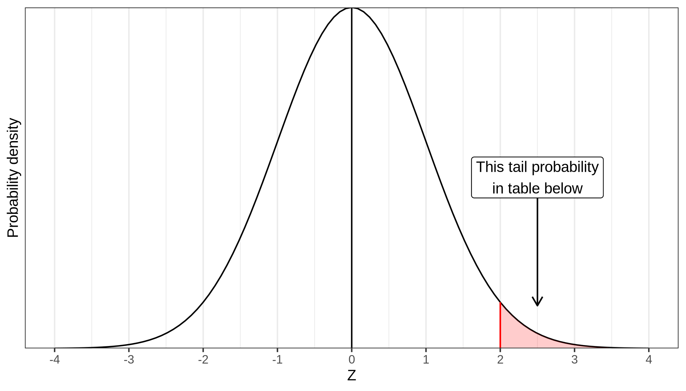

## Equations

~~~{=latex}
\setlength{\columnsep}{10mm}
\begin{multicols}{2}
\raggedcolumns
\setlength{\abovedisplayskip}{4pt}
\setlength{\belowdisplayskip}{5pt}
\setlength{\abovedisplayshortskip}{2pt}
\setlength{\belowdisplayshortskip}{4pt}
~~~

Variance
$$
s_x^2 = \frac{\sum_{i=1}^n (x_i-\bar x)^2}{n-1}
$$

Standardized values (Z-values)
$$
Z = \frac{X-\mu}{\sigma}
$$

Z-statistic in one sample Z-test
$$
Z = \frac{\bar x-\mu_0}{\sigma_{\bar x}}
$$

Standard error of the mean
$$
\sigma_{\bar x} = \frac{\sigma}{\sqrt n}
$$

$t$-statistic in a one sample $t$-test
$$
t = \frac{\bar x-\mu_0}{\mathrm{SE}_{\bar x}}
$$

Standard error of the mean (sample SD)
$$
\mathrm{SE}_{\bar x} = \frac{s_x}{\sqrt n}
$$

One-sample $t$ degrees of freedom
$$
df = n-1
$$

Pearson correlation
$$
r = \frac{s_{xy}}{s_x\times s_y}
$$

Simple regression slope
$$
b = r\times\frac{s_y}{s_x}
$$

Simple regression intercept
$$
a = \bar y-b\times\bar x
$$

Explained variance
$$
R^2 = \frac{\mathrm{RSS}}{\mathrm{TSS}} = 1-\frac{\mathrm{SSE}}{\mathrm{TSS}}
$$

~~~{=latex}
\columnbreak
~~~

Pooled variance
$$
s_{\mathrm{pooled}}^2 = \frac{(n_1-1)\times s_1^2+(n_2-1)\times s_2^2}{n_1+n_2-2}
$$

Pooled standard deviation
$$
s_{\mathrm{pooled}} = \sqrt{s_{\mathrm{pooled}}^2}
$$

Student's standard error
$$
\mathrm{SE}_{\bar y_1-\bar y_2} = \sqrt{s_{\mathrm{pooled}}^2\times\left(\frac{1}{n_1}+\frac{1}{n_2}\right)}
$$

Student's degrees of freedom
$$
df = n_1+n_2-2
$$

Welch's standard error
$$
\mathrm{SE}_{\bar y_1-\bar y_2} = \sqrt{\frac{s_1^2}{n_1}+\frac{s_2^2}{n_2}}
$$

Independent-samples $t$-test
$$
t = \frac{(\bar y_1-\bar y_2)-(\mu_1-\mu_2)_{H_0}}{\mathrm{SE}_{\bar y_1-\bar y_2}}
$$

Cohen's $d$
$$
d = \frac{\bar y_1-\bar y_2}{s_{\mathrm{pooled}}}
$$

Between-group mean square
$$
\mathrm{MSR} = \frac{\mathrm{RSS}}{k-1}
$$

Within-group mean square
$$
\mathrm{MSE} = \frac{\mathrm{SSE}}{N-k}
$$

One-way ANOVA $F$-test
$$
F(k-1,N-k) = \frac{\mathrm{MSR}}{\mathrm{MSE}}
$$

Overall regression $F$ from $R^2$
$$
F(p-1,N-p) = \frac{N-p}{p-1} \times \frac{R^2}{1-R^2}
$$

Eta squared (one-way ANOVA)
$$
\eta^2 = \frac{\mathrm{RSS}}{\mathrm{TSS}}
$$

~~~{=latex}
\end{multicols}
~~~

Here $N$ is the total sample size, $k$ is the number of groups, and $p$ counts the fitted coefficients, including the intercept.

~~~{=latex}
\newpage
\begingroup
\small
\renewcommand{\arraystretch}{0.95}
~~~

<!-- These tables use the same right-tail settings as the Exam 1 sheet. -->

## Z-table

Add the row and column values to obtain $z$. The cell gives the right-tail probability.

{fig-alt="Standard normal curve with the area to the right of z = 2 shaded as the table probability." fig-align="center" width="90%"}

::: {.formula-lookup}

| $z$ | 0.00 | 0.01 | 0.02 | 0.03 | 0.04 | 0.05 | 0.06 | 0.07 | 0.08 | 0.09 |
| ---: | ---: | ---: | ---: | ---: | ---: | ---: | ---: | ---: | ---: | ---: |
| 0.0 | 0.500 | 0.496 | 0.492 | 0.488 | 0.484 | 0.480 | 0.476 | 0.472 | 0.468 | 0.464 |
| 0.1 | 0.460 | 0.456 | 0.452 | 0.448 | 0.444 | 0.440 | 0.436 | 0.433 | 0.429 | 0.425 |
| 0.2 | 0.421 | 0.417 | 0.413 | 0.409 | 0.405 | 0.401 | 0.397 | 0.394 | 0.390 | 0.386 |
| 0.3 | 0.382 | 0.378 | 0.374 | 0.371 | 0.367 | 0.363 | 0.359 | 0.356 | 0.352 | 0.348 |
| 0.4 | 0.345 | 0.341 | 0.337 | 0.334 | 0.330 | 0.326 | 0.323 | 0.319 | 0.316 | 0.312 |
| 0.5 | 0.309 | 0.305 | 0.302 | 0.298 | 0.295 | 0.291 | 0.288 | 0.284 | 0.281 | 0.278 |
| 0.6 | 0.274 | 0.271 | 0.268 | 0.264 | 0.261 | 0.258 | 0.255 | 0.251 | 0.248 | 0.245 |
| 0.7 | 0.242 | 0.239 | 0.236 | 0.233 | 0.230 | 0.227 | 0.224 | 0.221 | 0.218 | 0.215 |
| 0.8 | 0.212 | 0.209 | 0.206 | 0.203 | 0.200 | 0.198 | 0.195 | 0.192 | 0.189 | 0.187 |
| 0.9 | 0.184 | 0.181 | 0.179 | 0.176 | 0.174 | 0.171 | 0.169 | 0.166 | 0.164 | 0.161 |
| 1.0 | 0.159 | 0.156 | 0.154 | 0.152 | 0.149 | 0.147 | 0.145 | 0.142 | 0.140 | 0.138 |
| 1.1 | 0.136 | 0.133 | 0.131 | 0.129 | 0.127 | 0.125 | 0.123 | 0.121 | 0.119 | 0.117 |
| 1.2 | 0.115 | 0.113 | 0.111 | 0.109 | 0.107 | 0.106 | 0.104 | 0.102 | 0.100 | 0.099 |
| 1.3 | 0.097 | 0.095 | 0.093 | 0.092 | 0.090 | 0.089 | 0.087 | 0.085 | 0.084 | 0.082 |
| 1.4 | 0.081 | 0.079 | 0.078 | 0.076 | 0.075 | 0.074 | 0.072 | 0.071 | 0.069 | 0.068 |
| 1.5 | 0.067 | 0.066 | 0.064 | 0.063 | 0.062 | 0.061 | 0.059 | 0.058 | 0.057 | 0.056 |
| 1.6 | 0.055 | 0.054 | 0.053 | 0.052 | 0.051 | 0.049 | 0.048 | 0.047 | 0.046 | 0.046 |
| 1.7 | 0.045 | 0.044 | 0.043 | 0.042 | 0.041 | 0.040 | 0.039 | 0.038 | 0.038 | 0.037 |
| 1.8 | 0.036 | 0.035 | 0.034 | 0.034 | 0.033 | 0.032 | 0.031 | 0.031 | 0.030 | 0.029 |
| 1.9 | 0.029 | 0.028 | 0.027 | 0.027 | 0.026 | 0.026 | 0.025 | 0.024 | 0.024 | 0.023 |
| 2.0 | 0.023 | 0.022 | 0.022 | 0.021 | 0.021 | 0.020 | 0.020 | 0.019 | 0.019 | 0.018 |
| 2.1 | 0.018 | 0.017 | 0.017 | 0.017 | 0.016 | 0.016 | 0.015 | 0.015 | 0.015 | 0.014 |
| 2.2 | 0.014 | 0.014 | 0.013 | 0.013 | 0.013 | 0.012 | 0.012 | 0.012 | 0.011 | 0.011 |
| 2.3 | 0.011 | 0.010 | 0.010 | 0.010 | 0.010 | 0.009 | 0.009 | 0.009 | 0.009 | 0.008 |
| 2.4 | 0.008 | 0.008 | 0.008 | 0.008 | 0.007 | 0.007 | 0.007 | 0.007 | 0.007 | 0.006 |
| 2.5 | 0.006 | 0.006 | 0.006 | 0.006 | 0.006 | 0.005 | 0.005 | 0.005 | 0.005 | 0.005 |
| 2.6 | 0.005 | 0.005 | 0.004 | 0.004 | 0.004 | 0.004 | 0.004 | 0.004 | 0.004 | 0.004 |
| 2.7 | 0.003 | 0.003 | 0.003 | 0.003 | 0.003 | 0.003 | 0.003 | 0.003 | 0.003 | 0.003 |
| 2.8 | 0.003 | 0.002 | 0.002 | 0.002 | 0.002 | 0.002 | 0.002 | 0.002 | 0.002 | 0.002 |
| 2.9 | 0.002 | 0.002 | 0.002 | 0.002 | 0.002 | 0.002 | 0.002 | 0.001 | 0.001 | 0.001 |
| 3.0 | 0.001 | 0.001 | 0.001 | 0.001 | 0.001 | 0.001 | 0.001 | 0.001 | 0.001 | 0.001 |

:::

~~~{=latex}
\newpage
~~~

## $t$-table

The cell gives the critical $t$ for the row's degrees of freedom and the column's right-tail probability.

::: {.formula-lookup}

| $df$ | .4 | .25 | .1 | .05 | .025 | .01 | .005 | .001 |
| ---: | ---: | ---: | ---: | ---: | ---: | ---: | ---: | ---: |
| 1 | 0.325 | 1.000 | 3.078 | 6.314 | 12.706 | 31.821 | 63.657 | 318.309 |
| 2 | 0.289 | 0.816 | 1.886 | 2.920 | 4.303 | 6.965 | 9.925 | 22.327 |
| 3 | 0.277 | 0.765 | 1.638 | 2.353 | 3.182 | 4.541 | 5.841 | 10.215 |
| 4 | 0.271 | 0.741 | 1.533 | 2.132 | 2.776 | 3.747 | 4.604 | 7.173 |
| 5 | 0.267 | 0.727 | 1.476 | 2.015 | 2.571 | 3.365 | 4.032 | 5.893 |
| 6 | 0.265 | 0.718 | 1.440 | 1.943 | 2.447 | 3.143 | 3.707 | 5.208 |
| 7 | 0.263 | 0.711 | 1.415 | 1.895 | 2.365 | 2.998 | 3.499 | 4.785 |
| 8 | 0.262 | 0.706 | 1.397 | 1.860 | 2.306 | 2.896 | 3.355 | 4.501 |
| 9 | 0.261 | 0.703 | 1.383 | 1.833 | 2.262 | 2.821 | 3.250 | 4.297 |
| 10 | 0.260 | 0.700 | 1.372 | 1.812 | 2.228 | 2.764 | 3.169 | 4.144 |
| 11 | 0.260 | 0.697 | 1.363 | 1.796 | 2.201 | 2.718 | 3.106 | 4.025 |
| 12 | 0.259 | 0.695 | 1.356 | 1.782 | 2.179 | 2.681 | 3.055 | 3.930 |
| 13 | 0.259 | 0.694 | 1.350 | 1.771 | 2.160 | 2.650 | 3.012 | 3.852 |
| 14 | 0.258 | 0.692 | 1.345 | 1.761 | 2.145 | 2.624 | 2.977 | 3.787 |
| 15 | 0.258 | 0.691 | 1.341 | 1.753 | 2.131 | 2.602 | 2.947 | 3.733 |
| 16 | 0.258 | 0.690 | 1.337 | 1.746 | 2.120 | 2.583 | 2.921 | 3.686 |
| 17 | 0.257 | 0.689 | 1.333 | 1.740 | 2.110 | 2.567 | 2.898 | 3.646 |
| 18 | 0.257 | 0.688 | 1.330 | 1.734 | 2.101 | 2.552 | 2.878 | 3.610 |
| 19 | 0.257 | 0.688 | 1.328 | 1.729 | 2.093 | 2.539 | 2.861 | 3.579 |
| 20 | 0.257 | 0.687 | 1.325 | 1.725 | 2.086 | 2.528 | 2.845 | 3.552 |
| 21 | 0.257 | 0.686 | 1.323 | 1.721 | 2.080 | 2.518 | 2.831 | 3.527 |
| 22 | 0.256 | 0.686 | 1.321 | 1.717 | 2.074 | 2.508 | 2.819 | 3.505 |
| 23 | 0.256 | 0.685 | 1.319 | 1.714 | 2.069 | 2.500 | 2.807 | 3.485 |
| 24 | 0.256 | 0.685 | 1.318 | 1.711 | 2.064 | 2.492 | 2.797 | 3.467 |
| 25 | 0.256 | 0.684 | 1.316 | 1.708 | 2.060 | 2.485 | 2.787 | 3.450 |
| 26 | 0.256 | 0.684 | 1.315 | 1.706 | 2.056 | 2.479 | 2.779 | 3.435 |
| 27 | 0.256 | 0.684 | 1.314 | 1.703 | 2.052 | 2.473 | 2.771 | 3.421 |
| 28 | 0.256 | 0.683 | 1.313 | 1.701 | 2.048 | 2.467 | 2.763 | 3.408 |
| 29 | 0.256 | 0.683 | 1.311 | 1.699 | 2.045 | 2.462 | 2.756 | 3.396 |
| 30 | 0.256 | 0.683 | 1.310 | 1.697 | 2.042 | 2.457 | 2.750 | 3.385 |

:::

~~~{=latex}
\endgroup
~~~
